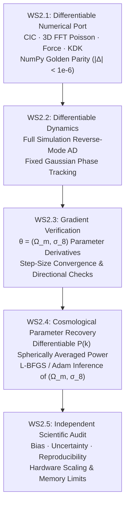

# ASTRAEUS Phase 6 Workstream 2 Research Protocol
## Differentiable Cosmological Simulation, Adjoint Gradient Verification & Parameter Recovery

**Document Identifier:** `ASTRAEUS-PHASE6-WS2-PROTO-001`  
**Classification:** Pre-Registered Scientific Research Protocol & Milestone Specification  
**Version:** 1.0.0 (Authoritative)  
**Lead Investigator & Mission Director:** Dev Mehta  
**Target Milestone:** `PHASE6_WS2_SCIENTIFIC_PROTOCOL_AND_JAX_PARITY`  
**Baseline Checkpoint:** Commit [`37d8148`](https://github.com/TEKURU-ZENO/ASTRAEUS/commit/37d8148) on branch `master`  
**Date:** November 23, 2026  

---

## 1. Scientific Objective & Scope Boundary

The primary objective of **Phase 6 Workstream 2 (WS2)** is to build a differentiable computational cosmology engine capable of inferring fundamental cosmological parameters from simulated matter-density fields, with automatic differentiation (AD) gradients rigorously and independently validated against finite differences.

### Flagship Research Question 16 (RQ16):
> *Can differentiable cosmological simulations support reliable, unbiased parameter inference without introducing numerical gradient artifacts or false local minima?*

### Epistemic Boundary & Authority Invariant:
- **Internal Reference Authority:** In strict adherence to senior review recommendations, third-party frameworks (such as `pmwd`) serve as external comparison baselines and integration candidates, **never** as the internal scientific authority.
- **Reference Implementation:** The NumPy/SciPy Workstream 1 solver (`engines/cosmology/mesh.py`, `integrator.py`) remains the authoritative golden reference implementation for all forward dynamics, physical invariants, and baseline benchmarking.
- **Epistemic Firewalls:** Gate 3 test set (586 objects) and Phase 5 empirical broker obligations remain quarantined and documented in [`docs/phase6/PHASE5_CONTINUATION_LEDGER.md`](file:///c:/Users/Dev%20Mehta/Desktop/ASTRAEUS/docs/phase6/PHASE5_CONTINUATION_LEDGER.md).

---

## 2. Decoupled Sub-Workstream Architecture

Workstream 2 is formally partitioned into five sequential, verifiable sub-workstreams:

1. **WS2.1 — Differentiable Numerical Port:** Implement tensorized differentiable operations for CIC deposition, discrete Green's function Poisson solver, force interpolation, and KDK leapfrog integration.
2. **WS2.2 — Differentiable Dynamics:** Implement automatic differentiation through the complete cosmological time evolution trajectory.
3. **WS2.3 — Gradient Verification:** Validate reverse-mode AD gradients for $\theta = (\Omega_m, \sigma_8)$ against two-sided finite differences across multiple perturbation sizes and directional projections.
4. **WS2.4 — Cosmological Parameter Recovery:** Generate controlled initial conditions and recover $(\Omega_m, \sigma_8)$ from simulated 3D matter density power spectra $P(k)$.
5. **WS2.5 — Independent Scientific Audit:** Quantify gradient accuracy, convergence orders, parameter bias, uncertainty bounds, and execution reproducibility.

---

## 3. Seven Mandated Protocol Specifications

### 3.1 Specification 1: Numerical Parity Architecture & Tolerances
- **Golden Reference:** The NumPy WS1 implementation serves as the ground-truth standard.
- **Differentiable Implementation:** Differentiable operations are tensorized to support automatic reverse-mode gradient propagation (using JAX / PyTorch tensor backends).
- **Parity Criteria:** For identical initial conditions $\mathbf{x}_0, \mathbf{p}_0, a_0, \Delta a$:
  - Position discrepancy:
    $$\frac{\|\mathbf{x}_{\mathrm{diff}} - \mathbf{x}_{\mathrm{NumPy}}\|_\infty}{L} < 1.0 \times 10^{-6} \quad (\text{float32}), \quad < 1.0 \times 10^{-12} \quad (\text{float64})$$
  - Peculiar momentum discrepancy:
    $$\frac{\|\mathbf{p}_{\mathrm{diff}} - \mathbf{p}_{\mathrm{NumPy}}\|_\infty}{\|\mathbf{p}_{\mathrm{NumPy}}\|_\infty} < 1.0 \times 10^{-5} \quad (\text{float32}), \quad < 1.0 \times 10^{-11} \quad (\text{float64})$$
  - Density contrast grid discrepancy:
    $$\|\delta_{\mathrm{diff}} - \delta_{\mathrm{NumPy}}\|_\infty < 1.0 \times 10^{-5} \quad (\text{float32})$$

---

### 3.2 Specification 2: Differentiability Analysis of Numerical Operators

Each operator within the particle-mesh loop is analyzed for differentiability and subgradient properties:

1. **Cloud-in-Cell (CIC) Mass Deposition:**
   - The trilinear interpolation kernel is:
     $$W(\mathbf{x}_p - \mathbf{x}_{\mathbf{i}}) = \prod_{\alpha=1}^3 \max\left(0, 1 - \frac{|x_{p,\alpha} - x_{\mathbf{i},\alpha}|}{\Delta x}\right)$$
   - **Smoothness:** $W$ is continuous everywhere ($C^0$) and piecewise linear. Its first spatial derivative $\nabla W$ is discontinuous across grid knots ($x_{p,\alpha} \in \mathbb{Z} \Delta x$). It is therefore globally $C^0$, not $C^1$.
   - **Subgradient Convention:** At grid knots, reverse-mode automatic differentiation utilizes Clarke generalized subgradients. The framework convention evaluates one-sided directional derivatives from both sides ($\partial^+ / \partial^-$) across boundary planes. Differentiability is not presumed across knots; explicit directional boundary tests verify finite, non-divergent subgradients without numerical NaNs or runaway values.
   - **Boundary Tests:** Explicit test cases verify that particle trajectories crossing grid boundaries do not produce infinite or NaN gradients.
2. **Discrete Green's Function 3D FFT Poisson Solver:**
   - In Fourier space, the Poisson solution is:
     $$\hat{\phi}(\mathbf{k}) = \hat{\delta}(\mathbf{k}) \cdot G(\mathbf{k}) \cdot \left(\frac{3}{2}\Omega_m H_0^2 a^{-1}\right)$$
   - **Smoothness:** The FFT is a unitary linear transformation ($C^\infty$). The multiplier $G(\mathbf{k})$ is smooth and fixed. Differentiation with respect to $\delta$ is strictly linear; differentiation with respect to $\Omega_m$ is analytic.
3. **2nd-Order Central Difference Force:**
   - Grid acceleration $\mathbf{g} = -\nabla_{\mathrm{grid}} \phi$ uses linear shift stencils $(\phi_{i+1} - \phi_{i-1})/(2\Delta x)$, which is $C^\infty$.
4. **Matched Force Interpolation:**
   - Linear combination of grid accelerations weighted by $W(\mathbf{x}_p - \mathbf{x}_{\mathbf{i}})$, possessing identical piecewise $C^0$ properties as deposition.
5. **Kick-Drift-Kick (KDK) Time Integrator:**
   - A finite composition of $N_{\mathrm{steps}}$ algebraic operations. By the chain rule of differential calculus, the composition of piecewise differentiable mappings is piecewise differentiable.

---

### 3.3 Specification 3: Initial-Condition Parameterization ($\Omega_m, \sigma_8$)

> [!IMPORTANT]
> **Anti-Contamination Rule:** $\sigma_8$ and $\Omega_m$ must not be treated as arbitrary heuristic force multipliers. They enter through physical transfer functions, cosmological linear growth, and displacement fields.

#### Physical Initial Condition Pipeline:
1. **Linear Matter Power Spectrum & Top-Hat Window Normalization:**
   $\sigma_8$ characterizes the root-mean-square amplitude of linear matter fluctuations at $z=0$ smoothed by a spherical top-hat filter of radius $R_8 = 8\,h^{-1}\mathrm{Mpc}$:
   $$\sigma_8^2 = \frac{1}{2\pi^2} \int_0^\infty k^2 P_{\mathrm{lin}}(k) W_{\mathrm{TH}}^2(k R_8)\,dk$$
   where the Fourier transform of the spherical top-hat window is:
   $$W_{\mathrm{TH}}(x) = \frac{3 (\sin x - x \cos x)}{x^3}$$
   The initial power spectrum $P(k; \Omega_m, \sigma_8)$ must be explicitly calibrated by dividing by this integral evaluated on the unnormalized shape function $P_{\mathrm{shape}}(k; \Omega_m)$ before scaling by $\sigma_8^2$:
   $$P_{\mathrm{lin}}(k; \Omega_m, \sigma_8) = \sigma_8^2 \cdot \frac{P_{\mathrm{shape}}(k; \Omega_m)}{\sigma_8^2[P_{\mathrm{shape}}]}$$
2. **Cosmological Nuisance & Background Parameter Freeze:**
   The shape parameter $\Gamma \approx \Omega_m h$ is an analytical approximation. To avoid unconstrained degrees of freedom during initial gradient verification, all background and nuisance parameters are formally frozen to Planck 2018 baseline values:
   - Baryon density: $\Omega_b = 0.0490$
   - Hubble parameter: $h = 0.6766$ ($H_0 = 67.66\,\mathrm{km/s/Mpc}$)
   - Dark energy density: $\Omega_\Lambda = 1.0 - \Omega_m - \Omega_r$ (flatness enforced)
   - Radiation density: $\Omega_r = 8.6 \times 10^{-5}$
   - Equation of state: $w_0 = -1.0, w_a = 0.0$
   - Primordial tilt: $n_s = 0.9665$
   - Neutrino mass: $m_\nu = 0.0\,\mathrm{eV}$ (massless approximation)
   This baseline guarantees that $\Omega_m$ acts specifically on expansion history, linear growth, and transfer function horizon scale.
3. **Fixed Gaussian Random Phases ($\xi_{\mathbf{k}}^{\mathrm{frozen}}$):**
   To eliminate stochastic Monte Carlo variance from contaminating gradient calculations, the Gaussian random field phases $\xi_{\mathbf{k}} \sim \mathcal{CN}(0, 1)$ are **permanently frozen**:
   $$\delta_{\mathbf{k}}(a_{\mathrm{init}}; \theta) = D_1(a_{\mathrm{init}}; \Omega_m) \cdot \sqrt{P_{\mathrm{lin}}(k; \Omega_m, \sigma_8)} \cdot \xi_{\mathbf{k}}^{\mathrm{frozen}}$$
4. **Zel'dovich Displacement Field (1LPT):**
   $$\mathbf{\Psi}(\mathbf{q}; \theta) = -i \sum_{\mathbf{k}} \frac{\mathbf{k}}{k^2} \delta_{\mathbf{k}}(a_{\mathrm{init}}; \theta) e^{i \mathbf{k} \cdot \mathbf{q}}$$
   $$\mathbf{x}_{\mathrm{init}}(\mathbf{q}; \theta) = \mathbf{q} + \mathbf{\Psi}(\mathbf{q}; \theta)$$
   $$\mathbf{p}_{\mathrm{init}}(\mathbf{q}; \theta) = m a_{\mathrm{init}}^2 H(a_{\mathrm{init}}; \Omega_m) f(a_{\mathrm{init}}; \Omega_m) \mathbf{\Psi}(\mathbf{q}; \theta)$$
5. **Physical Parameter Entry Points:**
   - $\sigma_8$ enters linearly into amplitude: $\mathbf{\Psi} \propto \sigma_8$.
   - $\Omega_m$ enters non-linearly into:
     - Transfer function horizon scale $\Gamma = \Omega_m h$.
     - Linear growth factor $D_1(a_{\mathrm{init}}; \Omega_m)$.
     - Linear growth rate $f(a_{\mathrm{init}}; \Omega_m) \approx \Omega_m(a_{\mathrm{init}})^{0.55}$.
     - Background expansion $H(a; \Omega_m) = H_0 \sqrt{\Omega_m a^{-3} + \Omega_\Lambda}$.
     - Comoving Poisson source factor $\frac{3}{2}\Omega_m H_0^2 a^{-1}$.

---

### 3.4 Specification 4: Finite-Difference Gradient Methodology

Gradients evaluated via reverse-mode automatic differentiation ($\nabla_\theta^{\mathrm{AD}} \mathcal{L}$) are validated against two-sided central finite differences ($\nabla_\theta^{\mathrm{FD}} \mathcal{L}$):

$$\nabla_{\theta_i}^{\mathrm{FD}} \mathcal{L} = \frac{\mathcal{L}(\theta + \epsilon \mathbf{e}_i; \xi^{\mathrm{frozen}}) - \mathcal{L}(\theta - \epsilon \mathbf{e}_i; \xi^{\mathrm{frozen}})}{2\epsilon}$$

#### Verification Protocol:
1. **Step-Size Convergence Study:**
   Evaluate finite differences across 5 orders of magnitude:
   $$\epsilon \in \{10^{-6}, 10^{-5}, 10^{-4}, 10^{-3}, 10^{-2}\}$$
   Verify that error exhibits $\mathcal{O}(\epsilon^2)$ convergence until floating-point cancellation dominates.
2. **Directional Derivative Projections:**
   Evaluate along arbitrary unit vectors $\mathbf{v} = (\cos\phi, \sin\phi) \in \mathbb{R}^2$:
   $$\mathcal{D}_{\mathbf{v}}^{\mathrm{FD}} \mathcal{L} = \frac{\mathcal{L}(\theta + \epsilon \mathbf{v}) - \mathcal{L}(\theta - \epsilon \mathbf{v})}{2\epsilon}$$
   Compare against the inner product:
   $$\mathcal{D}_{\mathbf{v}}^{\mathrm{AD}} \mathcal{L} = \mathbf{v} \cdot \nabla_\theta^{\mathrm{AD}} \mathcal{L}$$

---

### 3.5 Specification 5: Quantitative Gradient Acceptance Criteria

A gradient implementation is certified as scientifically accurate if and only if it satisfies all of the following pre-registered criteria:

| Metric | Mathematical Definition | Acceptance Threshold | Failure Consequence |
| :--- | :--- | :--- | :--- |
| **Relative Gradient Error** | $\frac{|\nabla_{\theta_i}^{\mathrm{AD}} - \nabla_{\theta_i}^{\mathrm{FD}}|}{\max(|\nabla_{\theta_i}^{\mathrm{AD}}|, |\nabla_{\theta_i}^{\mathrm{FD}}|, 10^{-8})}$ | $\le 1.0 \times 10^{-3}$ ($0.1\%$) | Immediate rejection of gradient engine |
| **Cosine Similarity** | $\frac{\nabla_\theta^{\mathrm{AD}} \cdot \nabla_\theta^{\mathrm{FD}}}{\|\nabla_\theta^{\mathrm{AD}}\| \|\nabla_\theta^{\mathrm{FD}}\|}$ | $\ge 0.9999$ | Unacceptable gradient direction bias |
| **Directional Error** | $|\mathcal{D}_{\mathbf{v}}^{\mathrm{AD}} - \mathcal{D}_{\mathbf{v}}^{\mathrm{FD}}| / |\mathcal{D}_{\mathbf{v}}^{\mathrm{FD}}|$ | $\le 2.0 \times 10^{-3}$ ($0.2\%$) | Directional anisotropy violation |
| **Numerical Stability** | $\sum \mathbb{I}(\text{NaN} \lor \text{Inf})$ | $0$ across all tested points | Reject; non-differentiable singularity |

---

### 3.6 Specification 6: Hardware & Empirical Memory Profiling Constraints

In adherence to the [Hardware & Compute Feasibility Charter](file:///c:/Users/Dev%20Mehta/Desktop/ASTRAEUS/docs/phase6/PHASE6_HARDWARE_AND_COMPUTE_FEASIBILITY.md), all Workstream 2 benchmarks are executed within explicit hardware allocations:

- **Workstation:** NVIDIA RTX 5050 Laptop GPU (8 GB VRAM, 23.8 GB host RAM).
- **Empirical Memory Profiling Requirement:**
  While simplified analytical tape scaling estimates $\mathcal{O}(N_{\mathrm{steps}} \times (N_p + N_{\mathrm{grid}}^3))$ provide a baseline lower bound, reverse-mode automatic differentiation retains substantially more memory due to:
  - Framework intermediate operation buffers and temporary tensors.
  - 3D FFT execution scratch workspaces.
  - Scatter/gather indices and gradient accumulation buffers.
  Therefore, all memory claims must be certified via **empirical peak allocated memory profiling** using runtime GPU trackers (`torch.cuda.max_memory_allocated()` or `jax.profiler`).
- **Local Ceiling Rule:** Local prototyping is strictly capped at $N_{\mathrm{grid}} \le 128^3$. Grids producing peak memory exceeding 6.5 GB (80% of local VRAM) are automatically flagged for gradient rematerialization or escalated to Tier 2 Cloud GPU nodes.

---

### 3.7 Specification 7: Cosmological Parameter-Recovery & Identifiability Design

To validate end-to-end parameter inference while addressing potential parameter degeneracies:

1. **Parameter Identifiability & Fisher Information Gate:**
   $\Omega_m$ and $\sigma_8$ exhibit known cosmological degeneracies along $S_8 = \sigma_8 \sqrt{\Omega_m / 0.3}$ over limited spatial scales. Prior to declaring successful parameter inference, the local Fisher information matrix:
   $$F_{ij} = \sum_{b=1}^{N_b} \frac{\partial P(k_b)}{\partial \theta_i} \mathbf{C}_{bb'}^{-1} \frac{\partial P(k_{b'})}{\partial \theta_j}$$
   must be numerically evaluated. Independent parameter recovery is conditional on demonstrating that $\operatorname{det}(F) > 0$ and the condition number $\kappa(F) < 10^3$, establishing that both parameters are locally identifiable on the simulated $k$-range.
2. **Realistic Covariance Structure:**
   The likelihood covariance $\mathbf{C}$ must account for:
   - Finite simulation box volume $V = L^3$.
   - Spherically averaged mode binning $\sigma_b^2 \propto 2 P^2(k_b) / N_{\mathrm{modes}}(k_b)$.
   - Off-diagonal covariance induced by non-linear mode coupling and grid assignment window effects.
3. **Synthetic Observation Generation:**
   Generate a reference 3D matter density field using ground-truth fiducial cosmological parameters:
   $$\theta^* = (\Omega_m^*, \sigma_8^*) = (0.3111, 0.8102)$$
   Compute the spherically averaged 3D matter power spectrum $P_{\mathrm{obs}}(k_b)$ across $N_b = 16$ radial Fourier bins $k_b \in [k_{\mathrm{min}}, k_{\mathrm{Nyquist}}]$.
4. **Loss Function:**
   Standardized Gaussian log-likelihood / chi-squared:
   $$\mathcal{L}(\theta) = \frac{1}{2} \sum_{b=1}^{N_b} \frac{\left(P(k_b; \theta) - P_{\mathrm{obs}}(k_b)\right)^2}{\sigma_b^2}$$
5. **Optimization Engine:**
   Gradient-based minimization via Adam ($\alpha = 0.01$) or L-BFGS, initialized from perturbed values:
   $$\theta^{(0)} = (\Omega_m^{(0)}, \sigma_8^{(0)}) = (0.2500, 0.7000)$$
6. **Recovery Acceptance Threshold (Conditional):**
   Parameter recovery is certified successful if and only if:
   $$\frac{|\hat{\Omega}_m - \Omega_m^*|}{\Omega_m^*} \le 1.0\%, \quad \frac{|\hat{\sigma}_8 - \sigma_8^*|}{\sigma_8^*} \le 1.0\%$$
   conditioned on passing the Fisher identifiability gate.

---

## 4. Verification & Audit Acceptance Gates

| Gate ID | Name | Objective | Acceptance Metric |
| :--- | :--- | :--- | :--- |
| **Gate 6.2A** | JAX/Differentiable Parity | Verify forward simulation parity against NumPy reference | Relative max error $< 10^{-6}$ |
| **Gate 6.2B** | Gradient Accuracy | Validate $\nabla_\theta^{\mathrm{AD}}$ against finite differences | Relative error $\le 0.1\%$, Cosine $\ge 0.9999$ |
| **Gate 6.2C** | Directional Consistency | Validate along 8 independent unit directions $\mathbf{v}$ | Max directional error $\le 0.2\%$ |
| **Gate 6.2D** | Boundary Stability | Test particles crossing grid cell boundaries | Zero NaNs, smooth directional subgradients |
| **Gate 6.2E** | Parameter Recovery | Recover ground truth $(\Omega_m^*, \sigma_8^*)$ | Bias $< 1.0\%$ on both parameters |

---

**Protocol Approved & Signed by:**  
**Dev Mehta**  
Lead Investigator & Mission Director, Project ASTRAEUS  
November 23, 2026
