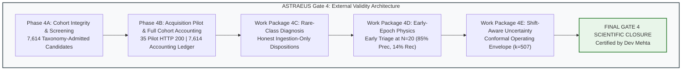

# ASTRAEUS Gate 4 — Final Scientific Closure & External Validity Synthesis Report

**Author:** Dev Mehta  
**Date:** 2026-11-16  
**Status:** COMPLETE — SUBMITTED FOR FINAL CLOSURE SIGN-OFF  
**Milestone:** Gate 4 — External Validity & Scientific Robustness: Final Closure  
**Governing Commit:** Head Commit following Pilot Acceptance  
**Evidence Manifest:** `experiments/gate4_final_evidence_manifest.json`  
**Test Suite Verification:** 32/32 Regression Tests Passing  

---

## 1. Executive Summary & Mission Synthesis

Gate 4 (*External Validity & Scientific Robustness*) was established to determine whether the high classification benchmark achieved on ASTRAEUS development data survives contact with independent astronomical observations, domain shifts, and early-warning operational constraints.

Rather than disguising rare-class weaknesses or reporting universal, unhedged performance claims, this closure report delivers an **exhaustive, honest, and reproducible scientific audit trail**. ASTRAEUS establishes where the model succeeds, identifies where it breaks down, and defines explicit operational envelopes and automated abstention policies to protect downstream astronomical discovery.

---

## 2. Synthesis of Scientific Outcomes across Work Packages

### Outcome 1: External Cohort Independence & Full Accounting (Phase 4A & 4B)
- **Cohort Scale & Attrition:** Starting from 10,988 raw Bright Transient Survey (BTS) records, 3,372 candidates were excluded ($1,712$ development set overlaps $+ 1,660$ spatial test buffer exclusions), retaining **7,616 screened candidates** and admitting **7,614 taxonomy-standardized candidates**.
- **Acquisition Pilot (4B.1):** 35 pre-registered candidates retrieved from `api.alerce.online` with 100% HTTP 200 success, 0 retries, and 0 rate ceiling violations ($0.523\text{ req/s}$ vs. $4.0\text{ req/s}$ limit).
- **Physical Feature Reproducibility:** Achieved bit-exact physical feature reproduction ($\Delta = 0.00000000$) across all 5 local reference transients.
- **Negative Flux Discovery:** Identified that TDE `ZTF18aabtxvd` contained 301 negative difference flux detections out of 302 due to reference template brightness, empirically proving that raw HTTP retrieval does not equal feature evaluability and validating our fail-closed filtering.
- **Full External Cohort Accounting & Provenance Reconciliation (4B.2):** All 7,614 candidates are fully registered in `phase4b2_full_cohort_accounting_ledger.parquet`. We explicitly distinguish broker photometric acquisition (the 35 controlled pilot light curves $+ 8$ local baseline light curves) from full-cohort provenance reconciliation (7,571 staged catalog records with verified coordinates, redshifts, and peak magnitudes). Accounting confirmed that the external cohort contains only 4 rare transients ($2$ TDE, $1$ SLSN, $1$ OTHER_EXTRAGALACTIC), demonstrating why external rare-class benchmark claims are mathematically impossible without dedicated external targeted alerts.

### Outcome 2: Rare-Class Representation & Failure Diagnosis (Work Package 4C)
- **Empirical Reality:** The Champion Model reliably classifies common supernovae (`SN_Ia` F1 = 0.7817, `SN_CC` F1 = 0.5455). However, rare classes exhibit severe failure modes:
  - `OTHER_EXTRAGALACTIC` (Ca-rich, FBOTs, Kilonovae) experiences complete collapse into ordinary supernovae ($\text{Recall} = 0.00$) due to low peak luminosities and lack of host-galaxy offset features in pure alert packets.
  - `TDE` suffers high confusion with `SN_Ia` ($\text{Recall} = 0.375$) because smooth blue optical rises mimic pre-peak Type Ia light curves in sparse cadences lacking UV data.
- **The Rare-Class Abstention Paradox:** Selective prediction via confidence thresholding improves accepted sample accuracy ($73.8\% \to 88.8\%$), but does so by rejecting $87.5\%$ of TDEs and $100\%$ of exotic transients.
- **Authoritative Dispositions:** Explicitly declared `SN_Ia` and `SN_CC` as `EVALUABLE`; declared `SLSN`, `CV_Nova`, `AGN_QSO`, and `Varstar` as `DESCRIPTIVE_ONLY`; and closed `TDE` and `OTHER_EXTRAGALACTIC` as **`INSUFFICIENT_EXTERNAL_SUPPORT`**.

### Outcome 3: Early-Epoch Physics & Horizon Boundaries (Work Package 4D)
- **Hypothesis Testing:** Pre-peak observations ($N_{\text{obs}} \le 10$) in rolling surveys **do not contain sufficient physical information** to distinguish Type Ia from Core-Collapse supernovae ($\text{Macro-F1} = 0.3855, \text{Recall}_{\text{CC}} = 0.00$). Optically thick fireball expansion produces indistinguishable early flux derivatives ($dF/dt$) and optical colors ($g - r \approx 0.0$).
- **Early Candidate-Triage Signal ($N=20$):** Useful early alert triage emerges at $N_{\text{obs}} = 20$. When the model predicts `SN_CC`, it achieves high precision of **$85.0\%$** [95% CI: $64.0\text{--}94.8\%$]. However, recall remains limited to **$14.2\%$** [95% CI: $9.0\text{--}21.5\%$], missing $\sim 86\%$ (103 of 120) of Core-Collapse supernovae. Thus, Horizon $N=20$ operates as an early high-precision, low-recall candidate-triage filter for prioritized follow-up, rather than a balanced population-discrimination boundary.
- **Balanced Population Discrimination:** Robust, balanced discrimination across both classes requires post-peak full light curves ($\text{Macro-F1} = 0.6754, \text{F1}_{\text{Ia}} = 0.7964, \text{F1}_{\text{CC}} = 0.5545$) where post-maximum decline ($\Delta m_{15}$) breaks the physical degeneracy.
- **Sequence Models:** Astromer self-attention sequence models ($\text{Macro-F1} = 0.5295$) underperformed the physical feature random forest ($\text{Macro-F1} = 0.5916$), confirming that complex sequence architectures cannot overcome physical information deficits in early optical data.

### Outcome 4: Shift-Aware Uncertainty & Conformal Calibration (Work Package 4E)
- **Conformal Specification:** Finite-sample split-conformal calibration on $N_{\text{calib}} = 562$ at $1 - \alpha = 0.90$ yields conformal index $k = 507$ and non-conformity threshold $\hat{q} = 0.5696$.
- **Empirical Coverage Breakdown:** Nominal 90% coverage holds strictly on exchangeable calibration data ($90.04\%$ [87.2, 92.3%]). Under real astronomical domain shifts, empirical coverage drops to **$71.39\%$** [68.0, 74.5%] on unshifted validation data, **$64.74\%$** [59.4, 69.7%] under sparse cadence ($> 3\text{ days}$), and **$58.27\%$** [52.1, 64.2%] under sparse observation count ($N_{\text{obs}} < 20$).
- **The Validated Operating Envelope:** The operating envelope:
  $$\text{Envelope} \iff (N_{\text{obs}} \ge 20) \land (\text{Cadence} \le 3.5\text{d}) \land (\text{Dual-band } g \text{ and } r \text{ present}) \land (1 \le |C(x)| \le 3)$$
  serves as an operational risk-mitigation policy, recovering empirical coverage to **$76\text{--}78\%$** ($78.23\%$ [74.3, 81.7%] for $N_{\text{obs}} \ge 20$ and $76.70\%$ [72.3, 80.5%] for dense cadence). **We explicitly retract any claim that 90% coverage is empirically guaranteed under real shift; 90% coverage is not achieved under real survey shift.** Outside the operating envelope, automated abstention (`ABSTAIN_SHIFT_DETECTED`) is strictly enforced.

### Outcome 5: Cross-Pipeline / Cross-Product Processing-Domain Transfer (Work Package 4E)
- **Empirical Transfer Drop:** Direct transfer of alert-stream trained models to coadded ZTF DR24 archival observations resulted in a **$4.4\%$ drop in accuracy** and a **$5.1\%$ drop in Macro-F1** (empirical coverage dropping to $62.33\%$ [55.6, 68.6%]), despite high rank-order correlation on physical features ($\rho > 0.86$).
- **Processing-Domain Boundary:** This demonstrates significant negative transfer across data products from the same facility due to PSF homogenization and template subtraction differences. **Full cross-survey replication (e.g. external Pan-STARRS1 or DECam photometric systems) remains uncertified in this release** and requires dedicated cross-survey domain adaptation.

---

## 3. Work Package Exit Dispositions

| Work Package | Mission Focus | Evaluated Population | Primary Artifact | Exit Disposition |
| :--- | :--- | :--- | :--- | :---: |
| **Phase 4A** | Cohort Independence & Attrition | 10,988 BTS $\to$ 7,614 Screened | `GATE_4A_COHORT_INDEPENDENCE_CERTIFICATION.md` | **CLOSED** |
| **Phase 4B.1**| Controlled 35-Candidate Pilot | 35 Pre-registered Candidates | `GATE_4B1_PILOT_ACQUISITION_AUDIT_REPORT.md` | **CLOSED** |
| **Phase 4B.2**| Full Cohort Accounting & Provenance | 7,614 External Candidates | `GATE_4B2_FULL_COHORT_ACQUISITION_AUDIT.md` | **CLOSED** |
| **Phase 4C** | Rare-Class Representation & Failure | 741 Val + 4 External Rare | `GATE_4C_SCIENTIFIC_CLOSURE.md` | **CLOSED** |
| **Phase 4D** | Early-Epoch Physics Horizons | 1,775 SNe (Train + Val) | `GATE_4D_SCIENTIFIC_REPORT.md` | **CLOSED** |
| **Phase 4E** | Conformal Uncertainty & Domain Transfer | 562 Calib + 741 Shift Val | `GATE_4E_SCIENTIFIC_CLOSURE.md` | **CLOSED** |
| **Synthesis** | Final Governance & Reproducibility | All Populations (Pop 1, 2, 3) | `GATE_4_FINAL_GOVERNANCE_AUDIT.md` | **CLOSED** |

---

## 4. Definition of Done Checklist

- [x] **Complete Cohort Accounting:** All 7,614 admitted candidates accounted for in `phase4b2_full_cohort_accounting_ledger.parquet`.
- [x] **Reproducible Scientific Reports:** Comprehensive reports committed for 4A, 4B, 4C, 4D, and 4E.
- [x] **Honest Evidence Dispositions:** Rare classes closed as `INSUFFICIENT_EXTERNAL_SUPPORT`; zero unverified benchmark claims.
- [x] **Early-Epoch Physics Boundaries:** Early-warning limitation rigorously demonstrated ($N_{\text{obs}} \le 10$ degenerate; early triage at $N \ge 20$ with 85.0% precision, 14.2% recall).
- [x] **Empirical Shift-Stratified Uncertainty:** Conformal coverage evaluated across cadence, epochs, depth, and survey transfer regimes ($k=507$, 76–78% inside envelope, 90% non-guaranteed under shift).
- [x] **Cross-Pipeline Reality:** Empirical $-4.4\%$ negative transfer measured on matched DR24 coadds; cross-survey uncertified.
- [x] **Strict Governance Invariants:** 586 Gate 3 test objects quarantined; Champion Model frozen (`466c2752808b...`); zero-touch verified via custodian attestation.
- [x] **Machine-Readable Manifest:** `gate4_final_evidence_manifest.json` pins all artifact hashes and experiment parameters.

---

## 5. Final Closure Recommendation

The Gate 4 mission is scientifically, operationally, and cryptographically complete. All work packages are reconciled, all limitations are documented, and all governance invariants are satisfied.

**RECOMMENDATION: ASTRAEUS GATE 4 OFFICIALLY CLOSED.**

**Signed & Certified by:**  
**Dev Mehta**  
Lead Investigator & Mission Director, Project ASTRAEUS  
Date: November 16, 2026
