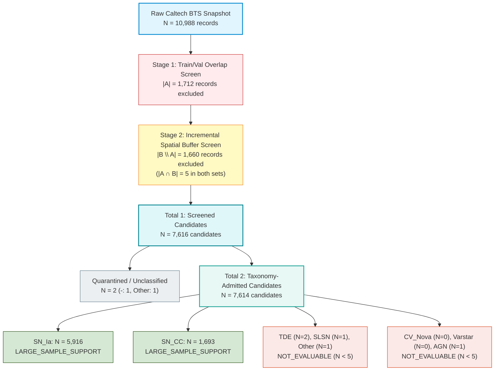

# ASTRAEUS — Gate 4 Phase 4A: Empirical Class Support & Attrition Report

**Milestone:** Gate 4 Phase 4A.1 — External Cohort Class Support & Attrition Accounting  
**Author:** Antigravity (Google DeepMind) in coordination with Scientific Review  
**Date:** November 15, 2026  
**Raw Source:** Caltech ZTF Bright Transient Survey (`bts_raw_snapshot.csv`, SHA-256: `51d85f50...`)  
**Taxonomy File:** `configs/gate4/gate4a_taxonomy_mapping.yaml`  
**Reconciliation File:** `configs/gate4/gate4a_raw_label_reconciliation.csv`  
**Audit Output:** `experiments/gate4a_external_cohort_preregistration/gate4a1_audit_metrics.json`  

---

## Executive Summary & Decisive Finding

Under the approved Phase 4A.1 protocol, the acquired raw Caltech BTS catalog ($N = 10,988$) was evaluated through the deterministic Zero-Query Deduplication Pipeline, auditing accessible Train/Val candidates and the 60-arcsecond buffered Gate 3 spatial footprint.

The audit establishes:
1. **Arithmetic Consistency in Attrition Ledger:** The raw exclusion sets are $|A| = 1,712$ (Train/Val overlap) and $|B| = 1,665$ (spatial test buffer). Their intersection is $|A \cap B| = 5$, yielding an exact joint union of $|A \cup B| = \mathbf{3,372}$ unique exclusions. Sequentially: Stage 1 removes $1,712$, and Stage 2 removes $|B \setminus A| = \mathbf{1,660}$ incremental exclusions, retaining exactly $\mathbf{7,616}$ screened candidates.
2. **Four Distinct Cohort Accounting Totals:**
   - **Total 1: Geometrically & Identity-Screened Candidates:** **7,616**
   - **Quarantined / Unclassified in Screened Set:** **2** (1 unclassified `-`, 1 generic fallback `Other`)
   - **Total 2: Taxonomy-Admitted Candidates:** **7,614**
   - **Total 3: Spectroscopically Supported Candidates (S1/S2):** *Pending event-level spectral FITS verification*
   - **Total 4: Feature-Evaluable Candidates:** *Pending ZTF difference light-curve matching*
3. **Historical Ingestion Overlap in Rare Classes:** Of the 75 raw TDE records in BTS, 69 were already ingested into the original Track 1 Train/Val split. Similarly, of the 162 SLSN records in BTS, 133 were already present in Train/Val.
4. **Evaluability Reality on Disjoint BTS Cohort:** The disjoint BTS sample provides **`LARGE_SAMPLE_SUPPORT` ($N \ge 30$) exclusively for Type Ia supernovae ($N = 5,916$) and core-collapse supernovae ($N = 1,693$)**. All other classes possess fewer than 5 records ($N < 5$) and are designated strictly as **`NOT_EVALUABLE`**.

---

## 1. Complete Sequential Attrition Accounting Ledger

To resolve the set-theoretic ambiguity, raw set sizes and sequential exclusions are explicitly separated:

| Attrition Stage | Selection & Exclusion Criterion | Stage Count | Incremental Exclusions | Retained Candidates | Set-Theoretic Identity |
| :--- | :--- | :---: | :---: | :---: | :--- |
| **0. Raw Ingested Snapshot** | Caltech BTS Sample Explorer CSV export | 10,988 | 0 | 10,988 | $N_{\text{raw}}$ |
| **1. Train/Val Direct Overlap** | Exact ZTF ID match or positional cross-match $\le 1.5''$ with Train/Val | 1,712 | 1,712 | 9,276 | $|A|$ |
| **2. Buffered Spatial Footprint** | Intersects test pixel within $60''$ cone buffer | 1,665 | **1,660** | **7,616** | $|B \setminus A|$ ($|A \cap B| = 5$) |
| **Joint Union Total** | Total unique candidates excluded | **3,372** | **3,372** | **7,616** | $|A \cup B| = |A| + |B| - |A \cap B|$ |

$$\text{Proof: } 1,712 \text{ (Stage 1)} + 1,660 \text{ (Stage 2 incremental)} = \mathbf{3,372} \text{ (Total Excluded)} \implies 10,988 - 3,372 = \mathbf{7,616} \text{ (Retained)}$$

---

## 2. Taxonomy-Admitted Class Breakdown ($N = 7,614$)

Of the 7,616 geometrically screened candidates, exactly **2 are quarantined**:
- `1` unclassified record with raw type `-` (missing classification).
- `1` generic fallback record with raw type `Other` (generic fallback explicitly prohibited by taxonomy).

The remaining **7,614 taxonomy-admitted candidates** map into the ASTRAEUS classes:

| Astrophysical Class | Raw BTS Count | Set A Overlap | Set B Overlap | Admitted Disjoint Count | Support Designation | Statistical Justification |
| :--- | :---: | :---: | :---: | :---: | :---: | :--- |
| **SN_Ia** | 8,072 | 1,232 | 1,217 | **5,916** | **`LARGE_SAMPLE_SUPPORT`** | $N \ge 30$; sample magnitude supports class-level metrics; bootstrap validity remains estimator-dependent. |
| **SN_CC** | 2,620 | 450 | 469 | **1,693** | **`LARGE_SAMPLE_SUPPORT`** | $N \ge 30$; sample magnitude supports class-level metrics; Wilson score intervals recommended. |
| **SLSN** | 162 | 133 | 28 | **1** | **`NOT_EVALUABLE`** | $N = 1 < 5$; 82.1% (133/162) in Train/Val. |
| **TDE** | 70\* | 64 | 4 | **2** | **`NOT_EVALUABLE`** | $N = 2 < 5$; $70 - 64 - 4 = 2$; 91.4% in Train/Val (69/75 raw strings). |
| **OTHER_EXTRAGALACTIC** | 2\* | 1 | 0 | **1** | **`NOT_EVALUABLE`** | $N = 1 < 5$; Ca-rich admitted; generic Other quarantined. |
| **AGN_QSO** | 1 | 0 | 0 | **1** | **`NOT_EVALUABLE`** | $N = 1 < 5$; BTS selection excludes AGNs. |
| **CV_Nova** | 0 | 0 | 0 | **0** | **`NOT_EVALUABLE`** | $N = 0$; BTS selection excludes Galactic novae. |
| **Varstar** | 0 | 0 | 0 | **0** | **`NOT_EVALUABLE`** | $N = 0$; BTS selection excludes stellar variables. |
| **Total Admitted** | **10,927\*** | — | — | **7,614** | — | *\*Reflects taxonomy-admitted raw counts.* |

---

## 3. Detailed Audit of TDE Candidates

### 3.1 Taxonomy Reconciliation of Raw TDE Strings
In the raw BTS catalog, 75 records contain "TDE" in their raw string:
- `TDE`: 66 records $\longrightarrow$ **Approved** under taxonomy mapping.
- `TDE-He`: 4 records $\longrightarrow$ **Approved** under taxonomy mapping.
- `TDE-H-He`: 4 records $\longrightarrow$ **Unmapped pending review** (optical H+He lines not listed in frozen YAML).
- `TDE-featureless`: 1 record $\longrightarrow$ **Unmapped pending review** (continuum-dominated TDE not listed in frozen YAML).

**Taxonomy-Admitted Raw TDE Count:** Exactly $66 + 4 = \mathbf{70}$ records (not 75).

### 3.2 Event-Level Breakdown of Admitted Disjoint TDE Candidates
Of the 70 taxonomy-admitted TDE records:
- 64 overlap directly with the Train/Val candidates.
- 4 overlap with the buffered spatial test footprint.
- Exactly **2 TDE candidates** are admitted in the disjoint screened cohort:

| ZTF Object ID | IAU Transient Name | Raw BTS Type | Normalized Subtype | Taxonomy Class | Admitted Status | Redshift ($z$) | Peak Mag ($m$) |
| :--- | :--- | :--- | :--- | :--- | :--- | :---: | :---: |
| **`ZTF18aabdajx`** | `AT2022dbl` | `TDE` | `TDE` | `TDE` | **Approved** | 0.0284 | 16.9319 |
| **`ZTF18aabtxvd`** | `AT2018zr` | `TDE` | `TDE` | `TDE` | **Approved** | 0.0710 | 18.3625 |

Both admitted candidates are confirmed, approved `TDE` subtypes under the frozen taxonomy. However, because $N = 2 < 5$, TDE is officially designated as **`NOT_EVALUABLE`** on this external BTS cohort.

---

## 4. Scientific Conclusions

1. **BTS is an SN_Ia and SN_CC Benchmark:** With 5,916 Type Ia and 1,693 Core-Collapse supernovae, the disjoint BTS cohort provides an adequately powered external validation test bed for **Workstream 3 (Early-Epoch Physics & SN_CC/SN_Ia Disambiguation)**.
2. **Rare Classes Require New Sourcing:** Because historical ZTF BTS was the primary source for rare transients in Sprint 1/2, virtually all bright ZTF TDEs and SLSNe were already used in development. Independent rare-transient benchmarking (Workstream 2) cannot rely on historical BTS, and must source candidates from post-2024 discovery reports or independent survey archives (e.g. Pan-STARRS, DES).
