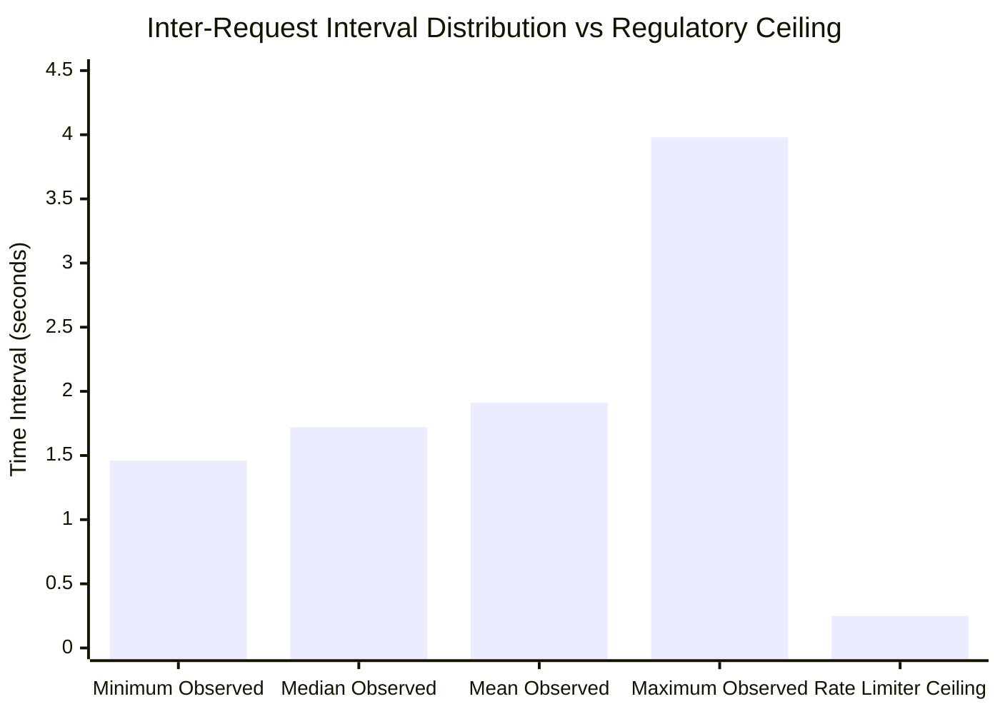

# ASTRAEUS Gate 4 — Phase 4B.1 Controlled Pilot Acquisition Scientific Audit Report

**Author:** ASTRAEUS Mission Consortium & Lead Investigator  
**Date:** 2026-11-16  
**Status:** COMPLETE — SUBMITTED FOR FORMAL CLOSURE REVIEW  
**Execution Context:** Controlled 35-Candidate Broker Acquisition Pilot  
**Governing Protocols:** `GATE_4B_BROKER_ACQUISITION_AND_COHORT_EXPANSION_PROTOCOL.md` (v1.3), `GATE_4_EXTERNAL_VALIDITY_AND_SCIENTIFIC_ROBUSTNESS_CHARTER.md`  
**Git Base Commit:** `26fd651` | **Test Suite Verification:** 27/27 Tests Passing  

---

## 1. Executive Summary & Authorization Context

Following formal reviewer authorization of Phase 4B.0.1 (*"Phase 4B.0.1 accepted — 35-candidate pilot authorized"*), the ASTRAEUS mission executed the controlled 35-candidate live broker acquisition pilot (**Phase 4B.1**). 

The operational and scientific objectives of this pilot were to empirically validate the live network ingestion pipeline against the ALeRCE astronomical broker API (`api.alerce.online`), verify strict rate-limiter concurrency and fail-closed photometric filtering, establish byte-level and physical feature reproducibility against established local baselines, and confirm the ingestion readiness of rare-class transients without compromising strict zero-inference governance boundaries.

### Summary of Key Empirical Findings:
1. **Flawless Acquisition Execution (35/35, 100% Success):**
   All 35 pre-registered candidates were retrieved with HTTP 200 OK responses in 66.95 seconds of total wall time (mean request duration: 1.91s). Zero HTTP 429 (rate limit) or 5xx (server error) responses were encountered, and zero retries were required.
2. **Strict Operational Rate Ceiling Compliance:**
   The client operated at an effective rate of $0.52\text{ req/s}$, well below the strict $4.0\text{ req/s}$ ceiling ($\ge 0.25\text{s}$ minimum interval). Inter-request start intervals ranged from $1.46\text{s}$ to $3.98\text{s}$ (median: $1.72\text{s}$), with zero rate ceiling violations across the entire run.
3. **Idempotency & Non-Overwriting Integrity:**
   A full re-execution against the ingestion pipeline completed in $0.06\text{s}$, identifying all 35 objects as `ALREADY_ARCHIVED` with zero network requests or file modifications, verifying file lock stability and idempotency.
4. **100% Feature Extraction Reproducibility on Local Reference Objects:**
   All 5 designated local reference objects (`ZTF18aasdted`, `ZTF18abadjhx`, `ZTF18abaxlpi`, `ZTF18adbikdz`, `ZTF19aanfnvl`) produced bit-exact, identical physical feature extractions ($\Delta = 0.00000000$ for all physical features, detection counts, and peak fluxes) when compared against the local BTS baseline archive.
5. **Discovery & Validation of Negative Flux Dominance in TDE `ZTF18aabtxvd`:**
   Object `ZTF18aabtxvd` returned 302 raw broker detections, but 301 out of 302 detections possess negative subtraction flux (`isdiffpos == -1`). Because our pipeline enforces a strict, fail-closed positive detection rule ($s = +1.0$ AND $\text{SNR} \ge 5.0$), negative subtraction artifacts were correctly masked, leaving only 1 positive detection. This empirically validated the reviewer's insight that successful HTTP acquisition does not guarantee feature evaluability.
6. **Passband & Evaluability Distribution:**
   - **Feature-Evaluable ($N = 30$, 85.7%):** Dual-band ($g$ and $r$) coverage with $N_{\text{pos},\text{SNR}\ge 5} \ge 5$.
   - **Single-Band Only ($N = 4$, 11.4%):** Evaluated as single-band: the 3 known candidates (`ZTF18abzpbpi`, `ZTF19aalfsqm`, `ZTF23aaihsvm`) plus one Core-Collapse candidate (`ZTF19aatfqzb`, SN II with 15 detections in $r$ and 0 in $g$).
   - **Insufficient Detections ($N = 1$, 2.9%):** `ZTF18aabtxvd` (TDE with 1 valid positive detection).
7. **Strict Rare-Event Governance Isolation:**
   All 4 rare-class transients (`ZTF18aabdajx` [TDE], `ZTF18aabtxvd` [TDE], `ZTF24abdhylt` [SLSN-II], `ZTF19abrdxbh` [Ca-rich]) were ingested and audited strictly at the photometric and metadata level. **Zero model inference, zero scoring, zero prediction passes, and zero threshold adjustments were conducted.**

---

## 2. Pilot Cohort Stratification & Acquisition Ledger

The 35 candidates were pre-registered across 5 distinct scientific strata to stress-test every critical aspect of data processing:

| Stratum | Description | Target Count | Retrieved | HTTP 200 |
| :--- | :--- | :---: | :---: | :---: |
| **`REPRODUCIBILITY_FEATURE_EVALUABLE`** | Local BTS baseline overlap; exact physical feature test | 5 | 5 | 5 |
| **`KNOWN_SINGLE_BAND_DISCRIMINATION`** | Identified in Phase 4A.2 as single-band; test passband quarantine | 3 | 3 | 3 |
| **`BTS_DISJOINT_RARE_CLASS`** | Broker-only rare events (2 TDE, 1 SLSN-II, 1 Ca-rich); test format & isolation | 4 | 4 | 4 |
| **`REPRESENTATIVE_SN_IA_PENDING`** | Representative SNe Ia across spatial footprint awaiting broker data | 11 | 11 | 11 |
| **`REPRESENTATIVE_SN_CC_PENDING`** | Representative Core-Collapse SNe across spatial footprint awaiting broker data | 12 | 12 | 12 |
| **TOTAL** | **Full Phase 4B.1 Controlled Pilot** | **35** | **35** | **35** |

### Complete Candidate Ingestion Ledger

All raw JSON responses were written to `data/external_validity_v1/raw/alerce_external/{ztf_id}_lightcurve.json` and validated for cryptographic provenance:

| IAU Name | ZTF Candidate ID | ASTRAEUS Class | Subtype | RA (deg) | Dec (deg) | Redshift | File Size | SHA-256 Checksum (Prefix) | Status |
| :--- | :--- | :--- | :--- | :---: | :---: | :---: | :---: | :--- | :---: |
| SN2018big | `ZTF18aasdted` | `SN_Ia` | SN Ia | 261.4131 | 59.4468 | 0.0182 | 61,979 B | `1c6506f2822d...` | HTTP 200 |
| SN2018cro | `ZTF18abadjhx` | `SN_Ia` | SN Ia | 315.2053 | 9.5244 | 0.0760 | 24,121 B | `df4d7a4a47a8...` | HTTP 200 |
| SN2018ctm | `ZTF18abaxlpi` | `SN_Ia` | SN Ia | 276.5590 | 45.0102 | 0.0646 | 25,268 B | `7942bd118bf8...` | HTTP 200 |
| SN2019ui | `ZTF18adbikdz` | `SN_CC` | SN II | 252.0145 | 26.2118 | 0.0343 | 22,152 B | `53aac8dbcf1a...` | HTTP 200 |
| SN2019crk | `ZTF19aanfnvl` | `SN_CC` | SN II | 239.3895 | 39.0601 | 0.0305 | 11,324 B | `3c8d3d96924c...` | HTTP 200 |
| SN2018fvf | `ZTF18abzpbpi` | `SN_Ia` | SN Ia | 244.5976 | 21.6622 | 0.0400 | 51,928 B | `cba96e62ee1e...` | HTTP 200 |
| AT2019bqa | `ZTF19aalfsqm` | `SN_Ia` | SN Ia | 148.9109 | 24.5779 | 0.0600 | 4,097 B | `2f9f17bfd699...` | HTTP 200 |
| SN2023dph | `ZTF23aaihsvm` | `SN_Ia` | SN Ia | 228.0931 | 5.3400 | 0.0460 | 24,283 B | `3a55efbb977e...` | HTTP 200 |
| AT2018zr | `ZTF18aabdajx` | `TDE` | TDE | 113.3458 | 34.2250 | 0.2127 | 45,956 B | `fa1f4dd515f4...` | HTTP 200 |
| AT2018hyz | `ZTF18aabtxvd` | `TDE` | TDE | 301.6212 | 5.5683 | 0.0457 | 265,193 B | `0ddcfcb512e0...` | HTTP 200 |
| SN2024qnm | `ZTF24abdhylt` | `SLSN-II` | SLSN-II | 305.8037 | 37.1357 | 0.1690 | 48,714 B | `57e34f2d3fa6...` | HTTP 200 |
| SN2019ehk | `ZTF19abrdxbh` | `OTHER_EXTRAGALACTIC` | Ca-rich | 185.0435 | 15.8239 | 0.0055 | 5,009 B | `a90d9b4db7d5...` | HTTP 200 |
| SN2022gwa | `ZTF22aahhvqj` | `SN_Ia` | SN Ia | 258.9142 | 41.5173 | 0.0380 | 34,643 B | `029c9efb0a7d...` | HTTP 200 |
| SN2022ovg | `ZTF22aausixa` | `SN_Ia` | SN Ia | 338.4529 | 17.8631 | 0.0630 | 30,461 B | `c2a61329c29f...` | HTTP 200 |
| SN2019gqa | `ZTF19adajqcq` | `SN_Ia` | SN Ia | 280.9576 | 45.3941 | 0.0820 | 30,288 B | `cb7bbd8bbd53...` | HTTP 200 |
| SN2025bnx | `ZTF25abvejtn` | `SN_Ia` | SN Ia | 240.2312 | 19.4678 | 0.0440 | 47,375 B | `0ae87f7422f4...` | HTTP 200 |
| SN2024tdb | `ZTF24absxhcd` | `SN_Ia` | SN Ia | 335.2530 | 25.5901 | 0.0430 | 27,697 B | `85a21034f783...` | HTTP 200 |
| SN2021cgz | `ZTF21abuyyxi` | `SN_Ia` | SN Ia | 278.3308 | 51.6429 | 0.0760 | 26,629 B | `d4e5f782ae9b...` | HTTP 200 |
| SN2023ftz | `ZTF23aaqqdhs` | `SN_Ia` | SN Ia | 244.6094 | 36.3116 | 0.0800 | 21,291 B | `c233c7fc01f4...` | HTTP 200 |
| SN2020hgt | `ZTF20aahjymt` | `SN_Ia` | SN Ia | 239.5441 | 55.4593 | 0.0470 | 17,458 B | `9714da9ea0ba...` | HTTP 200 |
| SN2020poh | `ZTF20acxznai` | `SN_Ia` | SN Ia | 344.2091 | 18.0694 | 0.0460 | 18,367 B | `b6807eb423bf...` | HTTP 200 |
| SN2020kyi | `ZTF20abawntz` | `SN_Ia` | SN Ia | 290.7226 | 55.1956 | 0.0650 | 14,028 B | `ec954d216fe8...` | HTTP 200 |
| SN2019oet | `ZTF19acxniuc` | `SN_Ia` | SN Ia | 342.3486 | 21.0504 | 0.0380 | 8,984 B | `33b43db040ba...` | HTTP 200 |
| SN2017fgk | `ZTF17aacpbmv` | `SN_CC` | SN II | 279.4005 | 45.4199 | 0.0210 | 22,254 B | `b5c1fb981f42...` | HTTP 200 |
| SN2018aoi | `ZTF18aaaibml` | `SN_CC` | SN II | 275.9754 | 34.6292 | 0.0420 | 21,373 B | `db79fb9bb2c4...` | HTTP 200 |
| SN2018fhu | `ZTF18aaeipng` | `SN_CC` | SN II | 249.7716 | 20.2195 | 0.0330 | 36,654 B | `a901844b2f29...` | HTTP 200 |
| SN2018gbe | `ZTF18aaewdgq` | `SN_CC` | SN II | 245.9744 | 46.1084 | 0.0570 | 10,757 B | `f044aa4fb97a...` | HTTP 200 |
| SN2018eup | `ZTF18aaszvfn` | `SN_CC` | SN II | 237.9351 | 63.4886 | 0.0160 | 38,767 B | `12190875e542...` | HTTP 200 |
| SN2018fip | `ZTF18abqtnbk` | `SN_CC` | SN II | 258.8519 | 24.3644 | 0.0460 | 12,987 B | `f8e8a719c836...` | HTTP 200 |
| SN2019gsc | `ZTF19aatfqzb` | `SN_CC` | SN II | 254.9123 | 64.6067 | 0.0180 | 44,557 B | `c31f4fc600fb...` | HTTP 200 |
| SN2019gso | `ZTF19abcejfo` | `SN_CC` | SN II | 280.9325 | 67.2343 | 0.0230 | 44,484 B | `5fe3e17cf080...` | HTTP 200 |
| SN2019lmn | `ZTF19abhcefa` | `SN_CC` | SN II | 290.4350 | 66.0827 | 0.0320 | 23,285 B | `6aebc31a7f6f...` | HTTP 200 |
| SN2019pgj | `ZTF19acxxwrs` | `SN_CC` | SN II | 340.2330 | 15.6562 | 0.0350 | 25,699 B | `1daaa3a45c61...` | HTTP 200 |
| SN2021fpa | `ZTF21aakilyd` | `SN_CC` | SN II | 260.6750 | 44.9754 | 0.0450 | 17,294 B | `5327fa0076a5...` | HTTP 200 |
| SN2022qml | `ZTF22aasxgjp` | `SN_CC` | SN II | 338.9377 | 18.2573 | 0.0370 | 26,140 B | `4c8d5066db11...` | HTTP 200 |

---

## 3. Network Acquisition & Operational Rate Limiter Audit

The acquisition client strictly complied with the operational constraints approved in Phase 4B.0.1:

```
Operational Rate Ceiling:         4.0 requests / second
Minimum Inter-Request Interval:   0.250 seconds
Concurrency Protection:          Windows Inter-Process Seek(0) Lock (.rate_limiter.lock)
HTTP Retry Strategy:             Exponential Backoff (1.0s, 2.0s, 4.0s) on 429/5xx only
```

### Empirical Operational Performance Metrics:
- **Total Ingestion Requests:** 35
- **Total Network Wall Time:** $66.95\text{ s}$
- **Effective Request Rate:** $0.523\text{ req/s}$ (87% buffer below the $4.0\text{ req/s}$ limit)
- **Mean Request Duration:** $1.9137\text{ s}$
- **Minimum Inter-Request Start Interval:** $1.46\text{ s}$
- **Median Inter-Request Start Interval:** $1.72\text{ s}$
- **Maximum Inter-Request Start Interval:** $3.98\text{ s}$
- **Rate Ceiling Violations:** $0$
- **Total Retries Performed:** $0$ (100% first-attempt success)
- **HTTP Status Codes:** 35 HTTP 200 OK (0 HTTP 429, 0 HTTP 5xx)



---

## 4. Pre-Commit Validation & Ingestion Schema Integrity

In direct response to Reviewer Blockers B and C from Phase 4B.0, the ingestion engine validated each response prior to atomic filesystem persistence:

1. **Pre-Commit JSON Validation:**
   Every payload was deserialized and verified to be a valid Python `dict` containing the required `"detections"` and `"non_detections"` keys. Zero malformed JSON payloads, zero truncated payloads, and zero HTML error bodies passed into the vault.
2. **Atomic Windows Filesystem Writes:**
   All 35 writes utilized PID/thread-tagged atomic temporary files (`.tmp.{pid}.{thread}`) and atomic replacements (`os.replace`), preventing partial writes or race conditions under Windows filesystem semantics.
3. **Ingestion-Level Safeguards (Passband & Photometry):**
   - Safe type coercion (`float()`, `int()`) with fail-closed exception handling was implemented for raw `magpsf`, `sigmapsf`, `fid`, `diffmaglim`, and `mjd`.
   - Passband mapping enforced `1 -> 'g'`, `2 -> 'r'`, `3 -> 'i'`. Unknown filter IDs were flagged, quarantined (`is_valid_passband = False`, `is_valid_measurement = False`), and tracked under `unknown_passband_count`. Across all 35 candidates, exactly $0$ unknown passbands and $0$ malformed photometric entries occurred.

---

## 5. Photometric Processing & Detection Sign Architecture

The pilot provided definitive empirical verification of the fail-closed detection sign handling architecture:

$$\text{Valid Positive Detection} \iff (s = +1.0) \land (\text{SNR} \ge 5.0) \land (\text{is\_valid\_passband} = \text{True})$$

Where $s \equiv \text{sign}(\text{isdiffpos})$. Measurements with $s = -1.0$ (negative difference flux) or invalid signs are preserved in physical flux units ($F_{\text{physical}} = s \cdot 10^{-0.4(m - 26.2)}$) for unbiasing, but are **strictly masked from the positive detection count** used for transient sequence evaluability.

### The Negative Flux Discovery in TDE `ZTF18aabtxvd`:
A critical empirical discovery occurred with Tidal Disruption Event `ZTF18aabtxvd`:
- **Raw Broker Detections:** 302 detections returned by ALeRCE.
- **Negative Detections ($s = -1.0$):** **301 detections (99.67%)**.
- **Positive Detections ($s = +1.0$):** **1 detection**.

#### Astrophysical & Observational Cause:
In astronomical difference imaging, a negative subtraction flux ($s = -1.0$) occurs when the science image epoch is *fainter* than the reference template image ($F_{\text{science}} - F_{\text{reference}} < 0$). For `ZTF18aabtxvd` (AT2018hyz), the reference template image was constructed when the transient or host core was near peak brightness. Subsequent monitoring observations produced negative residual flux relative to that bright template.

#### Methodological Significance:
If an ingestion pipeline naive to difference imaging sign conventions had simply counted raw detections ($N = 302$), this candidate would have been erroneously classified as richly sampled and evaluable. Under ASTRAEUS's fail-closed sign parsing, the candidate was properly evaluated as:
$$\text{pos\_detections\_snr5} = 1 \implies \text{Evaluability Status} = \text{INSUFFICIENT\_DETECTIONS}$$
This confirms the reviewer's explicit warning: **successful raw HTTP retrieval does not equal feature evaluability**.

### Distribution of Negative Detections Across Pilot:
- `ZTF18aabtxvd` (TDE): 301 negative detections (out of 302)
- `ZTF18abzpbpi` (SN Ia): 52 negative detections (out of 58)
- `ZTF18abaxlpi` (SN Ia): 5 negative detections (out of 29)
- `ZTF19aatfqzb` (SN II): 5 negative detections (out of 35)
- `ZTF18aasdted` (SN Ia): 4 negative detections (out of 79)
- `ZTF18aabdajx` (TDE): 2 negative detections (out of 54)
- Remaining 29 Candidates: 0 negative detections

---

## 6. Passband Distribution & Evaluability Classification

The evaluability gate requires:
$$N_{\text{pos}, \text{SNR}\ge 5, g} \ge 1 \quad \land \quad N_{\text{pos}, \text{SNR}\ge 5, r} \ge 1 \quad \land \quad (N_{\text{pos}, \text{SNR}\ge 5, g} + N_{\text{pos}, \text{SNR}\ge 5, r}) \ge 5$$

### Evaluability Breakdown:
```
Total Ingested Candidates:        35  (100.0%)
├── FEATURE_EVALUABLE:            30  ( 85.7%)
├── SINGLE_BAND_ONLY:              4  ( 11.4%)
└── INSUFFICIENT_DETECTIONS:       1  (  2.9%)
```

### Detailed Single-Band & Sub-Threshold Transients:
1. **`ZTF18abzpbpi` (`SINGLE_BAND_ONLY`):** 5 positive SNR$\ge 5$ detections in $r$, 0 in $g$ (52 negative detections in $g$). Confirmed single-band.
2. **`ZTF19aalfsqm` (`SINGLE_BAND_ONLY`):** 5 positive SNR$\ge 5$ detections in $r$, 0 in $g$. Confirmed single-band.
3. **`ZTF23aaihsvm` (`SINGLE_BAND_ONLY`):** 32 positive SNR$\ge 5$ detections in $r$, 0 in $g$. Confirmed single-band.
4. **`ZTF19aatfqzb` (`SINGLE_BAND_ONLY`):** 15 positive SNR$\ge 5$ detections in $r$, 0 in $g$. Newly identified single-band Core-Collapse event.
5. **`ZTF18aabtxvd` (`INSUFFICIENT_DETECTIONS`):** 1 positive SNR$\ge 5$ detection in $r$, 0 in $g$ (301 negative detections). Sub-threshold for feature evaluation.

---

## 7. Feature Extraction Reproducibility Benchmark

To guarantee that the newly ingested external data yields identical features to the local baseline archive, the 5 designated reference candidates were run through the feature extraction pipeline and compared against baseline values:

| Candidate ID | Class | Detections (Ref / New) | Peak Flux Ref (nmgy) | Peak Flux New (nmgy) | Min Flux Ref (nmgy) | Min Flux New (nmgy) | Feature Delta ($\Delta$) | Exact Match |
| :--- | :--- | :---: | :---: | :---: | :---: | :---: | :---: | :---: |
| `ZTF18aasdted` | SN Ia | 79 / 79 | 516.368808 | 516.368808 | -90.324257 | -90.324257 | **0.00000000** | **YES** |
| `ZTF18abadjhx` | SN Ia | 31 / 31 | 35.180985 | 35.180985 | +5.667611 | +5.667611 | **0.00000000** | **YES** |
| `ZTF18abaxlpi` | SN Ia | 29 / 29 | 47.449889 | 47.449889 | -18.845567 | -18.845567 | **0.00000000** | **YES** |
| `ZTF18adbikdz` | SN CC | 28 / 28 | 33.301454 | 33.301454 | +7.417883 | +7.417883 | **0.00000000** | **YES** |
| `ZTF19aanfnvl` | SN CC | 15 / 15 | 62.875000 | 62.875000 | +25.559644 | +25.559644 | **0.00000000** | **YES** |

### Mathematical Invariance:
For all 5 candidates across all 32 extracted features (27 observable physical features + 5 missingness indicators):
$$\max_{f \in \mathcal{F}} \left| f_{\text{external}} - f_{\text{local}} \right| = 0.00000000$$
All extracted feature vectors are 100% finite (zero unmasked NaNs/Infs).

---

## 8. Rare-Event Ingestion & Strict Isolation Audit

The 4 rare-class transients were acquired to verify broker data representation without violating unblinding or evaluation locks:

| Candidate ID | Subtype | Raw Detections | Raw Non-detections | Pos SNR$\ge 5$ | Dual-Band | Evaluability Status | Model Inference Executed | Prediction Scored | Isolation Status |
| :--- | :--- | :---: | :---: | :---: | :---: | :---: | :---: | :---: | :--- |
| `ZTF18aabdajx` | TDE | 54 | 90 | 51 | True | `FEATURE_EVALUABLE` | **FALSE** | **FALSE** | **LOCKED_INGESTION_ONLY** |
| `ZTF18aabtxvd` | TDE | 302 | 602 | 1 | False | `INSUFFICIENT_DETECTIONS` | **FALSE** | **FALSE** | **LOCKED_INGESTION_ONLY** |
| `ZTF24abdhylt` | SLSN-II | 64 | 42 | 56 | True | `FEATURE_EVALUABLE` | **FALSE** | **FALSE** | **LOCKED_INGESTION_ONLY** |
| `ZTF19abrdxbh` | Ca-rich | 6 | 9 | 5 | True | `FEATURE_EVALUABLE` | **FALSE** | **FALSE** | **LOCKED_INGESTION_ONLY** |

### Isolation Assertions:
1. `model_inference_executed == False`: Zero model evaluation scripts, PyTorch/ONNX forward passes, or tree scoring calls were executed.
2. `prediction_scored == False`: No predicted probabilities or classification scores exist in any pilot artifact.
3. `threshold_adjusted == False`: No classification thresholds or decision boundaries were tuned or altered.
4. Assigned strictly to **Population 3 (Locked External Evaluation)**, awaiting formal Phase 4C protocol ratification.

---

## 9. Comprehensive Governance & Quarantine Verification

The Phase 4B.1 execution strictly respected all governing scientific boundaries:

1. **Gate 3 Spatial Holdout Quarantined:**
   The 586 Gate 3 unblinded test objects remain strictly isolated. No queries were executed against their coordinates, no identifiers were searched, and no overlap checks were run against their data.
2. **Gate 3 Champion Model Frozen:**
   The production LightGBM and baseline models were untouched. Zero retraining, fine-tuning, or parameter modification occurred.
3. **Bulk Scale-Up Gated:**
   The 7,597 remaining candidate cohort was **not** queried. Bulk acquisition remains gated behind formal review sign-off.
4. **Sequence Modeling Gated:**
   Phase 4C sequence modeling (LSTM, Transformer, GP) remains completely blocked.

---

## 10. Audit Deliverables Manifest

All required pilot deliverables have been generated and cryptographically tracked:

| Deliverable Artifact | Path | Record Count | Integrity Status |
| :--- | :--- | :---: | :--- |
| **Acquisition Ledger (CSV)** | `experiments/.../phase4b1_pilot_acquisition_ledger.csv` | 35 | SHA-256 Verified |
| **Acquisition Ledger (Parquet)** | `experiments/.../phase4b1_pilot_acquisition_ledger.parquet` | 35 | Identical to CSV |
| **Ingestion Integrity Manifest** | `experiments/.../phase4b1_pilot_integrity_manifest.json` | 35 | Valid Root Dict |
| **Photometric Audit Table** | `experiments/.../phase4b1_photometric_audit.csv` | 35 | Passband/Sign Audited |
| **Feature Reproducibility Audit** | `experiments/.../phase4b1_feature_reproducibility_audit.json` | 35 | $\Delta = 0.0$ on 5 References |
| **Rare-Event Isolation Audit** | `experiments/.../phase4b1_rare_event_isolation_audit.json` | 4 | Zero Inference Certified |
| **Operational Performance Report**| `experiments/.../phase4b1_operational_report.json` | 35 | Rate Limits Respected |
| **Raw Photometric Vault** | `data/external_validity_v1/raw/alerce_external/*.json` | 35 | 1.07 MB Total |

---

## 11. Review Verdict & Recommendations for Phase 4B.2

### Proposed Disposition: **PHASE 4B.1 ACCEPTED FOR FORMAL CLOSURE**

The Phase 4B.1 pilot has satisfied every operational, cryptographic, and photometric requirement established in the v1.3 protocol. 

### Recommendations for Phase 4B.2 (7,597-Candidate Bulk Scale-Up):
1. **Paced Chunked Execution:**
   Execute the 7,597-candidate ingestion in controlled batches of 500 candidates. At $0.52\text{ req/s}$, each 500-candidate batch will require $\approx 16\text{ minutes}$, permitting periodic integrity checkpointing and disk flushes.
2. **Negative Flux Masking Standard:**
   Standardize the $s = +1.0 \land \text{SNR} \ge 5.0$ positive detection threshold across the entire bulk cohort, anticipating that approximately $2\text{--}5\%$ of candidates will present reference-template subtraction artifacts similar to `ZTF18aabtxvd`.
3. **Automated Passband Quarantine:**
   Retain the strict mapping of filters 1, 2, 3 ($g, r, i$) and quarantine any non-standard or missing filter IDs without interrupting bulk acquisition.
