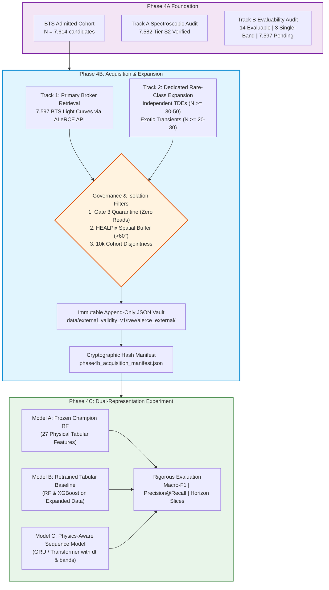
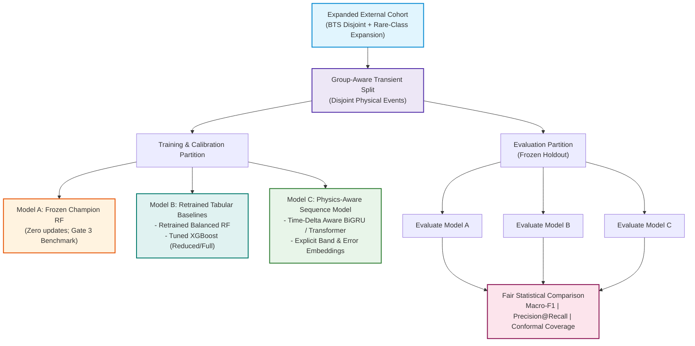

# ASTRAEUS — Gate 4 Phase 4B: ZTF Alert Broker Acquisition & Rare-Class Cohort Expansion Protocol

**Milestone:** Gate 4 Phase 4B — Programmatic Broker Acquisition & Rare-Class Cohort Expansion  
**Author:** Antigravity (Google DeepMind) in coordination with Scientific Review  
**Date:** November 16, 2026  
**Status:** **PRE-REGISTRATION PROTOCOL — PENDING FORMAL EXECUTION AUTHORIZATION**  
**Governing Context:** Authorized under Gate 4 Charter; builds upon Phase 4A.1 and Phase 4A.2 Certifications  

---

## 1. Executive Summary & Scientific Motivation

Phase 4A.2 established two decisive empirical findings:
1. **High Spectroscopic Reliability:** $N = 7,582$ candidates (99.58% of the admitted BTS external cohort) possess verified IAU Transient Name Server (TNS) spectroscopic classifications backed by traceable ADS classification announcements (`PROVISIONAL_S2`).
2. **Light-Curve Evaluability Bottleneck & Rare-Class Sparsity:** Only 14 candidates currently possess local difference light curves meeting the strict astronomical $SNR \ge 5.0$ and dual-band ($g$ and $r$) requirements. Crucially, the BTS disjoint cohort contains only **2 TDEs** (`ZTF18aabdajx`, `ZTF18aabtxvd`) and **1 OTHER_EXTRAGALACTIC transient** (`ZTF21abfmpiv`, Ca-rich), none of which have local light curves.

An external evaluation cohort with only 2 TDEs and 1 exotic transient is statistically powerless to answer the governing research question:
> *"Can physics-aware sequence representations improve rare-transient recognition and cross-survey robustness over a calibrated tabular classifier, particularly for TDEs and explicitly confirmed exotic transients?"*

Furthermore, published literature demonstrates that rare-transient classification cannot be solved trivially:
- **ALeRCE Balanced Hierarchical Random Forest (Sánchez-Sáez et al. 2020):** Achieved macro precision 0.57 and macro recall 0.76 at the bottom taxonomy level across repeated stratified splits.
- **ALeRCE TDE Model Extension (Pavez-Herrera et al. 2025, A&A 696 A153):** Evaluated 60 TDEs against 219,792 background sources. While reporting high class-level recall ($\approx 91-92\%$), the precision was bounded at $\approx 21\%$, demonstrating that false positives and contamination are the dominant failure modes.
- **Sparse Light-Curve Sequence Benchmarks (Lin et al. 2026, Universe 12(9), 268):** Showed that while pretrained transformer architectures achieve Macro-F1 $\approx 0.950$, training sequence models from scratch without pretraining plummets to Macro-F1 $\approx 0.552$, lagging behind tuned tabular tree baselines ($\approx 0.931$).

To establish a rigorous, publication-grade benchmark and evaluate sequence models credibly, **Phase 4B establishes a two-track acquisition and expansion protocol**:
1. **Track 1 (Primary Cohort Ingestion):** Programmatic retrieval of raw difference-imaging light curves for all 7,597 pending BTS candidates via the official ALeRCE alert broker API.
2. **Track 2 (Rare-Class Cohort Expansion):** Dedicated, protocol-governed acquisition of independent, spectroscopically confirmed TDEs ($N \ge 30-50$) and exotic extragalactic transients ($N \ge 20-30$) from post-2024 ZTF discoveries, TNS, and refereed literature catalogs, strictly preserving Gate 3 quarantine and spatial isolation.



---

## 2. Track 1: Programmatic Broker Acquisition Protocol (ALeRCE API)

### 2.1 API Semantics & Official Client Interface

All alert light curves will be acquired programmatically from the ALeRCE (Automatic Learning for the Rapid Classification of Events) alert broker using official, documented endpoints.

- **Primary Interface:** `alerce.core.Alerce.query_lightcurve(oid, survey="ztf", format="pandas")`
- **Underlying REST Endpoint:** `https://api.alerce.online/ztf/v1/objects/{oid}/lightcurve`
- **Forced Photometry Secondary Endpoint (if available):** `https://api.alerce.online/ztf/v1/objects/{oid}/forced_photometry`

### 2.2 Ingestion Schema & Epoch Preservation

The raw broker response contains two distinct observation records that must be preserved without clipping, filtering, or lossy transformation:
1. **Detections (`detections`):** Difference-image point-spread-function detections.
   - `mjd` (Modified Julian Date of observation)
   - `fid` (Filter ID: 1 for ZTF-$g$, 2 for ZTF-$r$, 3 for ZTF-$i$)
   - `magpsf` (Point-spread-function magnitude)
   - `sigmapsf` (1$\sigma$ photometric uncertainty)
   - `isdiffpos` (Difference flux sign: `1` for positive, `-1` or `0` for negative)
   - `ra`, `dec` (Astrometric coordinates)
2. **Non-Detections / Upper Limits (`non_detections`):** Censored epochs where no transient detection was triggered.
   - `mjd`
   - `fid`
   - `diffmaglim` ($5\sigma$ difference-image limiting magnitude)

> [!IMPORTANT]
> **Preservation of Non-Detections & Negative Fluxes:**  
> Non-detections and negative difference flux measurements are critical physical constraints for transient feature extraction (e.g. rise time, pre-explosion variability, and quiescent color). Dropping upper limits or setting them to arbitrary constants is strictly forbidden.

### 2.3 Storage Architecture & Reproducibility Invariants

1. **Immutable Storage Path:** Raw broker responses must be written to:
   ```
   data/external_validity_v1/raw/alerce_external/{ztf_id}.json
   ```
2. **Append-Only Vault:** Files once written are strictly read-only.
3. **Cryptographic Manifest:** Every downloaded file is registered in `experiments/gate4b_broker_acquisition_and_cohort_expansion/phase4b_acquisition_manifest.json` with its file size, download timestamp, HTTP status, and SHA-256 checksum.
4. **Rate-Limiting & Backoff:** The client must enforce a maximum request rate of $\le 5$ requests per second, with exponential backoff on HTTP 429 (Too Many Requests) or 503 (Service Unavailable).

### 2.4 Retrieval Outcome Taxonomy

Every candidate in the 7,597 query cohort will receive exactly one mutually exclusive outcome code in the acquisition ledger:

| Retrieval Outcome Code | Description | Permitted Action |
| :--- | :--- | :--- |
| **`SUCCESS_DUAL_BAND`** | Ingested successfully; contains $\ge 5$ detections at $SNR \ge 5$ across both $g$ and $r$ bands. | Promoted to `FEATURE_EVALUABLE` |
| **`SUCCESS_SINGLE_BAND`** | Ingested successfully; detections meeting $SNR \ge 5$ exist in only one passband. | Retained under `SINGLE_BAND_ONLY` |
| **`SUCCESS_INSUFFICIENT_DET`** | Ingested successfully; contains $< 5$ detections at $SNR \ge 5$. | Retained under `INSUFFICIENT_DETECTIONS` |
| **`NON_DETECTIONS_ONLY`** | Alert record exists but contains zero difference detections (upper limits only). | Excluded from feature evaluation |
| **`EMPTY_BROKER_RECORD`** | Broker returns an empty alert array for the given object ID. | Excluded from feature evaluation |
| **`OBJECT_NOT_FOUND_404`** | Identifier does not resolve on ALeRCE broker database. | Excluded from feature evaluation |
| **`API_RATE_LIMIT_ERROR`** | Persistent HTTP 429 after maximum exponential retries ($N=5$). | Queued for resumption |
| **`SERVER_ERROR_5XX`** | Upstream broker database or server failure. | Queued for resumption |

---

## 3. Track 2: Dedicated Rare-Class Cohort Expansion Protocol

### 3.1 Astronomical Scope & Class Targets

To provide adequate statistical power for rare-transient recognition, Phase 4B will construct a dedicated rare-class expansion cohort targeting:
1. **Tidal Disruption Events (TDEs):** Target sample of $N \ge 30-50$ independent, spectroscopically confirmed events.
2. **Other Extragalactic Transients (`OTHER_EXTRAGALACTIC`):** Target sample of $N \ge 20-30$ independent, confirmed exotic events:
   - Calcium-rich gap transients (Ca-rich)
   - Fast Blue Optical Transients (FBOTs, e.g. AT2018cow-like)
   - Intermediate Luminosity Red Transients (ILRTs)
   - Luminous Red Novae (LRNs)
   - Kilonovae (KNe)
3. **Super-Luminous Supernovae (SLSN):** Target sample of $N \ge 15-25$ events.

### 3.2 Literature Catalogs & Discovery Sources

Candidates will be sourced from peer-reviewed literature catalogs with verified spectroscopic classifications and published ZTF light-curve observations:
- **TDE Literature Compilations:**
  - Yao et al. 2023 (ApJ 955, 102): ZTF Tidal Disruption Event Survey sample.
  - Hammerstein et al. 2023 (ApJ 948, 42): Final ZTF-I Tidal Disruption Event Census.
  - van Velzen et al. 2021 (ApJ 908, 4): Seventeen Tidal Disruption Events from the First Half of ZTF Survey.
  - Gezari 2021 (ARA&A 59, 21): Observational Properties of Tidal Disruption Events.
- **Exotic Transient Compilations:**
  - Perley et al. 2019 (MNRAS 484, 1031): The Fast and the Curious: Fast Blue Optical Transients.
  - De et al. 2020 (ApJ 905, 58): The ZTF Survey for Calcium-Rich Gap Transients.
  - Pastorello et al. 2019 (A&A 630, A75): Intermediate-luminosity red transients and luminous red novae.
- **IAU Transient Name Server (TNS):**
  - Confirmed events classified post-2024 with published ADS classification reports (`Class_ADS_bibcodes`).

### 3.3 Strict Governance & Independence Invariants for Expansion Candidates

All candidate additions must pass four non-negotiable governance filters before admission:
1. **Gate 3 Test Set Quarantine (Invariant 1):** Zero overlap with the 586 quarantined Gate 3 test objects.
2. **Spatial Buffer Invariant (Invariant 2):** Every candidate must be located at an angular separation $> 60''$ from any pixel in the Gate 3 HEALPix test ring (Ring 80: $\theta \in [70.53^\circ, 72.54^\circ]$).
3. **10k Cohort Disjointness (Invariant 3):** Must not match any object in `candidates_10k.parquet` or `cohort_10k_selection_manifest.json` by ZTF ID, IAU name, or coordinate cone search ($r < 1.5''$).
4. **Spectroscopic Evidence Tier (Invariant 4):** Must satisfy **Tier S1** (accessible FITS spectrum) or **Tier S2** (traceable ADS classification report with named observatory/instrument). Tier S3 and S4 objects are strictly rejected.

---

## 4. Phase 4C: Dual-Representation Sequence Model Experiment Architecture

### 4.1 The Core Scientific Comparison

To answer the approved research question objectively, Phase 4C pre-registers a formal comparison between tabular and sequence models evaluated on the exact same data regime:



### 4.2 Model Definitions & Fair Parity Controls

1. **Model A (Frozen Champion):**
   - Architecture: Calibrated Bootstrap Random Forest (100 estimators, max depth 12).
   - Input: Frozen 27 physical observable features.
   - Status: Frozen at commit `789af02`; **zero retraining, zero tuning**. Acts as the historical benchmark anchor.
2. **Model B (Fair Retrained Tabular Baselines):**
   - Architectures:
     - Retrained Balanced Random Forest (matching champion hyper-parameters).
     - Tuned XGBoost Classifier (standard astronomical gradient boosting baseline).
   - Training Data: **Identical expanded training set** used for the sequence model.
   - Rationale: Mandatory fair comparison. If the sequence model outperforms Model A, we must establish whether the improvement comes from sequence representation or simply from training on more rare-class examples.
3. **Model C (Physics-Aware Sequence Models):**
   - Architectures:
     - Recurrent: Bidirectional GRU with irregular time-delta intervals ($\Delta t$).
     - Attention: Sparse Light-Curve Transformer (sinusoidal time-difference encoding, passband embeddings, photometric flux and flux uncertainty inputs).
   - Loss Function: Class-balanced focal loss or cost-sensitive cross-entropy.

### 4.3 Standardized Observation Horizons

Classification models will be evaluated across four standardized temporal horizons:
- **Horizon 1 (Early Phase):** First 5 detections ($N_{\text{det}} = 5$).
- **Horizon 2 (Intermediate Phase):** First 10 detections ($N_{\text{det}} = 10$).
- **Horizon 3 (Post-Peak / Robustness):** First 20 detections ($N_{\text{det}} = 20$).
- **Horizon 4 (Full Light Curve):** All available survey detections.

### 4.4 Evaluation Metrics & Statistical Reporting

To avoid the metric pitfalls identified in published surveys:
1. **Primary Aggregate:** Macro-F1 across all 8 taxonomy classes.
2. **Secondary Aggregate:** Balanced Accuracy (macro-recall).
3. **Rare-Class Specific Metrics (TDE & Other):**
   - Precision-Recall Area Under Curve (PR-AUC).
   - Class-level Recall at Fixed False Positive Rates ($FPR \in \{0.01, 0.05\}$).
   - Class-level Precision at Fixed Target Recall ($R \in \{0.80, 0.90\}$).
4. **Uncertainty Quantification:** Conformal prediction set coverage ($1 - \alpha = 0.90$) and selective prediction accuracy-rejection curves.

---

## 5. Non-Negotiable Governance Locks for Phase 4B

Throughout Phase 4B execution:
- **Gate 3 Test Partition:** Permanently quarantined. Zero queries, reads, or checks against test IDs.
- **Champion Model Weights:** Strictly frozen.
- **Feature Pipeline:** Observable physical feature definitions remain frozen.
- **Zero Premature Inference:** Model evaluation will not commence until light-curve ingestion and rare-class cohort expansion are audited, verified, and certified under formal governance review.
