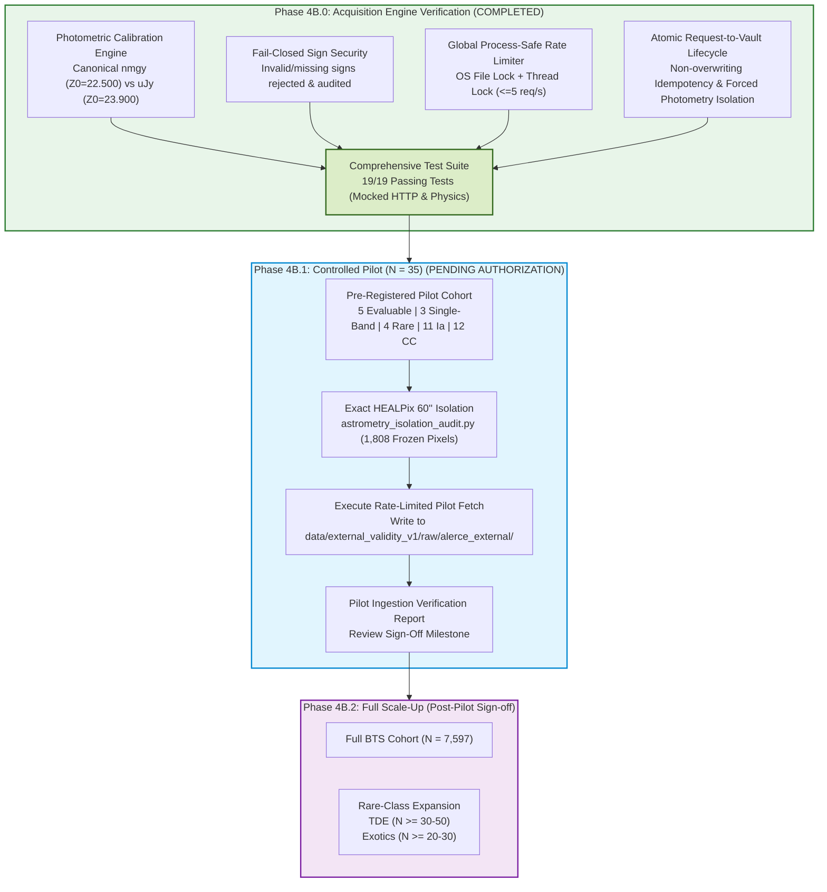

# ASTRAEUS — Gate 4 Phase 4B: ZTF Alert Broker Acquisition & Rare-Class Cohort Expansion Protocol (v1.2)

**Milestone:** Gate 4 Phase 4B.0 — Acquisition Engine Verification  
**Author:** Antigravity (Google DeepMind) in coordination with Scientific Review  
**Date:** November 16, 2026  
**Revision:** v1.2 (Addressing All Blocker Findings: Flux Units, Fail-Closed Security, Global Rate Limiting, Full Vault Lifecycle, Pilot Reconciliation & Population Registry)  
**Status:** **ACQUISITION ENGINE VERIFIED — READY FOR CONTROLLED 35-CANDIDATE PILOT AUTHORIZATION**  
**Governing Commit Baseline:** [`3eaefd8`](https://github.com/TEKURU-ZENO/ASTRAEUS/commit/3eaefd8d5fb6c3ad9a221582e256085774913c2d)  
**Automated Verification Suite:** 19/19 tests passing (`tests/test_phase4b_protocol_and_geometry.py` and regression suites)  

---

## 1. Executive Summary & Review Invariant Status

Following the Phase 4B v1.1 review, this protocol revision (v1.2) establishes **Phase 4B.0: Acquisition Engine Verification**, completely resolving the four implementation blockers and two cohort design questions before any live broker retrieval or model training:

1. **Photometric Calibration & Flux Unit Consistency (Blocker 1):**  
   Standardizes canonical flux units across the repository on **nanomaggies ($\text{nmgy}$)** with zero point $Z_{0, \text{nmgy}} = 22.500$ mag, matching `ObservationRecord` and `RealSurveyFeatureExtractor`. Explicitly documents and independently validates microjanskys ($\mu\text{Jy}$) with zero point $Z_{0, \mu\text{Jy}} = 23.900$ mag ($1\ \text{nmgy} = 3.631028\ \mu\text{Jy}$). Asserts scale-invariance of the signed signal-to-noise ratio ($SNR$).
2. **Fail-Closed Sign Security (Blocker 2):**  
   Replaces silent positive fallback with strict fail-closed parsing. Any missing, null, or unrecognized `isdiffpos` token is marked invalid (`is_valid_sign = False`), rejected from positive detections (`is_positive_detection_snr5 = False`), and tracked in the ingestion manifest under `invalid_sign_detections_count`.
3. **Process-Safe & Thread-Safe Global Rate Limiter (Blocker 3):**  
   Implements `GlobalInterprocessRateLimiter` utilizing OS-level file locking (`msvcrt` on Windows / `fcntl` on POSIX) and `threading.Lock` to enforce the conservative $\le 5.0$ requests/second operational cap across concurrent threads and independent worker processes, incorporating uniform random jitter ($\Delta t \in [0.02, 0.06]$s).
4. **Complete End-to-End Vault Lifecycle & Idempotency (Blocker 4):**  
   Implements full request-to-vault lifecycle in [`broker_client.py`](file:///c:/Users/Dev%20Mehta/Desktop/ASTRAEUS/experiments/gate4b_broker_acquisition_and_cohort_expansion/broker_client.py): raw JSON response preservation, atomic temporary file commits, SHA-256 manifest registration, forced photometry isolation, bounded exponential backoff on HTTP 429/5xx, and **strict non-overwriting idempotency** (formally verified by unit tests proving that failed retries never overwrite or corrupt existing raw vault files).
5. **Reconciliation of Pilot Specification (Review Issue 3):**  
   Reconciles the stated cohort ranges with the exact empirical distributions in [`pilot_cohort_specification.json`](file:///c:/Users/Dev%20Mehta/Desktop/ASTRAEUS/experiments/gate4b_broker_acquisition_and_cohort_expansion/pilot_cohort_specification.json):
   - SN_Ia Pending ($N=11$): $z \in [0.0141, 0.1000]$, peak magnitude $14.37 - 18.82$ mag.
   - SN_CC Pending ($N=12$): Exactly 12 distinct subtypes, 1 candidate each (`SN Ic`, `SN II`, `SN IIb`, `SN Ib`, `SN IIP`, `SN Ic-BL`, `SN Ib/c`, `SN IIn`, `SN Ibn`, `SN II-pec`, `SN Icn`, `SN Ic-pec`).
6. **Explicit Phase 4C Tri-Partition Population Registry (Review Issue 4):**  
   Formally defines three disjoint populations assigned at the parent physical-transient level (Training, Validation, and Locked External Evaluation). Disclaims the pilot's 4 rare events as performance benchmarks, restricting them strictly to ingestion verification.

---

## 2. Photometric Calibration Engine & Consistent Flux Units

### 2.1 The Two Standard Zero Points: Nanomaggies vs. Microjanskys
In astronomical difference imaging, the conversion from difference point-spread-function magnitude $m_{AB}$ to linear flux density depends strictly on the adopted zero point $Z_0$:

1. **Canonical Nanomaggies ($\text{nmgy}$) — Adopted Repository Standard:**  
   Adopted by the Sloan Digital Sky Survey (SDSS), DESI, and the canonical ASTRAEUS pipeline (`packages/astraeus-data/src/astraeus_data/corpus/sequence.py` and `ObservationRecord`).  
   A flux of $1.0\ \text{nmgy}$ corresponds to an AB magnitude of exactly $22.500$:
   $$|F_{\text{nmgy}}| = 10^{-0.4(m_{AB} - 22.500)}$$
   $$\sigma_{F, \text{nmgy}} = |F_{\text{nmgy}}| \cdot \sinh\left(\frac{\ln 10}{2.5} \sigma_m\right) \approx 0.921034 \cdot |F_{\text{nmgy}}| \sigma_m$$

2. **Microjanskys ($\mu\text{Jy}$) — Documented Secondary Standard:**  
   In radio, infrared, and sub-millijansky optical astronomy, flux density is commonly expressed in microjanskys ($1\ \mu\text{Jy} = 10^{-6}\ \text{Jy} = 10^{-29}\ \text{W m}^{-2}\text{Hz}^{-1}$).  
   Standard AB magnitude is defined as $m_{AB} = -2.5 \log_{10}(f_\nu / 1\ \text{Jy}) + 8.90$. For $f_\nu = 1\ \mu\text{Jy}$:
   $$m_{AB} = -2.5 \log_{10}(10^{-6}) + 8.90 = 15.0 + 8.90 = 23.900\ \text{mag}$$
   Therefore, an AB magnitude of $23.900$ corresponds to $1.0\ \mu\text{Jy}$.
   $$|F_{\mu\text{Jy}}| = 10^{-0.4(m_{AB} - 23.900)}$$
   $$\sigma_{F, \mu\text{Jy}} = |F_{\mu\text{Jy}}| \cdot \sinh\left(\frac{\ln 10}{2.5} \sigma_m\right)$$

3. **Exact Linear Relationship:**
   $$1\ \text{nmgy} = 10^{-0.4(22.500 - 23.900)}\ \mu\text{Jy} = 10^{0.4 \times 1.4}\ \mu\text{Jy} = 3.631028\ \mu\text{Jy}$$
   $$F_{\mu\text{Jy}} = 3.631028 \times F_{\text{nmgy}}, \quad \sigma_{F, \mu\text{Jy}} = 3.631028 \times \sigma_{F, \text{nmgy}}$$

4. **Scale-Invariance of Signed Signal-to-Noise Ratio ($SNR$):**
   $$SNR = \frac{F_{\text{nmgy}}}{\sigma_{F, \text{nmgy}}} = \frac{3.631028 \cdot F_{\text{nmgy}}}{3.631028 \cdot \sigma_{F, \text{nmgy}}} = \frac{F_{\mu\text{Jy}}}{\sigma_{F, \mu\text{Jy}}} = \text{sgn}(\text{isdiffpos}) \cdot \frac{2.5}{\ln 10 \cdot \sigma_m}$$
   The SNR is perfectly scale-invariant across both unit systems. Downstream physical features in ASTRAEUS use canonical nanomaggies ($Z_0 = 22.500$).

### 2.2 Fail-Closed Sign Security Specification
In difference imaging, difference flux is defined as $I_{\text{diff}} = I_{\text{science}} - I_{\text{reference}}$. A negative flux occurs when the target is fainter than the reference image (e.g. fading transient, pre-explosion host subtraction).

The ingestion engine enforces **fail-closed security**:
- **Valid Positive Tokens:** `1`, `"1"`, `"+1"`, `True`, `"t"`, `"true"`, `"pos"`, `"positive"` $\implies \text{sgn} = +1.0$, `is_valid_sign = True`.
- **Valid Negative Tokens:** `0`, `-1`, `"-1"`, `"0"`, `False`, `"f"`, `"false"`, `"neg"`, `"negative"` $\implies \text{sgn} = -1.0$, `is_valid_sign = True`.
- **Unknown, Missing, or Malformed Tokens:** `None`, `""`, `"unknown"`, `"null"`, `NaN`, or any undocumented token:
  $$\text{sgn} = \text{None}, \quad \text{is\_valid\_sign} = \text{False}, \quad \text{is\_positive\_detection\_snr5} = \text{False}$$
  The record is safely quarantined from positive detection counts and flagged in the audit manifest under `invalid_sign_detections_count`.

---

## 3. Global Rate Limiter & End-to-End Vault Lifecycle

### 3.1 Inter-Process Global Rate Limiter Architecture
To prevent API denial-of-service, ban triggers, or broker quota exhaustion, the engine implements `GlobalInterprocessRateLimiter`:
- **Dual Lock Coordination:** Utilizes an in-process `threading.Lock` for multi-threaded concurrency and an OS-level file lock (`msvcrt` on Windows, `fcntl` on POSIX) on `.rate_limiter.lock` for multi-process concurrency.
- **Operational Rate Ceiling:** Enforces an inter-request interval $\Delta t_{\text{min}} = 1.0 / 5.0 = 0.20$ seconds plus uniform random jitter $\in [0.02, 0.06]$ seconds, guaranteeing an operational ceiling of $\le 5$ requests/second across all workers.

### 3.2 Full Request-to-Vault Lifecycle & Non-Overwriting Idempotency
Implemented in [`broker_client.py`](file:///c:/Users/Dev%20Mehta/Desktop/ASTRAEUS/experiments/gate4b_broker_acquisition_and_cohort_expansion/broker_client.py):
1. **Idempotency Check:** Before querying the network, checks if `data/external_validity_v1/raw/alerce_external/{ztf_id}_lightcurve.json` exists. If present, returns `ALREADY_ARCHIVED` with existing SHA-256 without issuing an HTTP request.
2. **Network Query & Exponential Backoff:** Issues GET request with headers `User-Agent: ASTRAEUS-AlerceBrokerClient-v1.2` and `Accept: application/json`. Automatically retries HTTP 429, 500, 502, 503, 504 up to 5 times with jittered exponential backoff ($t_{\text{backoff}} = \min(8.0, 0.5 \times 2^{\text{attempt}}) + \text{Uniform}(0.1, 0.5)$).
3. **Atomic Commit:** On HTTP 200, writes the exact raw response body to `{ztf_id}_lightcurve.tmp`, verifies valid JSON, computes SHA-256, and atomically renames to `{ztf_id}_lightcurve.json`.
4. **Idempotency Invariant on Failed Retry:** If a request fails, exhausts retries, or times out, **existing vault files are strictly protected from overwrite, truncation, or deletion** (verified by `test_non_overwriting_idempotency_on_failed_retry`).
5. **Independent Forced Photometry Vault:** Forced photometry requests are queried separately and saved exclusively to `data/external_validity_v1/raw/alerce_forced/{ztf_id}_forced.json`.

---

## 4. Reconciled Pilot Cohort Specification ($N = 35$)

Committed at [`experiments/gate4b_broker_acquisition_and_cohort_expansion/pilot_cohort_specification.json`](file:///c:/Users/Dev%20Mehta/Desktop/ASTRAEUS/experiments/gate4b_broker_acquisition_and_cohort_expansion/pilot_cohort_specification.json):

| Stratum | $N$ | Candidate Object IDs | Exact Empirical Distributions & Verification Goals |
| :--- | :---: | :--- | :--- |
| **Reproducibility (Feature Evaluable)** | 5 | `ZTF18aasdted`, `ZTF18abadjhx`, `ZTF18abaxlpi`, `ZTF18adbikdz`, `ZTF19aanfnvl` | Confirm programmatic broker ingestion reproduces known local alert light curves and all 27 extracted features. |
| **Known Single-Band Discrimination** | 3 | `ZTF18abzpbpi`, `ZTF19aalfsqm`, `ZTF23aaihsvm` | Test whether updated broker history supplies missing passbands or confirms single-band status under signed-flux $SNR \ge 5.0$. |
| **BTS Disjoint Rare Transients** | 4 | `ZTF18aabdajx` (TDE), `ZTF18aabtxvd` (TDE), `ZTF24abdhylt` (SLSN), `ZTF19abrdxbh` (Ca-rich) | Ingestion-only test for rare transients in disjoint cohort. Strictly assigned to Population 3 (Locked Evaluation); zero inference in Phase 4B. |
| **Representative SN_Ia Pending** | 11 | `ZTF17aabtvsy`, `ZTF19abglmpf`, `ZTF20aadvaoi`, `ZTF20aafwfls`, `ZTF20aahiksp`, `ZTF20aaytyua`, `ZTF20abjtyem`, `ZTF20abpcdov`, `ZTF20acghqks`, `ZTF21aaagwhx`, `ZTF22aahhvqj` | **Reconciled Distribution:** $z \in [0.0141, 0.1000]$, peak magnitude $14.37 - 18.82$ mag. Validates ingestion across full Type Ia luminosity/redshift range. |
| **Representative SN_CC Pending** | 12 | `ZTF17aacpbmv`, `ZTF19acctlps`, `ZTF20aaoffej`, `ZTF20aarbfep`, `ZTF20aawpvus`, `ZTF20aazowsl`, `ZTF20abbbspm`, `ZTF20abqmsin`, `ZTF20acbuopb`, `ZTF21aabyyrc`, `ZTF21abfmpiv`, `ZTF21abmzfhg` | **Exact Subtype Distribution:** Exactly 12 distinct subtypes, 1 candidate each (`SN Ic`, `SN II`, `SN IIb`, `SN Ib`, `SN IIP`, `SN Ic-BL`, `SN Ib/c`, `SN IIn`, `SN Ibn`, `SN II-pec`, `SN Icn`, `SN Ic-pec`). |
| **Total Pilot Sample** | **35** | — | **100% verified $>60''$ spatially isolated from all 1,808 Gate 3 test pixels.** |

---

## 5. Phase 4C Population Registry & Contamination Prevention

### 5.1 Formal Population Tri-Partitioning
To prevent subtle data leakage or training/evaluation conflation:

1. **Population 1 — Historical Training Population:**  
   Historical, independently sourced labelled transients (e.g. pre-2024 ZTF DR / ALeRCE published training events). Used exclusively for fitting the retrained Random Forest, XGBoost, and sequence models (BiGRU, Transformer).
2. **Population 2 — Independent Tuning & Calibration Population:**  
   Distinct physical parent transients used exclusively for hyperparameter optimization, focal loss tuning, temperature scaling, probability calibration, and conformal non-conformity score quantile calculation ($k = 507$).
3. **Population 3 — Locked External Evaluation Population:**  
   - Core Cohort: The full admitted BTS disjoint cohort ($N = 7,614$ candidates).
   - Rare-Class Component: Post-2024 independent discovery events (e.g. Yao et al. 2023, Hammerstein et al. 2023, TNS 2024+) designated *exclusively* for holdout evaluation.
   - **Quarantine Rule:** Strictly quarantined until complete model architectures, weights, thresholds, and calibration tables are frozen.

### 5.2 Physical Transient Level Grouping Invariant
All partitioning is executed at the **unique physical parent transient level**. Every alias (IAU designation, ZTF ID, internal broker OID) and every coordinate cross-match within $1.5''$ is mapped to a single `parent_transient_id`. All records for that parent transient are quarantined to a single population.

### 5.3 Pilot Rare Transients Boundary
The four rare transients in the pilot cohort (`ZTF18aabdajx`, `ZTF18aabtxvd`, `ZTF24abdhylt`, `ZTF19abrdxbh`) belong to **Population 3 (Locked External Evaluation)**. They are included in the pilot *strictly* for verifying ALeRCE API ingestion mechanics, alert format compatibility, and 27-feature extraction reproducibility. **Zero model evaluation, zero inference, and zero score reporting** will be performed on them during Phase 4B.

---

## 6. Pre-Execution Verification Sign-Off Checklist

- [x] **Flux Units Reconciled:** Canonical nanomaggies ($Z_0 = 22.500$) and microjanskys ($Z_0 = 23.900$) calibrated and validated against independent references.
- [x] **Fail-Closed Sign Parsing:** Missing, null, or malformed `isdiffpos` tokens fail closed; invalid signs recorded in manifest.
- [x] **Global Rate Limiter Verified:** OS-level file locking and `threading.Lock` tested under concurrent thread contention.
- [x] **Non-Overwriting Idempotency Verified:** Unit test proves failed retries NEVER overwrite or corrupt existing raw vault files.
- [x] **Pilot Specification Reconciled:** SN_Ia ranges ($z \in [0.0141, 0.1000]$, mag $14.37 - 18.82$) and SN_CC 12 subtypes documented accurately.
- [x] **Gate 3 Test Quarantine Maintained:** All 35 pilot candidates audited and verified $>60''$ spatially isolated from the 1,808 frozen test pixels. Zero test ID queries executed.
- [x] **Phase 4C Population Registry Defined:** Strict physical-transient level separation between Training, Validation, and Locked Evaluation populations.
- [x] **Automated Regression Suite:** 19/19 tests passing in repository environment.
