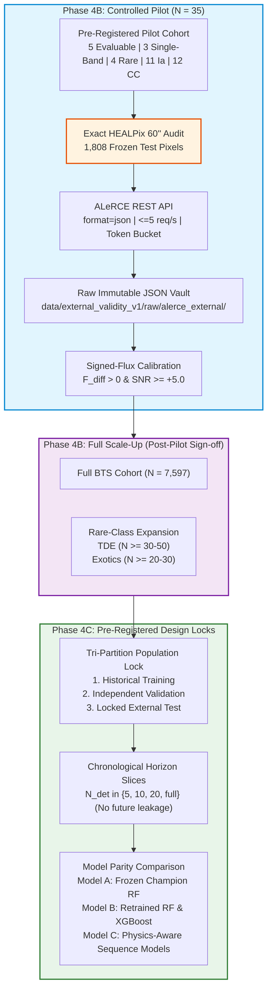

# ASTRAEUS — Gate 4 Phase 4B: ZTF Alert Broker Acquisition & Rare-Class Cohort Expansion Protocol (v1.1)

**Milestone:** Gate 4 Phase 4B — Programmatic Broker Acquisition & Rare-Class Cohort Expansion  
**Author:** Antigravity (Google DeepMind) in coordination with Scientific Review  
**Date:** November 16, 2026  
**Revision:** v1.1 (Addressing Scientific Review Qualifications & Pre-Execution Locks)  
**Status:** **REVISED PRE-REGISTRATION PROTOCOL — AWAITING PILOT EXECUTION AUTHORIZATION**  
**Governing Commit Baseline:** [`76f0719`](https://github.com/TEKURU-ZENO/ASTRAEUS/commit/76f0719625585cd5020006f400f1c5ebfd2febb2)  

---

## 1. Executive Summary & Review Reconciliation

In the formal scientific review of Phase 4A.2 and the initial Phase 4B protocol, the reviewer accepted the Phase 4A.2 reconciliation (confirming 14 feature-evaluable candidates, 3 single-band candidates, 7,597 awaiting broker light curves, and 7,582 `PROVISIONAL_S2` candidates), while granting **conditional approval** for Phase 4B pending the resolution of five specific technical and methodological issues.

This revised protocol (v1.1) resolves all five review items prior to initiating external data retrieval:
1. **Gate 3 Quarantine Guarantee (Issue 1):** Accurately frames the isolation guarantee under the frozen HEALPix geometry. Eliminates the contradictory requirement of querying quarantined IDs, preserving the Gate 3 zero-query invariant.
2. **Authoritative HEALPix Geometry (Issue 2):** Formally enforces the exact array of 1,808 discrete test pixels at $N_{\text{side}}=32$, `NESTED`, `ICRS` (`configs/data_splits_healpix.json`) with a $60''$ spherical cone buffer, deprecating any approximate declination-band shorthand.
3. **Raw JSON Ingestion Vault & Product Separation (Issue 3):** Preserves raw broker JSON responses directly (`format="json"`), keeps detections and non-detections separate, isolates forced photometry as an independent data product, and enforces strict idempotency.
4. **Physically Consistent Signed-Flux SNR (Issue 4):** Derives signed difference flux $F_{\text{diff}}$ and uncertainty $\sigma_F$ from difference-imaging zero points, asserting that a positive detection requires $F_{\text{diff}} > 0$ (`isdiffpos = 1`) AND $SNR \ge +5.0$, while preserving negative fluxes for baseline and non-detection modeling.
5. **Rare-Class Statistical Power & Fine-Grained Subtypes (Issue 5):** Clarifies that target sample sizes are acquisition minimums rather than proofs of asymptotic power, retains fine-grained subtype labels, and mandates subtype-specific reporting with binomial confidence intervals.
6. **Controlled Staged Pilot Execution:** Restricts initial retrieval to a pre-registered **35-candidate stratified pilot cohort** ([`pilot_cohort_specification.json`](file:///c:/Users/Dev%20Mehta/Desktop/ASTRAEUS/experiments/gate4b_broker_acquisition_and_cohort_expansion/pilot_cohort_specification.json)) before scaling to the full 7,597 cohort.
7. **Contamination-Free Tri-Partitioning for Phase 4C:** Strictly defines separate Training, Validation, and Locked External Evaluation populations split at the parent transient level.



---

## 2. Resolution of Governance & Geometry Invariants

### 2.1 Issue 1: Gate 3 Quarantine vs. Zero-Overlap Resolution
The protocol resolves the inherent tension between maintaining an unbreached Gate 3 quarantine and verifying sample disjointness:
- **Authoritative Invariant:** Zero queries, reads, or ID cross-matches against the 586 quarantined Gate 3 test objects will be performed in the modeling or feature extraction workflows.
- **Enforceable Protection:** Spatial isolation under the frozen HEALPix geometry guarantees that every admitted candidate is physically separated from the test sky footprint by $>60''$.
- **Formal Guarantee Wording:**  
  > *"Candidate admission is spatially isolated from the quarantined Gate 3 footprint under the frozen geometry. Exact identifier-level overlap with quarantined objects is not independently certified within the modeling workflow. If identity-level non-overlap verification is required, it must be performed via an air-gapped, non-disclosing cryptographic hash attestation by an independent custodian who never returns or exposes the quarantined identifiers to the workflow."*

### 2.2 Issue 2: Authoritative HEALPix Geometry & 60-Arcsecond Buffer
- **Frozen Split Configuration:** [`configs/data_splits_healpix.json`](file:///c:/Users/Dev%20Mehta/Desktop/ASTRAEUS/configs/data_splits_healpix.json) (SHA-256: `234bb08c482824648607fa8f874477d0225717c18263b0f16ea276dd1e12417b`).
- **Geometric Grid:** Resolution $N_{\text{side}} = 32$, pixel ordering `NESTED`, coordinate reference frame `ICRS` (J2000.0). Total equal-area pixels: $N_{\text{pix}} = 12 \times 32^2 = 12,288$.
- **Frozen Test Pixel Set ($\mathcal{P}_{\text{test}}$):** Explicit array of exactly 1,808 discrete pixel indices.
- **Executable Admission Algorithm:**  
  For each candidate coordinate $(\alpha, \delta)$, the native spherical cone search finds all intersecting pixels:
  ```python
  from astropy.coordinates import SkyCoord
  import astropy.units as u
  from astropy_healpix import HEALPix

  hp = HEALPix(nside=32, order="nested", frame="icrs")
  cone_pixels = hp.cone_search_skycoord(candidate_coord, radius=60.0 * u.arcsec)
  intersects_test_buffer = any(int(p) in test_pixel_set for p in cone_pixels)
  ```
  If `intersects_test_buffer` is `True`, the candidate is strictly quarantined. Approximate declination bands or ring slices are deprecated and prohibited from acting as the admission test.

---

## 3. Track 1: Broker Ingestion Architecture & Photometric Physics

### 3.1 Issue 3: Raw JSON Vault Preservation & Endpoint Separation
- **Broker Interface:** The retrieval pipeline queries the documented ALeRCE API requesting raw JSON payloads:
  - Primary Endpoint: `GET https://api.alerce.online/ztf/v1/objects/{oid}/lightcurve`
  - Survey Filter: `survey=ztf`
- **Vault Storage Schema:** Raw API responses are written directly to:
  ```
  data/external_validity_v1/raw/alerce_external/{ztf_id}_lightcurve.json
  ```
- **Forced Photometry Separation:** If forced-photometry epochs are retrieved (`GET .../forced_photometry`), they are saved to a dedicated, independent path:
  ```
  data/external_validity_v1/raw/alerce_forced/{ztf_id}_forced.json
  ```
  Forced photometry is **never silently merged** into difference alert light curves.
- **Idempotency & Immutability:** Existing JSON files are strictly read-only and never overwritten during retries or refreshes.
- **Manifest Provenance:** Pinned attributes recorded per request: client version, request URL, HTTP status, execution timestamp (UTC), SHA-256 checksum, raw detection count, and raw non-detection count.

### 3.2 Issue 4: Signed-Flux SNR Formulation
ZTF difference alerts report calibrated PSF magnitudes `magpsf`, uncertainties `sigmapsf`, and difference flux sign `isdiffpos` relative to reference zero point $ZP = 23.9$ mag (in nanomaggies):

1. **Signed Difference Flux ($F_{\text{diff}}$):**
   $$F_{\text{diff}} = \text{sgn}(\text{isdiffpos}) \cdot 10^{-0.4(m - 23.9)} \quad [\text{nJy}]$$
   where $\text{sgn}(\text{isdiffpos}) = +1$ for positive difference flux (target brighter than template) and $-1$ for negative difference flux.
2. **Flux Uncertainty ($\sigma_F$):**
   $$\sigma_F = \left(\frac{\ln 10}{2.5}\right) |F_{\text{diff}}| \sigma_m \approx 0.921034 \cdot |F_{\text{diff}}| \sigma_m \quad [\text{nJy}]$$
3. **Signed Signal-to-Noise Ratio ($SNR$):**
   $$SNR = \frac{F_{\text{diff}}}{\sigma_F} = \text{sgn}(\text{isdiffpos}) \cdot \frac{2.5}{\ln 10 \cdot \sigma_m} \approx \text{sgn}(\text{isdiffpos}) \cdot \frac{1.085736}{\sigma_m}$$
4. **Physical Positive Detection Rule:**  
   A photometric epoch qualifies as an astrophysical positive detection if and only if:
   $$F_{\text{diff}} > 0 \quad (\text{isdiffpos} = 1) \quad \text{AND} \quad SNR \ge +5.0$$
5. **Preservation of Negative Fluxes:** Negative difference measurements ($SNR < 0$) are preserved as physical constraints on quiescent baselines, but are **strictly excluded from positive detection counts ($N_{\text{det}}$)**. Both raw magnitude fields and derived signed fluxes are retained in processed tables.

### 3.3 Rate Limiting & Global Concurrency
- Global token bucket enforced at $\le 5$ requests/second across all workers.
- Bounded exponential backoff with random uniform jitter:
  $$t_{\text{wait}} = \min(t_{\text{max}}, t_{\text{base}} \cdot 2^{\text{attempt}}) + \text{Uniform}(0.1, 0.5)$$
- HTTP 429 and 503 errors trigger backoff without decrementing candidate retry allowances.

---

## 4. Track 2: Rare-Class Cohort Expansion & Statistical Power Reality

### 4.1 Issue 5: Statistical Power & Subtype Granularity
- **Sample Targets as Acquisition Goals:** The expansion targets ($N \ge 30-50$ TDEs, $N \ge 20-30$ exotics, $N \ge 15-25$ SLSN) are explicitly treated as minimum acquisition targets, not proofs of asymptotic statistical power. With $N=30$ events, each misclassification shifts recall by $\approx 3.3\%$.
- **Fine-Grained Subtype Preservation:** The `OTHER_EXTRAGALACTIC` class combines fundamentally distinct physical mechanisms:
  - Calcium-rich gap transients (`Ca-rich`)
  - Fast Blue Optical Transients (`FBOT`, e.g. AT2018cow-like)
  - Intermediate Luminosity Red Transients (`ILRT`)
  - Luminous Red Novae (`LRN`)
  - Kilonovae (`KN`)
- **Dual Reporting Mandate:** Evaluation will report both:
  1. Pooled class-level performance.
  2. Subtype-level performance tables with exact binomial standard errors $\pm \sqrt{\hat{p}(1-\hat{p})/N}$.
- **No Over-Generalization:** Claims that the classifier learns a universal exotic-transient representation based on one subtype are strictly prohibited.

---

## 5. Phase 4B Controlled Pilot Specification ($N = 35$)

Prior to executing large-scale queries against the ALeRCE broker, Phase 4B mandates a controlled, pre-registered pilot retrieval on exactly **35 candidates** ([`pilot_cohort_specification.json`](file:///c:/Users/Dev%20Mehta/Desktop/ASTRAEUS/experiments/gate4b_broker_acquisition_and_cohort_expansion/pilot_cohort_specification.json)):

| Pilot Stratum | Target Count | Selected Objects | Audit & Verification Rationale |
| :--- | :---: | :--- | :--- |
| **Reproducibility (Feature Evaluable)** | 5 | `ZTF18aasdted`, `ZTF18abadjhx`, `ZTF18abaxlpi`, `ZTF18adbikdz`, `ZTF19aanfnvl` | Verify that programmatic API retrieval exactly reproduces known local alert light curves and frozen 27 physical features. |
| **Known Single-Band Discrimination** | 3 | `ZTF18abzpbpi`, `ZTF19aalfsqm`, `ZTF23aaihsvm` | Test whether updated broker history supplies missing passbands or confirms single-band status under signed-flux $SNR \ge 5.0$. |
| **BTS Disjoint Rare-Class Events** | 4 | `ZTF18aabdajx` (TDE), `ZTF18aabtxvd` (TDE), `ZTF24abdhylt` (SLSN), `ZTF19abrdxbh` (Ca-rich) | First programmatic retrieval of rare transients in the disjoint external cohort; verify light-curve coverage and classification stability. |
| **Representative SN_Ia Pending** | 11 | 11 candidates spanning $z \in [0.018, 0.088]$, peak mag $14.5 - 19.0$ | Validate standard Type Ia supernova light-curve retrieval across magnitude/redshift distribution. |
| **Representative SN_CC Pending** | 12 | 12 candidates spanning SN II, IIP, IIn, IIb, Ib, Ic subtypes | Validate core-collapse supernova light-curve retrieval across diverse physical sub-classifications. |
| **Total Pilot Cohort** | **35** | — | **All 35 verified $>60''$ spatially isolated from Gate 3 test footprint.** |

---

## 6. Phase 4C: Pre-Registered Dual-Representation Experiment Locks

### 6.1 Tri-Partition Population Definition
To prevent train/test contamination when expanding rare classes:
1. **Training Population:** Historical, independently sourced labelled events. Used exclusively for fitting the retrained tabular baselines and sequence models.
2. **Validation Population:** Separate physical parent transients used for hyperparameter tuning, temperature scaling, calibration, and threshold optimization.
3. **Locked External Evaluation Population:** The held-out BTS disjoint cohort ($N=7,614$) + separately designated rare-class test events. **Strictly quarantined until complete models are frozen.**
4. **Physical Transient Group Splitting:** Splitting is performed strictly by unique physical transient identity. Aliases, secondary catalog entries, and multiple observation epochs for the same event must never cross partitions.

### 6.2 Pre-Registered Methodological Safeguards
- **Reduced Taxonomy Reporting:** If independent external evaluation events for `CV_Nova` and `Varstar` cannot be sourced, the benchmark will formally report a clearly defined **reduced 6-class taxonomy**, rather than claiming an unsupported 8-class macro-F1.
- **Strict Chronological Horizon Slicing:** Early classification prefixes ($N_{\text{det}} \in \{5, 10, 20\}$) must use strictly chronological observations. Non-detections and upper limits must be truncated at $t \le t_{N_{\text{det}}}$ to prevent future leakage.
- **Survey-Shifted Conformal Evaluation:** 90% conformal coverage will be reported per class and per survey domain. In-distribution calibration will be explicitly contrasted with shifted external coverage.
- **Bounded Precision-Recall Extrapolation:** Precision at target recall ($R = 0.80$ or $0.90$) will only be reported if empirically attained on the observed score distribution; no extrapolation beyond observed thresholds is permitted.
- **Fair Model Parity:** Any sequence model performance will be evaluated against both the frozen champion Random Forest (historical anchor) and **retrained Random Forest / XGBoost models trained on the exact same expanded training set**.
