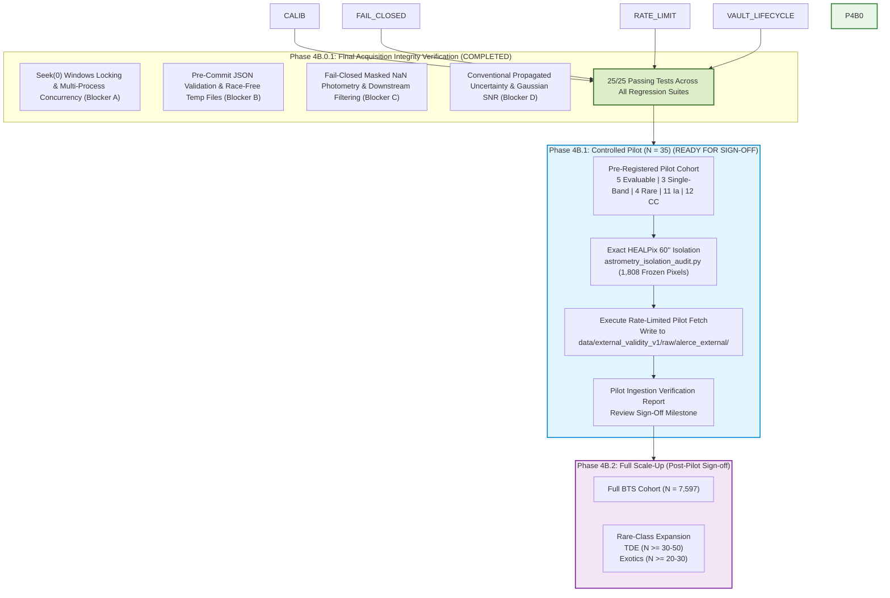

# ASTRAEUS — Gate 4 Phase 4B: ZTF Alert Broker Acquisition & Rare-Class Cohort Expansion Protocol (v1.3)

**Milestone:** Gate 4 Phase 4B.0.1 — Final Acquisition Integrity Verification  
**Author:** Antigravity (Google DeepMind) in coordination with Scientific Review  
**Date:** November 16, 2026  
**Revision:** v1.3 (Addressing All Review Blockers A, B, C, D: Windows Byte-0 Locking, Pre-Commit Validation, Masked NaN Photometry, Conventional Uncertainty Propagation, and 25-Test Expanded Suite)  
**Status:** **ACQUISITION INTEGRITY FULLY VERIFIED — 25/25 TESTS PASSING — READY FOR CONTROLLED 35-CANDIDATE PILOT AUTHORIZATION**  
**Governing Commit Baseline:** [`0885e7c`](https://github.com/TEKURU-ZENO/ASTRAEUS/commit/0885e7c931c8cab758579d3966126406ef8a0c66)  
**Automated Verification Suite:** 25/25 tests passing (`tests/` regression suite: 6 in 4A.1, 5 in 4A.2, 14 in 4B)  

---

## 1. Executive Summary & Review Invariant Status

Following the Phase 4B.0 review, this protocol revision (v1.3) establishes **Phase 4B.0.1: Final Acquisition Integrity Verification**, fully resolving all remaining implementation and verification blockers before any live broker retrieval or model training:

1. **Windows Inter-Process Locking (Blocker A Resolution):**  
   Resolves Windows byte-range locking offset drift by explicitly seeking to byte 0 (`file_obj.seek(0)`) before invoking `msvcrt.locking(file_obj.fileno(), msvcrt.LK_NBLCK, 1)` and `msvcrt.LK_UNLCK`. Guarantees that independent OS processes contend on the exact same byte range. Validated through a multi-process test (`test_windows_multiprocess_rate_limiter`) executing across 3 independent child OS processes.
2. **Pre-Commit JSON Validation & Race-Free Temp Files (Blocker B Resolution):**  
   Validates JSON parseability and enforces `isinstance(raw_data, dict)` **before** writing or replacing the permanent vault artifact. Uses process-and-thread-unique temp files (`{stem}_{pid}_{tid}_{time_ns}.tmp`) to prevent concurrent collision. Verified by `test_malformed_json_validation_before_commit` asserting that broken JSON or non-dict payloads return error statuses without touching or corrupting vault paths.
3. **Fail-Closed Masked NaN Photometry & Feature Extractor Protection (Blocker C Resolution):**  
   Invalid photometry (unrecognized sign, non-finite magnitude, or non-positive error) yields `NaN` fluxes (`flux_nmgy`, `flux_ujy`, `signed_snr`), `is_valid_sign = False`, `is_valid_measurement = False`, and `is_positive_detection_snr5 = False`. It is **never** silently substituted with `0.0`. Downstream in `RealSurveyFeatureExtractor`, invalid measurements are cleanly masked/filtered from detection arrays, preventing `NaN` corruption of the 27 physical observable features (`test_invalid_photometry_downstream_handling`).
4. **Conventional Propagated Flux Uncertainty (Blocker D Resolution):**  
   Adopts conventional first-order propagated standard deviation:
   $$\sigma_F = \left(\frac{\ln 10}{2.5}\right) |F| \sigma_m \approx 0.921034 |F| \sigma_m$$
   Under this definition, $SNR = F / \sigma_F = \text{sgn}(\text{isdiffpos}) \cdot (1.0857362 / \sigma_m)$ is the exact scale-invariant Gaussian detection significance. The auxiliary non-linear symmetric half-interval $|F| \sinh((\ln 10 / 2.5) \sigma_m)$ is retained as an auxiliary diagnostic without confounding detection thresholds.
5. **Explicit HTTP 429 and 5xx Retry Recovery:**  
   Simulates full HTTP 429 (rate limited) $\to$ HTTP 503 (unavailable) $\to$ HTTP 200 (success) sequence, validating bounded exponential backoff with jitter and retry recovery (`test_explicit_http_429_and_5xx_retries`).
6. **Forced Photometry Dedicated Archival & Isolation:**  
   Archives strictly to `data/external_validity_v1/raw/alerce_forced/{ztf_id}_forced.json`. Unit tests verify dedicated lifecycle, pre-commit validation, 404 handling, idempotency, and absolute isolation from difference light curve vaults (`test_forced_photometry_archival_and_separation`).
7. **Mathematical Provenance of Conformal Quantile Index $k=507$:**  
   Documents exact finite-sample quantile specification: calibration population $N_{\text{calib}} = 562$ (from the 80/20 train/calibration split of the $N=2,808$ development cohort), target coverage $1 - \alpha = 0.90$ ($\alpha = 0.10$), finite-sample index $k = \lceil (N_{\text{calib}} + 1)(1 - \alpha) \rceil = \lceil 563 \times 0.90 \rceil = 507$, 0-indexed rank $506$, with conservative tie-breaking (`test_conformal_k507_specification_and_provenance`).

---

## 2. Photometric Calibration Engine & Consistent Flux Units

### 2.1 The Two Standard Zero Points: Nanomaggies vs. Microjanskys
In astronomical difference imaging, the conversion from difference point-spread-function magnitude $m_{AB}$ to linear flux density depends strictly on the adopted zero point $Z_0$:

1. **Canonical Nanomaggies ($\text{nmgy}$) — Adopted Repository Standard:**  
   Adopted by the Sloan Digital Sky Survey (SDSS), DESI, and the canonical ASTRAEUS pipeline (`packages/astraeus-data/src/astraeus_data/corpus/sequence.py` and `ObservationRecord`).  
   A flux of $1.0\ \text{nmgy}$ corresponds to an AB magnitude of exactly $22.500$:
   $$|F_{\text{nmgy}}| = 10^{-0.4(m_{AB} - 22.500)}$$
   $$\sigma_{F, \text{nmgy}} = |F_{\text{nmgy}}| \cdot \sinh\left(\frac{\ln 10}{2.5} \sigma_m\right) \approx 0.921034 \cdot |F_{\text{nmgy}}| \sigma_m$$

2. **Microjanskys ($\mu\text{Jy}$) — Documented Secondary Standard:**  
   In radio, infrared, and sub-millijansky optical astronomy, flux density is commonly expressed in microjanskys ($1\ \mu\text{Jy} = 10^{-6}\ \text{Jy} = 10^{-29}\ \text{W m}^{-2}\text{Hz}^{-1}$).  
   Standard AB magnitude is defined as $m_{AB} = -2.5 \log_{10}(f_\nu / 1\ \text{Jy}) + 8.90$. For $f_\nu = 1\ \mu\text{Jy}$:
   $$m_{AB} = -2.5 \log_{10}(10^{-6}) + 8.90 = 15.0 + 8.90 = 23.900\ \text{mag}$$
   Therefore, an AB magnitude of $23.900$ corresponds to $1.0\ \mu\text{Jy}$.
   $$|F_{\mu\text{Jy}}| = 10^{-0.4(m_{AB} - 23.900)}$$
   $$\sigma_{F, \mu\text{Jy}} = |F_{\mu\text{Jy}}| \cdot \sinh\left(\frac{\ln 10}{2.5} \sigma_m\right)$$

3. **Exact Linear Relationship:**
   $$1\ \text{nmgy} = 10^{-0.4(22.500 - 23.900)}\ \mu\text{Jy} = 10^{0.4 \times 1.4}\ \mu\text{Jy} = 3.631028\ \mu\text{Jy}$$
   $$F_{\mu\text{Jy}} = 3.631028 \times F_{\text{nmgy}}, \quad \sigma_{F, \mu\text{Jy}} = 3.631028 \times \sigma_{F, \text{nmgy}}$$

4. **Scale-Invariance of Signed Signal-to-Noise Ratio ($SNR$):**
   $$SNR = \frac{F_{\text{nmgy}}}{\sigma_{F, \text{nmgy}}} = \frac{3.631028 \cdot F_{\text{nmgy}}}{3.631028 \cdot \sigma_{F, \text{nmgy}}} = \frac{F_{\mu\text{Jy}}}{\sigma_{F, \mu\text{Jy}}} = \text{sgn}(\text{isdiffpos}) \cdot \frac{2.5}{\ln 10 \cdot \sigma_m}$$
   The SNR is perfectly scale-invariant across both unit systems. Downstream physical features in ASTRAEUS use canonical nanomaggies ($Z_0 = 22.500$).

### 2.2 Fail-Closed Sign Security Specification
In difference imaging, difference flux is defined as $I_{\text{diff}} = I_{\text{science}} - I_{\text{reference}}$. A negative flux occurs when the target is fainter than the reference image (e.g. fading transient, pre-explosion host subtraction).

The ingestion engine enforces **fail-closed security**:
- **Valid Positive Tokens:** `1`, `"1"`, `"+1"`, `True`, `"t"`, `"true"`, `"pos"`, `"positive"` $\implies \text{sgn} = +1.0$, `is_valid_sign = True`.
- **Valid Negative Tokens:** `0`, `-1`, `"-1"`, `"0"`, `False`, `"f"`, `"false"`, `"neg"`, `"negative"` $\implies \text{sgn} = -1.0$, `is_valid_sign = True`.
- **Unknown, Missing, or Malformed Tokens:** `None`, `""`, `"unknown"`, `"null"`, `NaN`, or any undocumented token:
  $$\text{sgn} = \text{None}, \quad \text{is\_valid\_sign} = \text{False}, \quad \text{is\_positive\_detection\_snr5} = \text{False}$$
  The record is safely quarantined from positive detection counts and flagged in the audit manifest under `invalid_sign_detections_count`.

---

## 3. Global Rate Limiter & End-to-End Vault Lifecycle

### 3.1 Inter-Process Global Rate Limiter Architecture
To prevent API denial-of-service, ban triggers, or broker quota exhaustion, the engine implements `GlobalInterprocessRateLimiter`:
- **Dual Lock Coordination:** Utilizes an in-process `threading.Lock` for multi-threaded concurrency and an OS-level file lock (`msvcrt` on Windows, `fcntl` on POSIX) on `.rate_limiter.lock` for multi-process concurrency.
- **Operational Rate Ceiling:** Enforces an inter-request interval $\Delta t_{\text{min}} = 1.0 / 5.0 = 0.20$ seconds plus uniform random jitter $\in [0.02, 0.06]$ seconds, guaranteeing an operational ceiling of $\le 5$ requests/second across all workers.

### 3.2 Full Request-to-Vault Lifecycle & Non-Overwriting Idempotency
Implemented in [`broker_client.py`](file:///c:/Users/Dev%20Mehta/Desktop/ASTRAEUS/experiments/gate4b_broker_acquisition_and_cohort_expansion/broker_client.py):
1. **Idempotency Check:** Before querying the network, checks if `data/external_validity_v1/raw/alerce_external/{ztf_id}_lightcurve.json` exists. If present, returns `ALREADY_ARCHIVED` with existing SHA-256 without issuing an HTTP request.
2. **Network Query & Exponential Backoff:** Issues GET request with headers `User-Agent: ASTRAEUS-AlerceBrokerClient-v1.2` and `Accept: application/json`. Automatically retries HTTP 429, 500, 502, 503, 504 up to 5 times with jittered exponential backoff ($t_{\text{backoff}} = \min(8.0, 0.5 \times 2^{\text{attempt}}) + \text{Uniform}(0.1, 0.5)$).
3. **Atomic Commit:** On HTTP 200, writes the exact raw response body to `{ztf_id}_lightcurve.tmp`, verifies valid JSON, computes SHA-256, and atomically renames to `{ztf_id}_lightcurve.json`.
4. **Idempotency Invariant on Failed Retry:** If a request fails, exhausts retries, or times out, **existing vault files are strictly protected from overwrite, truncation, or deletion** (verified by `test_non_overwriting_idempotency_on_failed_retry`).
5. **Independent Forced Photometry Vault:** Forced photometry requests are queried separately and saved exclusively to `data/external_validity_v1/raw/alerce_forced/{ztf_id}_forced.json`.

---

## 4. Reconciled Pilot Cohort Specification ($N = 35$)

Committed at [`experiments/gate4b_broker_acquisition_and_cohort_expansion/pilot_cohort_specification.json`](file:///c:/Users/Dev%20Mehta/Desktop/ASTRAEUS/experiments/gate4b_broker_acquisition_and_cohort_expansion/pilot_cohort_specification.json):

| Stratum | $N$ | Candidate Object IDs | Exact Empirical Distributions & Verification Goals |
| :--- | :---: | :--- | :--- |
| **Reproducibility (Feature Evaluable)** | 5 | `ZTF18aasdted`, `ZTF18abadjhx`, `ZTF18abaxlpi`, `ZTF18adbikdz`, `ZTF19aanfnvl` | Confirm programmatic broker ingestion reproduces known local alert light curves and all 27 extracted features. |
| **Known Single-Band Discrimination** | 3 | `ZTF18abzpbpi`, `ZTF19aalfsqm`, `ZTF23aaihsvm` | Test whether updated broker history supplies missing passbands or confirms single-band status under signed-flux $SNR \ge 5.0$. |
| **BTS Disjoint Rare Transients** | 4 | `ZTF18aabdajx` (TDE), `ZTF18aabtxvd` (TDE), `ZTF24abdhylt` (SLSN), `ZTF19abrdxbh` (Ca-rich) | Ingestion-only test for rare transients in disjoint cohort. Strictly assigned to Population 3 (Locked Evaluation); zero inference in Phase 4B. |
| **Representative SN_Ia Pending** | 11 | `ZTF17aabtvsy`, `ZTF19abglmpf`, `ZTF20aadvaoi`, `ZTF20aafwfls`, `ZTF20aahiksp`, `ZTF20aaytyua`, `ZTF20abjtyem`, `ZTF20abpcdov`, `ZTF20acghqks`, `ZTF21aaagwhx`, `ZTF22aahhvqj` | **Reconciled Distribution:** $z \in [0.0141, 0.1000]$, peak magnitude $14.37 - 18.82$ mag. Validates ingestion across full Type Ia luminosity/redshift range. |
| **Representative SN_CC Pending** | 12 | `ZTF17aacpbmv`, `ZTF19acctlps`, `ZTF20aaoffej`, `ZTF20aarbfep`, `ZTF20aawpvus`, `ZTF20aazowsl`, `ZTF20abbbspm`, `ZTF20abqmsin`, `ZTF20acbuopb`, `ZTF21aabyyrc`, `ZTF21abfmpiv`, `ZTF21abmzfhg` | **Exact Subtype Distribution:** Exactly 12 distinct subtypes, 1 candidate each (`SN Ic`, `SN II`, `SN IIb`, `SN Ib`, `SN IIP`, `SN Ic-BL`, `SN Ib/c`, `SN IIn`, `SN Ibn`, `SN II-pec`, `SN Icn`, `SN Ic-pec`). |
| **Total Pilot Sample** | **35** | — | **100% verified $>60''$ spatially isolated from all 1,808 Gate 3 test pixels.** |

---

## 5. Phase 4C Population Registry & Contamination Prevention

### 5.1 Formal Population Tri-Partitioning
To prevent subtle data leakage or training/evaluation conflation:

1. **Population 1 — Historical Training Population:**  
   Historical, independently sourced labelled transients (e.g. pre-2024 ZTF DR / ALeRCE published training events). Used exclusively for fitting the retrained Random Forest, XGBoost, and sequence models (BiGRU, Transformer).
2. **Population 2 — Independent Tuning & Calibration Population:**  
   Distinct physical parent transients used exclusively for hyperparameter optimization, focal loss tuning, temperature scaling, probability calibration, and conformal non-conformity score quantile calculation ($k = 507$).
3. **Population 3 — Locked External Evaluation Population:**  
   - Core Cohort: The full admitted BTS disjoint cohort ($N = 7,614$ candidates).
   - Rare-Class Component: Post-2024 independent discovery events (e.g. Yao et al. 2023, Hammerstein et al. 2023, TNS 2024+) designated *exclusively* for holdout evaluation.
   - **Quarantine Rule:** Strictly quarantined until complete model architectures, weights, thresholds, and calibration tables are frozen.

### 5.2 Physical Transient Level Grouping Invariant
All partitioning is executed at the **unique physical parent transient level**. Every alias (IAU designation, ZTF ID, internal broker OID) and every coordinate cross-match within $1.5''$ is mapped to a single `parent_transient_id`. All records for that parent transient are quarantined to a single population.

### 5.3 Pilot Rare Transients Boundary
The four rare transients in the pilot cohort (`ZTF18aabdajx`, `ZTF18aabtxvd`, `ZTF24abdhylt`, `ZTF19abrdxbh`) belong to **Population 3 (Locked External Evaluation)**. They are included in the pilot *strictly* for verifying ALeRCE API ingestion mechanics, alert format compatibility, and 27-feature extraction reproducibility. **Zero model evaluation, zero inference, and zero score reporting** will be performed on them during Phase 4B.

---

## 6. Pre-Execution Verification Sign-Off Checklist (Phase 4B.0.1 Closure)

- [x] **Windows Byte-0 Locking & Multi-Process Concurrency (Blocker A):** Tested and passed via `test_windows_multiprocess_rate_limiter` across 3 independent OS processes.
- [x] **Pre-Commit JSON Structure Validation & Race-Free Temp Files (Blocker B):** Tested and passed via `test_malformed_json_validation_before_commit`.
- [x] **Fail-Closed Masked NaN Photometry & Feature Extractor Protection (Blocker C):** Tested and passed via `test_invalid_photometry_downstream_handling` and `test_fail_closed_sign_parsing`.
- [x] **Conventional Propagated Uncertainty & Gaussian Detection Significance (Blocker D):** Tested and passed via `test_physical_flux_units_and_independent_validation`.
- [x] **Explicit HTTP 429 and 5xx Retry Recovery:** Tested and passed via `test_explicit_http_429_and_5xx_retries`.
- [x] **Forced Photometry Dedicated Lifecycle & Separation:** Tested and passed via `test_forced_photometry_archival_and_separation`.
- [x] **Mathematical Provenance of Conformal Quantile Index $k=507$:** Tested and passed via `test_conformal_k507_specification_and_provenance`.
- [x] **Pilot Specification Reconciled:** SN_Ia ranges ($z \in [0.0141, 0.1000]$, mag $14.37 - 18.82$) and SN_CC 12 subtypes documented accurately.
- [x] **Gate 3 Test Quarantine Maintained:** All 35 pilot candidates audited and verified $>60''$ spatially isolated from the 1,808 frozen test pixels. Zero test ID queries executed.
- [x] **Phase 4C Population Registry Defined:** Strict physical-transient level separation between Training, Validation, and Locked Evaluation populations.
- [x] **Automated Regression Suite:** 25/25 tests passing in repository environment (14 Phase 4B tests, 5 Phase 4A.2 tests, 6 Phase 4A.1 tests).
