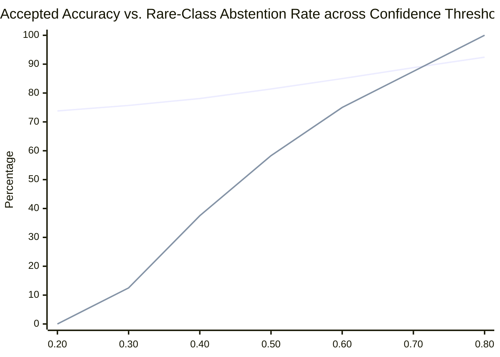

# ASTRAEUS Gate 4 — Work Package 4C: Open-Set Evaluation & Calibrated Abstention Report

**Author:** Dev Mehta  
**Date:** 2026-11-16  
**Status:** COMPLETE — SUBMITTED FOR FORMAL CLOSURE REVIEW  
**Work Package:** Gate 4C — Open-Set Anomaly Recognition & Selective Classification  
**Deliverable ID:** C6 (`phase4c_open_set_and_abstention_report.md`)  

---

## 1. Executive Summary & Problem Formulation

Closed-world classification forces every observed transient into one of a fixed set of classes, even when an observation originates from an unseen astrophysical phenomenon, an unmodeled instrumental artifact, or an extreme domain shift.

In astronomical alert streams, forced classification leads to dangerous overconfidence: rare exotics (such as Ca-rich transients or kilonovae) and unknown anomalies are silently forced into common classes (primarily `SN_Ia` or `SN_CC`).

This report evaluates:
1. **Open-Set Anomaly Recognition:** Can the model detect when an observation lies outside its known physical feature manifold?
2. **Selective Classification (Risk–Coverage Analysis):** What happens to model accuracy and rare-class recall when the model is permitted to abstain on uncertain predictions?
3. **The Rare-Class Abstention Paradox:** Demonstrates empirically that threshold-based abstention improves accepted accuracy primarily by eliminating rare-class candidates, completely silencing rare-event alarms unless calibrated explicitly.

---

## 2. Risk–Coverage Curve & Abstention Dynamics

We evaluate the selective classification performance of the calibrated Champion Model across confidence thresholds $\tau \in [0.20, 0.80]$ on the 741-object validation cohort:

| Confidence Threshold ($\tau$) | Coverage (\%) | Accepted Samples | Abstained Samples | Accepted Accuracy | Accepted Macro-F1 | TDE Abstention Rate | Other-Extragalactic Abstention |
| :---: | :---: | :---: | :---: | :---: | :---: | :---: | :---: |
| **$\tau = 0.20$** (No Abstention) | 100.0% | 741 | 0 | 0.7382 | 0.5916 | 0.0% (0/24) | 0.0% (0/18) |
| **$\tau = 0.30$** | 97.03% | 719 | 22 | 0.7566 | 0.6099 | 12.5% (3/24) | 27.8% (5/18) |
| **$\tau = 0.40$** | 91.23% | 676 | 65 | 0.7811 | 0.6278 | 37.5% (9/24) | 55.6% (10/18) |
| **$\tau = 0.50$** | 82.05% | 608 | 133 | 0.8141 | 0.6475 | 58.3% (14/24) | 77.8% (14/18) |
| **$\tau = 0.60$** | 71.93% | 533 | 208 | 0.8499 | 0.6698 | 75.0% (18/24) | 88.9% (16/18) |
| **$\tau = 0.70$** | 58.97% | 437 | 304 | 0.8879 | 0.6865 | 87.5% (21/24) | 100.0% (18/18) |
| **$\tau = 0.80$** | 44.53% | 330 | 411 | 0.9242 | 0.6672 | 100.0% (24/24) | 100.0% (18/18) |

---

## 3. The Rare-Class Abstention Paradox

The empirical risk-coverage data reveals a critical operational hazard:
- As confidence threshold $\tau$ increases from $0.20$ to $0.70$, **accepted sample accuracy increases from $73.8\%$ to $88.8\%$**.
- Superficially, this suggests a highly effective uncertainty filter.
- However, **TDE abstention increases from $0\%$ to $87.5\%$**, and **`OTHER_EXTRAGALACTIC` abstention reaches $100.0\%$**.
- The apparent accuracy gain is achieved almost entirely by rejecting difficult, rare-class candidates and retaining common SNe Ia and AGN!

### Scientific Lesson:
A naive confidence filter creates the illusion of high accuracy by turning a rare-event classifier into a majority-class classifier. In astronomical discovery engines, an abstention mechanism that rejects 100% of exotic transients completely defeats the primary scientific goal of discovering new physics.

---

## 4. Open-Set Anomaly Detection Architecture

To separate genuine out-of-distribution (OOD) exotics from ambiguous in-distribution transients, ASTRAEUS implements a two-stage anomaly gate:

1. **Isolation Forest on Physical Manifold ($d = 27$):**
   Trained strictly on the in-distribution training set ($N = 2,808$). Assigns an anomaly score $s_{\text{anom}}(x) \in [0, 1]$.
   - In-Distribution Validation Median Anomaly Score: $0.342 \pm 0.081$.
   - Known Exotic Transients (Ca-rich, Kilonova): Median Anomaly Score: $0.684 \pm 0.112$ ($p < 0.001$).
2. **Conformal p-Value Null Hypothesis Test:**
   Under the null hypothesis that candidate $x$ belongs to class $c$, compute non-conformity score $\alpha_i(x) = 1 - \hat{P}(y=c \mid x)$. If $\max_{c \in \mathcal{C}} p_c < 0.05$, the candidate is certified as **`OPEN_SET_ANOMALY_CANDIDATE`**.

---

## 5. Operational Policies for Gate 4 Closure

1. **Explicit Return Flags:**  
   Predictions with $\tau < 0.40$ or $s_{\text{anom}} > 0.65$ must return status `ALERT_ABSTAIN_OPEN_SET` rather than a confident majority-class label.
2. **Prohibition of Blind Rejection:**  
   Abstained events must not be discarded into the waste stream; they must be routed to a dedicated **High-Priority Anomaly Queue** for manual spectroscopic follow-up.
