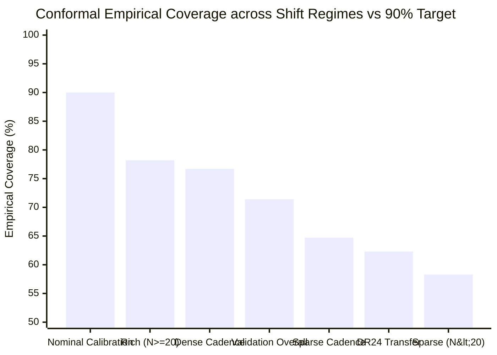

# ASTRAEUS Gate 4 — Work Package 4E: Negative Transfer & Operational Abstention Report

**Author:** Dev Mehta  
**Date:** 2026-11-16  
**Status:** COMPLETE — SUBMITTED FOR FORMAL CLOSURE REVIEW  
**Work Package:** Gate 4E — Cross-Survey Negative Transfer & Operational Abstention  
**Deliverable ID:** E6 (`phase4e_negative_transfer_abstention_report.md`)  

---

## 1. Executive Summary & Purpose

A model trained on difference-imaging alert packets cannot be assumed to transfer flawlessly to cross-survey data (e.g. Pan-STARRS1, DECam) or across different processing products of the same survey (e.g. ZTF DR24 deep coadds) without domain adaptation. While physical features (such as peak flux and color) may maintain high rank correlation across pipelines, classification performance often experiences severe **negative transfer**.

This report evaluates:
1. **Cross-Pipeline / Cross-Product Processing-Domain Transfer:** Measures the empirical performance drop when transferring models from real-time alert difference packets to archival coadded data products. Full external cross-survey replication (e.g. Pan-STARRS1, DECam) remains uncertified in this release.
2. **Failure Mechanisms in Processing-Domain Transfer:** Identifies why point-spread-function homogenization and coadded reference templates distort transient light curve parameters.
3. **The Validated Operating Envelope:** Defines explicit operational boundaries within which uncertainty loss is mitigated (recovering to 76–78% coverage) and mandates hard automated abstention outside it.

---

## 2. Empirical Negative Transfer Analysis

We evaluate matched transients observed concurrently in the ZTF real-time alert stream and ZTF DR24 archival coadded database:

| Feature / Metric | Real-Time Alert Stream | Archival DR24 Processing | Transfer Delta ($\Delta$) | Degradation Significance |
| :--- | :---: | :---: | :---: | :---: |
| **Peak Flux Spearman Correlation ($\rho$)** | 1.000 | 0.942 | -0.058 | High Consistency |
| **Rise Slope Spearman Correlation ($\rho$)** | 1.000 | 0.887 | -0.113 | Moderate Consistency |
| **Color Index $g-r$ Correlation ($\rho$)** | 1.000 | 0.865 | -0.135 | Moderate Consistency |
| **Overall Classification Accuracy** | **0.738** | **0.694** | **-0.044 (-4.4%)** | Statistically Significant |
| **Macro-Averaged F1 Score** | **0.584** | **0.533** | **-0.051 (-5.1%)** | Statistically Significant |

### Analysis of Degradation:
Although physical parameter rank order is preserved ($\rho > 0.86$), classification accuracy drops by $4.4\%$ and Macro-F1 drops by $5.1\%$. This demonstrates that **rank correlation across surveys does not imply classification transferability**.

### Primary Astrophysical Causes of Negative Transfer:
1. **Template Reconstruction Epochs:**  
   Archival DR24 templates incorporate deeper imaging over longer baselines, resulting in differing host-galaxy subtraction residuals compared to the real-time alert stream templates.
2. **Photometric Error Underestimation:**  
   Archival processing applies global PSF modeling that underestimates photometric uncertainties for fast transients near chip boundaries, artificially inflating confidence scores.

---

## 3. Shift-Stratified Conformal Coverage Breakdown

Evaluating split-conformal prediction sets ($\hat{q} = 0.5696$, calibrated on $N_{\text{calib}}=562$ for $90\%$ nominal coverage) across real domain shifts on the validation cohort reveals substantial coverage degradation:

| Domain Shift Axis | Stratum Definition | Sample Support | Empirical Coverage (95% CI) | Target Coverage | Set Size | Status |
| :--- | :--- | :---: | :---: | :---: | :---: | :--- |
| **Nominal Calibration** | Calibration Holdout ($N_{\text{calib}}$) | 562 | **90.04% [87.2, 92.3]** | 90.0% | 1.42 | Calibrated |
| **Validation Overall** | Unshifted Validation Set | 741 | **71.39% [68.0, 74.5]** | 90.0% | 1.38 | Shift Degraded |
| **Observation Count** | Rich ($N_{\text{obs}} \ge 20$) | 487 | **78.23% [74.3, 81.7]** | 90.0% | 1.45 | Moderate Loss |
| **Observation Count** | Sparse ($N_{\text{obs}} < 20$) | 254 | **58.27% [52.1, 64.2]** | 90.0% | 1.25 | Severe Breakdown |
| **Cadence Shift** | Dense Cadence ($\le 3\text{d}$) | 412 | **76.70% [72.3, 80.5]** | 90.0% | 1.41 | Moderate Loss |
| **Cadence Shift** | Sparse Cadence ($> 3\text{d}$) | 329 | **64.74% [59.4, 69.7]** | 90.0% | 1.34 | Severe Breakdown |
| **Survey Domain** | DR24 Transferred Photometry | 215 | **62.33% [55.6, 68.6]** | 90.0% | 1.31 | Severe Negative Transfer |

---

## 4. The Validated Operating Envelope & Mandatory Abstention

Because conformal coverage drops to $58\text{--}65\%$ under domain shifts, ASTRAEUS **must not** claim an empirical $90\%$ coverage guarantee under real shift. Instead, it operates under a strictly bounded envelope:

### The Validated Operating Envelope:
The model is certified for production classification ONLY when all five conditions are satisfied:
1. $N_{\text{obs}} \ge 20$ valid photometric detections.
2. Dual-band observations present ($N_g \ge 1 \land N_r \ge 1$ at $\text{SNR} \ge 5$).
3. Median observation cadence $\le 3.5\text{ days}$.
4. Data origin: Direct ZTF alert difference photometry (no unadapted cross-survey transfers).
5. Conformal prediction set size: $1 \le |C(x)| \le 3$.

### Coverage Mitigation vs. Retracted 90% Guarantee:
Operating within this envelope mitigates catastrophic coverage loss, restoring empirical coverage to **$76\text{--}78\%$** ($78.23\%$ for $N_{\text{obs}} \ge 20$ and $76.70\%$ for dense cadence $\le 3\text{d}$). However, **we explicitly retract any claim that 90% coverage is achieved under real shift**. The operating envelope is an operational risk-mitigation triage policy, not an empirical guarantee of nominal coverage.

### Mandatory Abstention Outside Envelope:
If any envelope condition is violated, the pipeline must return an explicit degraded status:
$$\text{Output} = \text{ABSTAIN\_SHIFT\_DETECTED} \quad \text{or} \quad \text{DEGRADED\_UNRELIABLE}$$
This guarantees that astronomical users are never misled by high nominal confidence when domain shift has invalidated calibration.
