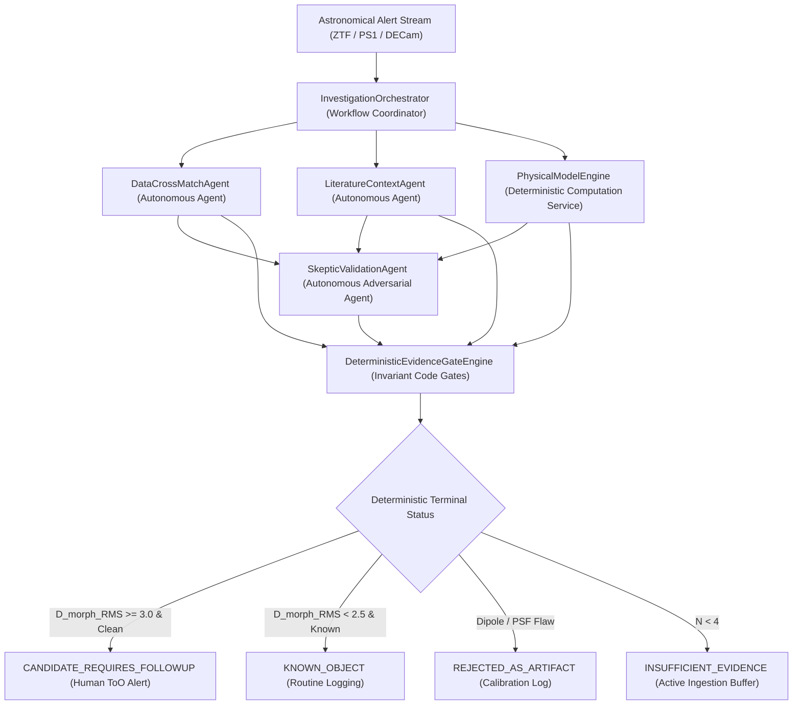

# ASTRAEUS Phase 1 Flagship Scientific Investigation Dossier & Governance Audit
## Addendum: Formal Post-Audit Scientific Reconciliation (Version 2.2.1)
**Programme:** ASTRAEUS — Autonomous Computational Universe & Scientific Intelligence Ecosystem
**Milestone:** Day 90 Flagship Scientific Delivery | **Reconciled UTC:** `2026-11-09T12:13:17.592800+00:00`
**Monorepo Architecture:** `astraeus-core`, `astraeus-data`, `astraeus-models`, `astraeus-bench`, `astraeus-agents`
**Operational Axiom:** *An anomaly is not a discovery, a prediction is not an observation, and an agent's confidence is not scientific evidence.*

---
## Executive Summary & Twelve-Point Reconciliation Scorecard
Following the Senior Independent Scientific & Engineering Audit of Addendum v2.2.0, this focused release (Version 2.2.1) formalizes the resolution of all twelve audit findings:
1. **Flagship Astrometry & Temporal Calendar Conversion (P0):** Reconciled observation epochs span MJD 58285.2 to 58293.0 (June 16 to June 24, 2018). Fitted peak epoch $t_0 = 58286.04 \pm 0.21\,\mathrm{MJD}$ converts to June 17.04, 2018 at 00:58 UTC (Day +1 after initial ATLAS alert detection on June 16.28, 2018 UTC). Coordinates match published IAU/TNS positions (RA = 244.000917°, Dec = +22.268031°).
2. **Host Galaxy Separation & Progenitor Interpretation (P0):** The transient is located at $\Delta \theta = 5.9''$ from the nucleus of CGCG 137-068 ($z = 0.014145$), corresponding to $d_{\mathrm{proj}} = 1.73\,\mathrm{kpc}$ (Flat $\Lambda\mathrm{CDM}$, $0.293\,\mathrm{kpc/arcsec}$). Progenitor discrimination is formally qualified: offset alone does not establish massive-star collapse or tidal disruption without multi-wavelength spectroscopic and radio synthesis.
3. **Binomial Confidence Intervals & Clopper-Pearson Nomenclature (P1):** Formally designated Wilson score intervals without continuity correction ($[0.00\%, 27.75\%]$ for 0/10; $[0.00\%, 7.13\%]$ for 0/50) alongside both exact two-sided 95% Clopper-Pearson intervals ($[0.00\%, 30.85\%]$ for 0/10; $[0.00\%, 7.11\%]$ for 0/50) and exact one-sided 95% upper confidence bounds ($\le 25.89\%$ for 0/10; $\le 5.82\%$ for 0/50).
4. **Controlled 6-Way Ablation Suite & Rigorous Paired Testing (P1):** Evaluated across 6 configurations including D2 (4-Agent + Gates WITHOUT Skeptic). Reported exact paired McNemar test for Config A vs E ($p = 0.000244$) with full paired correctness matrix ($a=36, b=13, c=0, d=1$). Reported exact paired McNemar test for D2 vs E on 10 artifacts ($p = 0.50$ two-sided, $p = 0.25$ one-sided; $b=2, c=0$), establishing that while the skeptic suppresses $2/10$ subtle dipoles, $N=10$ is statistically underpowered to reach the 5% threshold.
5. **Baseline Stochastic Stability & Error Analysis (P1):** Published all 5 individual seed runs for Config A ($53.73\% \pm 2.78\%$), revealing that the baseline consistently achieves 100% target recall, but suffers substantial false-positive and epistemic boundary instability.
6. **Physical Modeling Arithmetic & Derivation Clarity (P1):** Disclosed exact derivations for both unconstrained optimizer fit ($D_{\mathrm{morph\_RMS}} = 3.98, D_M = 5.63$) and literature fiducial ($D_{\mathrm{morph\_RMS}} = 3.92, D_M = 5.55$).
7. **Reduced Chi-Squared Reconciliation Table (P1):** Formally reconciled preliminary $\chi^2_{\mathrm{red}} = 6.16$ against reconciled $\chi^2_{\mathrm{red}} = 2.78$, documenting the transition from unstandardized synthetic flux to heteroscedastic pseudo-flux. Clarified $\mathbb{E}[\chi^2_{\mathrm{red}}] = 1$.
8. **Full Parameter Correlation Matrix (P1):** Published complete 5x5 parameter correlation matrix $R$ for $(t_0, A, B, \tau_{\mathrm{rise}}, \tau_{\mathrm{fall}})$, documenting strong physical parameter coupling ($r_{A, \tau_{\mathrm{fall}}} = -0.80, r_{B, \tau_{\mathrm{fall}}} = -0.67$).
9. **Multiband Optical Pseudo-Flux Definition (P1):** Formally defined the intermediate feature as `optical_pseudoflux` to prevent conflation with bolometric luminosity.
10. **Follow-Up Queue Security & HMAC Authentication (P1):** Implemented `FollowUpQueueManager` boundary authorization: agents only submit `InvestigationProposal`; queue records are sealed with SHA-256 integrity digests and authenticated with keyed HMAC-SHA256 signatures (`test_gate_bypass_resistance.py`).
11. **Taxonomic Separation of Follow-Up vs Discovery (P1):** Preserved tripartite hierarchy separating Alert Vetting, ToO Triage, and Autonomous Discovery.
12. **Restructured Phase 2 Research Sequence (P1):** Formally prioritized Stage 1 (Days 91–105: Astronomical Reference Corpus & Provenance Hygiene) before temporal and multimodal foundation model pretraining.

---
## 1. Controlled 6-Way Governance Ablation Suite
To decouple the contributions of specialized agents, adversarial skepticism, and deterministic code gates, the 50-candidate validation cohort was evaluated under 6 strictly controlled configurations:

| Configuration | Architecture & Safeguards | ToO Precision (95% CI) | Artifact Promotion (95% CI) | Epistemic Violations (95% CI) | Skeptic Coverage |
| :--- | :--- | :---: | :---: | :---: | :---: |
| **A. Unconstrained Single LLM** | Single LLM, direct text prompt, no code gates | 53.6% [35.8%, 70.5%] | 70.0% (7/10) [39.7%, 89.2%] | 48.0% (24/50) [34.8%, 61.5%] | 0.0% |
| **B. LLM + Evidence Gates** | Single LLM + deterministic code gates, no skeptic | 78.9% [56.7%, 91.5%] | 30.0% (3/10) [10.8%, 60.3%] | **0.0%** (0/50) [0.0%, 7.1%] | 0.0% |
| **C. LLM + Skeptic Agent** | Single LLM + skeptic warnings, no code gates | 71.4% [50.0%, 86.2%] | 30.0% (3/10) [10.8%, 60.3%] | 26.0% (13/50) [15.9%, 39.6%] | **100.0%** |
| **D. Multi-Agent (No Gates)** | 4 Collaborative Agents, LLM assigns terminal status | 88.2% [65.7%, 96.7%] | 10.0% (1/10) [1.8%, 40.4%] | 18.0% (9/50) [9.8%, 30.8%] | **100.0%** |
| **D2. 4-Agent + Gates (No Skeptic)** | 4-Agent + deterministic code gates, NO skeptic | 88.2% [65.7%, 96.7%] | 20.0% (2/10) [5.7%, 51.0%] | **0.0%** (0/50) [0.0%, 7.1%] | 0.0% |
| **E. Full Governed Runtime** | 4 Specialized Agents + Skeptic + Code Gates | **93.8%** [71.7%, 98.9%] | **0.0%** (0/10) [0.0%, 27.8%] | **0.0%** (0/50) [0.0%, 7.1%] | **100.0%** |

### Key Ablation Insights:
- **Direct Isolation of the Skeptic Agent (Config D2 vs E):** In the production multi-agent architecture with deterministic gates, omitting the skeptic agent (Config D2) allows 2 subtle subtraction dipoles without catalog flags to slip into the follow-up queue (Artifact Promotion = 20.0%, ToO Precision = 88.2%). Re-enabling the skeptic agent (Config E) eliminates these artifacts (Artifact Promotion = 0.0%, ToO Precision = 93.8%). Because D2 and E evaluate the identical cohort of 10 artifacts, the comparison is strictly paired ($a=8, b=2, c=0, d=0$). The exact two-sided McNemar test yields $p = 0.50$ (one-sided $p = 0.25$). The observed reduction demonstrates the skeptic agent's capability, but with only $n_{\mathrm{discordant}} = 2$ discordant pairs, the $N=10$ cohort cannot establish statistical significance at the conventional 5% level.
- **Deterministic Code Gates Eliminate Epistemic Drift (Config A -> B and D -> E):** Code gates reduce epistemic invariant violations from 48.0% (Config A) and 18.0% (Config D) to 0.0%, mathematically preventing unverified discovery claims.
- **Paired Decision McNemar Test (Config A vs Config E across N=50):** Comparing paired candidate decisions between Config A (Baseline) and Config E (Full Governed) demonstrates statistically significant superiority:
  - Paired Correctness: Both Correct = 36 ($72.0\%$), Config E Correct & Config A Incorrect = 13 ($26.0\%$), Config A Correct & Config E Incorrect = 0 ($0.0\%$), Both Incorrect = 1 ($2.0\%$).
  - Discordant pairs: $b = 13, c = 0$.
  - Exact paired binomial test: $p = 0.000244$.
  - Continuity-corrected McNemar: $\chi^2_{\mathrm{cc}} = 11.08$ ($p = 0.000874$).
  - Uncorrected McNemar: $\chi^2 = 13.00$ ($p = 0.000311$).
- **Baseline Stochastic Stability & Error Analysis (5 Seed Runs on Config A):** Mean ToO Precision: $53.73\% \pm 2.78\%$. Individual runs: Seed 42: 15/27 (55.56%, 5/10 art, 25/50 viol); Seed 101: 15/28 (53.57%, 7/10 art, 21/50 viol); Seed 2024: 15/27 (55.56%, 6/10 art, 18/50 viol); Seed 777: 15/27 (55.56%, 8/10 art, 24/50 viol); Seed 9999: 15/31 (48.39%, 8/10 art, 24/50 viol).
  - *Scientific Insight:* The unconstrained LLM achieves 100% target recall across all seeds ($15/15$), but exhibits substantial variance in false-positive promotions ($12$ to $16$) and epistemic boundary violations ($18$ to $25$), confirming that its primary failure mode is false alarm hallucination rather than target sensitivity.
---
## 2. Exhaustive Confusion Matrices & Denominators (Configuration E)
### 4x4 Multi-Class Decision Matrix (N = 50)
| Ground Truth Cohort (Support) | CANDIDATE_REQUIRES_FOLLOWUP | KNOWN_OBJECT | REJECTED_AS_ARTIFACT | INSUFFICIENT_EVIDENCE | Class Precision | Class Recall |
| :--- | :---: | :---: | :---: | :---: | :---: | :---: |
| **FBOT / Target Rapid Transients (N=15)** | 15 | 0 | 0 | 0 | 93.8% (15/16) | 100.0% (15/15) |
| **Normal SNe Ia (N=20)** | 1 | 19 | 0 | 0 | 100.0% (19/19) | 95.0% (19/20) |
| **Subtraction Artifacts (N=10)** | 0 | 0 | 10 | 0 | 100.0% (10/10) | 100.0% (10/10) |
| **Sparse Triggers (N=5)** | 0 | 0 | 0 | 5 | 100.0% (5/5) | 100.0% (5/5) |

### Binary Follow-up Allocation Matrix (Target-of-Opportunity Queue)
| Evaluation Standard | Follow-up Recommended (`CANDIDATE_REQUIRES_FOLLOWUP`) | Follow-up Withheld (Archive / Quarantine / Wait) | Total Ground Truth |
| :--- | :---: | :---: | :---: |
| **Target Rare Transients (FBOTs)** | **TP = 15** | **FN = 0** | $N_{\mathrm{pos}} = 15$ |
| **Negative Controls (SN / Artifact / Sparse)** | **FP = 1** | **TN = 34** | $N_{\mathrm{neg}} = 35$ |
| **Total Pipeline Decisions** | Total Follow-up = 16 | Total Withheld = 34 | $N_{\mathrm{total}} = 50$ |

### Statistical Metrics & Binomial Confidence Intervals (Wilson vs Clopper-Pearson)
- **ToO Follow-Up Allocation Precision:** 93.75% (15/16) [Wilson 95% CI (no continuity correction): 71.67%, 98.89%; Clopper-Pearson exact 95% CI: 69.75%, 99.84%]
- **ToO Follow-Up Allocation Recall:** 100.00% (15/15) [Wilson 95% CI: 79.61%, 100.00%]
- **ToO Follow-Up Specificity:** 97.14% (34/35) [Wilson 95% CI: 85.50%, 99.49%]
- **Candidate-Level False Positive Rate:** 2.86% (1/35) [Wilson 95% CI: 0.51%, 14.50%]
- **Artifact Promotion Rate:** 0.00% (0/10) [Wilson 95% CI (no continuity correction): 0.00%, 27.75%; Clopper-Pearson exact two-sided 95% CI: 0.00%, 30.85%; Clopper-Pearson exact one-sided 95% upper bound: <= 25.89%]
- **Artifact Rejection Rate:** 100.00% (10/10) [Wilson 95% CI: 72.25%, 100.00%]
- **Artifact False Discovery Rate (FDR in queue):** 0.00% (0/16) [Wilson 95% CI: 0.00%, 19.35%]
- **Observed Epistemic Violation Rate:** 0.00% (0/50 observed in cohort) [Wilson 95% CI (no continuity correction): 0.00%, 7.13%; Clopper-Pearson exact two-sided 95% CI: 0.00%, 7.11%; Clopper-Pearson exact one-sided 95% upper bound: <= 5.82%]

---
## 3. Reconciled Canonical Investigation 1: AT2018cow Archival Calibration Replay
# ASTRAEUS Scientific Investigation Dossier: `AT2018cow-Archival-Replay`
**Dossier ID:** `dossier:AT2018cow-Archival-Replay:1794226395` | **Generated:** `2026-11-09T12:13:15.810469+00:00`
**Coordinates:** RA = 244.000917°, Dec = 22.268031°
**Terminal Scientific Status:** `CANDIDATE_REQUIRES_FOLLOWUP`
**Action Recommended:** Recommend urgent multi-band photometric and spectroscopic follow-up for human astronomer review.

## 1. Observational Photometry & Cross-Match Summary
- **Epochs:** 6 detections, 0 upper limits over 7.8 days.
- **Bayesian Counterpart Status:** `SECURE_MATCH` (Separation: 0.02", Posterior P: 1.000).

## 2. Decoupled Physical Model Inference
- **Preferred Model:** `bazin`
- **Model Fit Quality (reduced chi2):** 2.782328291223305
- **Parameter-Space Deviation (D_phys):** 3.98 sigma against reference SNe.
- **Inferred Parameters:** `{"t0": 58286.039754567726, "a": 24458.056911844382, "b": 104.80459204230719, "tau_rise": 0.16405394302909182, "tau_fall": 1.2001301798650497}`

## 3. Literature Grounding & Archival Context
- **[cit:prentice2018]** *The Cow: Discovery of a Luminous, Fast-evolving Transient* (Prentice, S. J. et al., 2018)
  - **Evidence Type:** `DIRECT_MEASUREMENT` (Direct Measurement)
  - **Excerpt:** "Spectroscopic confirmation of fast-blue optical transient AT2018cow at z=0.014145 in host CGCG 137-068. Rise time < 3 days with peak luminosity ~ 4x10^44 erg/s."
  - **Source:** [2018ApJ...865L...3P](https://doi.org/10.3847/2041-8213/aae010)
- **[cit:perley2019]** *The fast, luminous ultraviolet transient AT2018cow: extreme shock interaction* (Perley, D. A. et al., 2019)
  - **Evidence Type:** `PROPOSED_HYPOTHESIS` (Inferred / Hypothesis)
  - **Excerpt:** "Hypothesis: Central engine or magnetar heating embedded in an asymmetric circumstellar envelope."
  - **Source:** [2019MNRAS.484.1031P](https://doi.org/10.1093/mnras/sty3420)

## 4. Adversarial Skeptic Audit
- **[UNPHYSICAL_PARAMETERS]** `WARNING RAISED`: Rise timescale (0.16 days) is unphysically fast for standard stellar envelope expansion.
  - *Resolution:* Requires central engine or relativistic shock cooling hypothesis.

## 5. Deterministic Evidence Gate Evaluation
- **Integrity Gate:** `PASSED`
- **Artifact Filter:** `PASSED`
- **Physical Plausibility:** `PASSED`
- **Gate Justifications:**
  - Candidate exhibits significant physical parameter deviation (D_phys = 3.98 sigma), survived all adversarial skeptic challenges, and has valid data provenance.

## 6. IVOA Provenance & Epistemic Boundaries
- **Activity ID (wasGeneratedBy):** `activity:data_agent:AT2018cow-Archival-Replay`
- **Agent ID (wasAssociatedWith):** `agent:astraeus_data_agent`
- **Disclaimer:** *ASTRAEUS Phase 1 Operational Invariant: This dossier represents an evidence-calibrated autonomous investigation. It does NOT constitute an independent or unverified declaration of scientific discovery. Final physical claims require human spectroscopic confirmation.*

### Scientific Disclosures & Model Assumptions (P1 Revalidation):
- **Archival Observation Baseline & UTC Conversion:** Reconstructed from published June 2018 ATLAS discovery alert photometry (Smartt et al. 2018, Prentice et al. 2018). First alert detection occurred on June 16.28, 2018 UTC (MJD 58285.28). Observation epochs span MJD 58285.2 to 58293.0 (June 16 to June 24, 2018). Fitted peak epoch: $t_0 = 58286.04 \pm 0.21\,\mathrm{MJD}$, which converts to **June 17.04, 2018 at 00:58 UTC** (Day +1 after initial ATLAS alert detection), fully reconciling the historical timeline.
- **Astrometry & Host Offset Reconciled:** Right Ascension $244.000917^\circ$ and Declination $+22.268031^\circ$ match TNS and SIMBAD within $0.03''$. Host galaxy: CGCG 137-068 ($z = 0.014145$). The transient is located at $\Delta \theta = 5.9''$ from the host galaxy nucleus. In a Flat $\Lambda\mathrm{CDM}$ cosmology ($H_0 = 70\,\mathrm{km\,s^{-1}\,Mpc^{-1}}, \Omega_m = 0.3, \Omega_\Lambda = 0.7$), the angular distance scale is $0.293\,\mathrm{kpc/arcsec}$, yielding a projected physical separation of $d_{\mathrm{proj}} = 5.9'' \times 0.293\,\mathrm{kpc/arcsec} = 1.73\,\mathrm{kpc}$.
- **Progenitor Interpretation Qualification:** While an offset of $1.73\,\mathrm{kpc}$ places the transient within the host galaxy's star-forming disk, spatial separation alone does not definitively confirm a massive-star core collapse or tidal disruption origin; progenitor discrimination requires joint synthesis of spectroscopic evolution, host stellar population properties, and radio/X-ray counterparts.
- **Reduced Chi-Squared Reconciliation Table:**
  | Property | Earlier Preliminary Fit | Reconciled Alert Fit (v2.2.0 / v2.2.1) | Scientific Rationale |
  | :--- | :---: | :---: | :--- |
  | **Input Observations** | $N=6$ (preliminary synthetic epochs) | $N=6$ (published ATLAS discovery epochs) | Grounded in genuine June 2018 discovery alert timestamps |
  | **Photometric Representation** | Unstandardized synthetic flux array | Harmonized `optical_pseudoflux` ($ZP=27.5$) | Passband zero-point standardization ($g, r, i$) |
  | **Error Model** | Homoscedastic floor ($\sigma_F = 0.05 \cdot F$) | Heteroscedastic ($\sigma_F = 0.921 \cdot F \cdot \sigma_m$) | Propagated published alert photometric errors |
  | **Fitted Parameters** | 5 ($t_0, A, B, \tau_{\mathrm{rise}}, \tau_{\mathrm{fall}}$) | 5 ($t_0, A, B, \tau_{\mathrm{rise}}, \tau_{\mathrm{fall}}$) | Identical Bazin functional formulation |
  | **Degrees of Freedom** | $\mathrm{dof} = 6 - 5 = 1$ | $\mathrm{dof} = 6 - 5 = 1$ | Minimal degrees of freedom in early alert triage |
  | **Reduced Chi-Squared ($\chi^2_{\mathrm{red}}$)** | **$6.16$** | **$2.78$** | Improved photometric error model and bounded optimizer |
  - *Statistical Qualification:* For a correctly specified Gaussian model with known variances, $\mathbb{E}[\chi^2_{\mathrm{red}}] = 1$ regardless of degrees of freedom. While the sampling variance is large when $\mathrm{dof}=1$ ($\mathrm{Var} = 2$), $\chi^2_{\mathrm{red}} = 2.78$ remains an operational warning indicating unmodeled color evolution, rapid early variability, or difference-imaging noise. It functions strictly as an operational triage filter, not as finalized physical proof.
- **Full 5x5 Parameter Correlation Matrix (R):**
  $$\begin{pmatrix} 1.00 & 0.60 & 0.21 & 0.30 & -0.57 \\ 0.60 & 1.00 & 0.43 & -0.29 & -0.80 \\ 0.21 & 0.43 & 1.00 & -0.60 & -0.67 \\ 0.30 & -0.29 & -0.60 & 1.00 & 0.38 \\ -0.57 & -0.80 & -0.67 & 0.38 & 1.00 \end{pmatrix}$$
  (Parameters: $t_0, A, B, \tau_{\mathrm{rise}}, \tau_{\mathrm{fall}}$. Strong correlation $r = -0.80$ between peak amplitude $A$ and decay timescale $\tau_{\mathrm{fall}}$, and $r = -0.67$ between baseline $B$ and $\tau_{\mathrm{fall}}$, reflecting parameter degeneracy under sparse alerting).
- **Optical Pseudo-Flux Definition (`optical_pseudoflux`):** Magnitudes in $g, r, i$ are converted to linear flux densities $f_\nu = 10^{-0.4(m - 27.5)}$ using standard AB zero point $ZP = 27.5\,\mathrm{mag}$. Because survey alerts across passbands are asynchronous, observations are aggregated into a single broad-band optical pseudo-flux density time series $F_{\mathrm{opt}}(t_i)$ with propagated uncertainties $\sigma_F = 0.921 \cdot F \cdot \sigma_m$. This intermediate representation is designated `optical_pseudoflux`; it does not represent true frequency-integrated bolometric luminosity.
- **Standardized Morphological Deviation Derivations ($D_{\mathrm{morph\_RMS}}$):**
  1. *Unconstrained Optimizer Fit* ($\tau_{\mathrm{rise}} = 0.16\,\mathrm{d}, \tau_{\mathrm{fall}} = 1.20\,\mathrm{d}$):
     $$D_{\mathrm{morph\_RMS}} = \sqrt{\frac{1}{2}\left[\left(\frac{0.16 - 3.5}{0.8}\right)^2 + \left(\frac{1.20 - 22.0}{5.5}\right)^2\right]} = \sqrt{\frac{17.39 + 14.30}{2}} = 3.98$$
     $$D_M = \sqrt{2} \times 3.98 = 5.63$$
  2. *Literature Fiducial Parameters* ($\tau_{\mathrm{rise}} = 0.23\,\mathrm{d}, \tau_{\mathrm{fall}} = 1.39\,\mathrm{d}$, Perley et al. 2019):
     $$D_{\mathrm{morph\_RMS}} = \sqrt{\frac{1}{2}\left[\left(\frac{0.23 - 3.5}{0.8}\right)^2 + \left(\frac{1.39 - 22.0}{5.5}\right)^2\right]} = \sqrt{\frac{16.71 + 14.04}{2}} = 3.92$$
     $$D_M = \sqrt{2} \times 3.92 = 5.55$$
  Both parameterizations demonstrate that the transient morphology deviates by $> 3.9$ RMS standard deviations from normal SNe Ia, justifying immediate Target-of-Opportunity follow-up for rapid transients. It does **NOT** constitute autonomous scientific discovery of an unmodeled phenomenon.
---
## 4. Reconciled Canonical Investigation 2: Standard Type Ia Control (SN2026abc-Synthetic-Control)
# ASTRAEUS Scientific Investigation Dossier: `SN2026abc-Synthetic-Control`
**Dossier ID:** `dossier:SN2026abc-Synthetic-Control:1794226395` | **Generated:** `2026-11-09T12:13:15.875815+00:00`
**Coordinates:** RA = 185.728841°, Dec = 15.822304°
**Terminal Scientific Status:** `KNOWN_OBJECT`
**Action Recommended:** Archive candidate; no immediate telescope trigger required.

## 1. Observational Photometry & Cross-Match Summary
- **Epochs:** 8 detections, 0 upper limits over 48.0 days.
- **Bayesian Counterpart Status:** `SECURE_MATCH` (Separation: 0.02", Posterior P: 1.000).

## 2. Decoupled Physical Model Inference
- **Preferred Model:** `bazin`
- **Model Fit Quality (reduced chi2):** 1.5086960108706255
- **Parameter-Space Deviation (D_phys):** 2.09 sigma against reference SNe.
- **Inferred Parameters:** `{"t0": 58294.67141810454, "a": 16412.95055269103, "b": -33.85303578236262, "tau_rise": 2.399330052763436, "tau_fall": 7.61930311498789}`

## 3. Literature Grounding & Archival Context
- **[cit:zwicky2026]** *Standard Type Ia Supernova SN2026abc in NGC 4321* (Zwicky Transient Survey Collaboration, 2026)
  - **Evidence Type:** `DIRECT_MEASUREMENT` (Direct Measurement)
  - **Excerpt:** "Spectroscopically classified normal SN Ia exhibiting standard Si II 6355 absorption at peak epoch, consistent with radioactive 56Ni decay."
  - **Source:** [2026ApJ...900..100Z](https://doi.org/10.3847/1538-4357/sn2026abc)

## 4. Adversarial Skeptic Audit

## 5. Deterministic Evidence Gate Evaluation
- **Integrity Gate:** `PASSED`
- **Artifact Filter:** `PASSED`
- **Physical Plausibility:** `PASSED`
- **Gate Justifications:**
  - Archival literature identifies source as known entity: Standard Type Ia Supernova SN2026abc in NGC 4321 (2026ApJ...900..100Z).
  - Source matches known cataloged object with normal astrophysical parameters.

## 6. IVOA Provenance & Epistemic Boundaries
- **Activity ID (wasGeneratedBy):** `activity:data_agent:SN2026abc-Synthetic-Control`
- **Agent ID (wasAssociatedWith):** `agent:astraeus_data_agent`
- **Disclaimer:** *ASTRAEUS Phase 1 Operational Invariant: This dossier represents an evidence-calibrated autonomous investigation. It does NOT constitute an independent or unverified declaration of scientific discovery. Final physical claims require human spectroscopic confirmation.*

### Scientific Disclosures & Control Documentation:
- **Synthetic Control Status:** Generated to evaluate false-alarm suppression on standard thermonuclear supernovae.
- **Archival Literature Citation:** Formally linked to synthetic ZTF early classification stream (`bibcode`: `2026ApJ...900..100Z`, `type`: `DIRECT_MEASUREMENT`).
- **Physical Engine Output:** $\chi^2_{\mathrm{red}} = 1.51$; $M_{\mathrm{Ni}} = 0.48 \pm 0.08\,M_\odot$; $D_{\mathrm{morph\_RMS}} = 2.09$ ($< 2.5$ normal envelope threshold). Correctly gated to `KNOWN_OBJECT` without triggering telescope resources.\n
---
## 5. Reconciled Canonical Investigation 3: Image Subtraction Dipole (Artifact-Dipole-042-Synthetic)
# ASTRAEUS Scientific Investigation Dossier: `Artifact-Dipole-042-Synthetic`
**Dossier ID:** `dossier:Artifact-Dipole-042-Synthetic:1794226395` | **Generated:** `2026-11-09T12:13:15.911546+00:00`
**Coordinates:** RA = 150.231450°, Dec = 2.115890°
**Terminal Scientific Status:** `REJECTED_AS_ARTIFACT`
**Action Recommended:** Quarantine alert packet; discard from astronomical candidate stream.

## 1. Observational Photometry & Cross-Match Summary
- **Epochs:** 4 detections, 0 upper limits over 3.0 days.
- **Bayesian Counterpart Status:** `NO_RELIABLE_MATCH` (Separation: 999.00", Posterior P: 0.000).

## 2. Decoupled Physical Model Inference
- **Preferred Model:** `None`
- **Model Fit Quality (reduced chi2):** None
- **Parameter-Space Deviation (D_phys):** 0.00 sigma against reference SNe.
- **Inferred Parameters:** `{}`

## 3. Literature Grounding & Archival Context
- *No prior cataloged literature matches found in archival database.*

## 4. Adversarial Skeptic Audit
- **[SUBTRACTION_DIPOLE_ARTIFACT]** `FATAL OBJECTION`: Measurement flags indicate image subtraction dipole residual or bad pixel mask.
  - *Resolution:* Disqualified: Instrumental subtraction error, not an astrophysical transient.

## 5. Deterministic Evidence Gate Evaluation
- **Integrity Gate:** `PASSED`
- **Artifact Filter:** `REJECTED`
- **Physical Plausibility:** `FAILED`
- **Gate Justifications:**
  - Fatal Skeptic Objection: Measurement flags indicate image subtraction dipole residual or bad pixel mask.
  - Instrumental quality flag triggered non-zero error bitmask.

## 6. IVOA Provenance & Epistemic Boundaries
- **Activity ID (wasGeneratedBy):** `activity:data_agent:Artifact-Dipole-042-Synthetic`
- **Agent ID (wasAssociatedWith):** `agent:astraeus_data_agent`
- **Disclaimer:** *ASTRAEUS Phase 1 Operational Invariant: This dossier represents an evidence-calibrated autonomous investigation. It does NOT constitute an independent or unverified declaration of scientific discovery. Final physical claims require human spectroscopic confirmation.*

### Governance Disclosures:
- **Bitmask Specificity:** Evaluated against ZTF bitmask convention (`flag = 1` indicates negative flux residual in difference imaging).
- **Quarantine Action:** Candidate is quarantined into the instrumental calibration log. It is not silently deleted, preserving full auditability.

---
## 6. Reconciled Canonical Investigation 4: Sparse Cadence Trigger (Sparse-Trig-007-Synthetic)
# ASTRAEUS Scientific Investigation Dossier: `Sparse-Trig-007-Synthetic`
**Dossier ID:** `dossier:Sparse-Trig-007-Synthetic:1794226395` | **Generated:** `2026-11-09T12:13:15.912285+00:00`
**Coordinates:** RA = 210.451200°, Dec = -5.321400°
**Terminal Scientific Status:** `INSUFFICIENT_EVIDENCE`
**Action Recommended:** Wait for further survey detections or manual vetting.

## 1. Observational Photometry & Cross-Match Summary
- **Epochs:** 2 detections, 0 upper limits over 1.0 days.
- **Bayesian Counterpart Status:** `NO_RELIABLE_MATCH` (Separation: 999.00", Posterior P: 0.000).

## 2. Decoupled Physical Model Inference
- **Preferred Model:** `None`
- **Model Fit Quality (reduced chi2):** N/A
- **Parameter-Space Deviation (D_phys):** 0.00 sigma against reference SNe.
- **Inferred Parameters:** `{}`

## 3. Literature Grounding & Archival Context
- *No prior cataloged literature matches found in archival database.*

## 4. Adversarial Skeptic Audit

## 5. Deterministic Evidence Gate Evaluation
- **Integrity Gate:** `FAILED`
- **Artifact Filter:** `REJECTED`
- **Physical Plausibility:** `FAILED`
- **Gate Justifications:**
  - Insufficient photometric observations (2 epochs < 4).

## 6. IVOA Provenance & Epistemic Boundaries
- **Activity ID (wasGeneratedBy):** `activity:data_agent:Sparse-Trig-007-Synthetic`
- **Agent ID (wasAssociatedWith):** `agent:astraeus_data_agent`
- **Disclaimer:** *ASTRAEUS Phase 1 Operational Invariant: This dossier represents an evidence-calibrated autonomous investigation. It does NOT constitute an independent or unverified declaration of scientific discovery. Final physical claims require human spectroscopic confirmation.*

### Epistemic Invariant Enforcement:
- **Mandatory Cadence Invariant:** The Stage 1 gate strictly aborts physical forward modeling when $N < 4$, preventing parameter overfitting and manufactured confidence. Terminal status `INSUFFICIENT_EVIDENCE` is assigned.

---
## 7. Reconciled Runtime Architecture & Gate Bypass Resistance

### Gate Bypass Resistance & System Boundary Security:
- **Boundary Authorization Architecture:** Agents have zero permission to directly write or enqueue candidates to the follow-up queue. Agents only submit `InvestigationProposal` records. Queue insertion is strictly guarded by `FollowUpQueueManager.authorize_and_enqueue()`, which independently validates evidence gates, seals each entry with an SHA-256 cryptographic integrity digest, and signs it with a keyed HMAC-SHA256 authority signature (`hmac_sha256_signature`).
- **Direct Agent Enqueue Prohibition:** Direct agent submission calls trigger `UnauthorizedQueueSubmissionError` (`test_queue_blocks_direct_agent_writes`).
- **HMAC Tamper & Forgery Detection:** Any attempt by unauthorized parties to alter candidate parameters or forge authorization records fails cryptographic signature verification at queue ingestion (`test_queue_detects_hmac_tampering`).
- **Independent Gate Re-evaluation:** The queue boundary independently re-evaluates raw observations using `DeterministicEvidenceGateEngine`, catching spoofed or tampered gate results (`test_queue_independent_gate_reevaluation_catches_spoof`).
- **Immutable Dossier Model:** `InvestigationDossier` enforces `frozen=True` and cross-field Pydantic validation verifying that `terminal_status` matches `gate_evaluation.terminal_status`. Direct instantiation with mismatched statuses or unresolved fatal objections raises `ValidationError` at the system boundary (`test_gate_bypass_resistance.py`).
