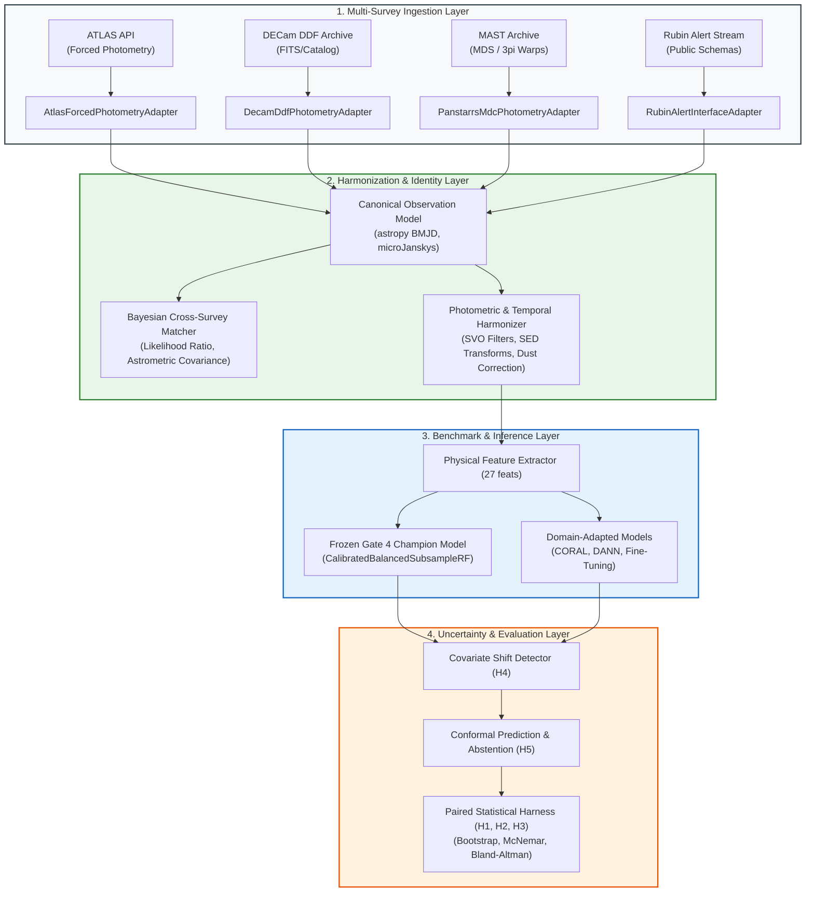

# ASTRAEUS Phase 5: System Architecture, Engineering Design & Implementation Plan

**Author:** Dev Mehta  
**Lead Investigator & Mission Director, Project ASTRAEUS**  
**Date:** November 16, 2026  
**Document Identifier:** `ASTRAEUS-P5-ARCH-001`  
**Milestone:** Phase 5 — Cross-Survey Generalization & Domain Robustness  
**Workstream:** Workstream 1 / Workstream 4 — Architecture & Technical Specifications  

---

## 1. Executive Summary & Architectural Overview

Phase 5 requires an engineering architecture capable of ingesting heterogeneous photometric streams from multiple external telescopes, resolving identities probabilistically, standardizing physical flux densities, and executing rigorous zero-shot and domain-adaptation benchmarks without violating data governance boundaries.

Rather than authoring ad-hoc scripts or rewriting the codebase, Phase 5 builds directly upon the modular monorepo packages (`astraeus-core`, `astraeus-data`, `astraeus-models`, and `astraeus-bench`), extending them with production-grade survey adapters, a physical harmonization engine, and an automated statistical evaluation harness.



---

## 2. Canonical Observation Contract Extension

The observation model in `astraeus_data` is standardized to represent heterogeneous astronomical epochs without loss of physical fidelity.

### Canonical Observation Schema Fields:
```python
class CanonicalObservation(BaseModel):
    # Temporal Coordinates
    t_obs_bmjd: float = Field(
        ...,
        description=(
            "Barycentric Modified Julian Date (TDB scale) at exposure midpoint."
        ),
    )
    t_pub_utc: str = Field(
        ...,
        description=(
            "ISO 8601 UTC timestamp when observation packet was published."
        ),
    )
    t_err_days: float = Field(
        default=0.0001, description="Exposure duration / timing uncertainty."
    )

    # Spatial Coordinates
    ra_deg: float = Field(..., ge=0.0, lt=360.0, description="ICRS Right Ascension.")
    dec_deg: float = Field(..., ge=-90.0, le=90.0, description="ICRS Declination.")
    astrometric_sigma_arcsec: float = Field(
        ..., gt=0.0, description="1-sigma astrometric uncertainty."
    )

    # Photometric Measurements
    survey_id: str = Field(..., description="'ZTF', 'ATLAS', 'DECam', or 'PS1'.")
    native_passband: str = Field(
        ..., description="'ZTF_g', 'ZTF_r', 'ATLAS_c', 'ATLAS_o', 'g_DECam', etc."
    )
    obs_type: str = Field(
        ..., description="'DIFFERENCE_FORCED', 'DIFFERENCE_ALERT', or 'TOTAL_STACK'."
    )
    measured_flux_ujy: float = Field(
        ..., description="Standardized flux density in microJanskys (Z0 = 23.900)."
    )
    measurement_sigma_ujy: float = Field(
        ..., gt=0.0, description="1-sigma heteroscedastic uncertainty."
    )
    upper_limit_ujy: Optional[float] = Field(
        default=None, description="5-sigma limiting flux for non-detections."
    )
    is_positive_detection_snr5: bool = Field(
        ..., description="True if flux > 0 and flux / sigma >= 5.0."
    )
    quality_bitmask: int = Field(
        default=0, description="Survey-specific image subtraction quality flags."
    )
    provenance_hash: str = Field(
        ..., description="SHA-256 digest of original raw provider payload."
    )
```

### Essential Contract Invariants:
1. **Preservation of Negative Difference Flux:**  
   Unlike alert brokers that censor $F < 0$, `measured_flux_ujy` natively permits negative values resulting from background fluctuations or reference template subtraction. This guarantees unbiased baseline statistical fits.
2. **Decoupled Observation vs. Publication Time:**  
   $t_{\mathrm{obs},\mathrm{BMJD}}$ governs all astrophysical light-curve models, whereas $t_{\mathrm{pub},\mathrm{UTC}}$ is used exclusively to audit operational latency and alert simulation causality.

---

## 3. Photometric & Temporal Harmonization Engine

### 3.1 Photometric Harmonization Architecture
Photometric transformations between different telescope passbands cannot be treated as scalar offsets. The response depends on the transient's intrinsic Spectral Energy Distribution (SED) and filter transmission profiles.

Phase 5 implements the rigorous SED-convolved filter transformation model:
$$F_{\mathrm{target}}(\lambda_2) = T\left(F_{\mathrm{source}}(\lambda_1), \text{SED}(\theta), R_{\mathrm{source}}(\lambda), R_{\mathrm{target}}(\lambda)\right)$$

where $R(\lambda)$ is the total system throughput from the Spanish Virtual Observatory (SVO) Filter Profile Service.

### Uncertainty Decomposition:
The propagated variance of the transformed flux density accounts for measurement noise, calibration error, and transformation model variance:
$$\sigma_{\mathrm{target}}^2 = \sigma_{\mathrm{measurement}}^2 + \sigma_{\mathrm{calibration}}^2 + \sigma_{\mathrm{transformation}}^2$$

- $\sigma_{\mathrm{measurement}}$: Propagated photon Poisson noise and read noise from the raw exposure.
- $\sigma_{\mathrm{calibration}}$: Zero-point calibration uncertainty (typically $0.01\text{--}0.02\,\mathrm{mag}$).
- $\sigma_{\mathrm{transformation}}$: Empirical scatter from polynomial color-transformation fits across the transient reference SED grid.

### Galactic Extinction Standardization:
Every flux measurement is dereddened using the Schlafly & Finkbeiner (2011) re-calibration of the Schlegel, Finkbeiner & Davis (1998) dust maps:
$$A_{\lambda} = R_V \times E(B - V) \times k_{\lambda}$$
$$F_{\mathrm{dereddened}} = F_{\mathrm{obs}} \times 10^{A_{\lambda} / 2.5}$$
with passband-specific extinction coefficients $k_{\lambda}$ registered in `SURVEY_FILTER_METADATA`.

---

## 4. Survey Adapter Specifications

To decouple external API formats from internal models, Phase 5 introduces four dedicated adapters under `astraeus_data.adapters`:

### 1. `AtlasForcedPhotometryAdapter`
- **Source:** REST API (`fallingstar-data.com/forcedphot`).
- **Input:** Coordinates $(\alpha, \delta)$, MJD range $[t_{\mathrm{start}}, t_{\mathrm{end}}]$.
- **Rate Limiting:** Global Windows multi-process seek-lock rate limiter ($0.5\text{ req/s}$ ceiling, 429 exponential backoff).
- **Transformations:**
  - Converts native flux and error fields to microJanskys.
  - Filters subtraction artifacts using `chi/N <= 3.0` and proximity bitmasks.
  - Retains all non-detections with computed 5-sigma limiting flux.

### 2. `DecamDdfPhotometryAdapter`
- **Source:** NOIRLab Astro Data Lab / Zenodo DDF candidate light curves.
- **Input:** Published CSV/Parquet time-series tables across DDF fields.
- **Transformations:**
  - Standardizes calibrated AB magnitudes to microJanskys.
  - Separates positive transient flares from over-subtraction residuals.
  - Maps DECam $u, g, r, i, z, Y$ filters to SVO transmission curves.

### 3. `PanstarrsMdcPhotometryAdapter`
- **Source:** MAST CasJobs / TAP service.
- **Input:** Medium Deep Survey (MDS) candidate tables and $3\pi$ single-epoch warps.
- **Transformations:**
  - Separates single-epoch warp measurements from deep coadded stack photometry.
  - Extracts host-galaxy morphological parameters (half-light radius, Kron magnitude).

### 4. `RubinAlertInterfaceAdapter`
- **Source:** Rubin LSST alert simulation / broker test streams.
- **Input:** Avro alert packets containing DIAObject and DIASource records.
- **Transformations:**
  - Forward-compatible conversion of nanoJanskys ($Z_0 = 31.400$) to microJanskys ($Z_0 = 23.900$).

---

## 5. Seven Sequential Workstreams Roadmap & Deliverables Inventory

Phase 5 will execute strictly across seven sequential workstreams:

```
Phase 5 Master Execution Lifecycle
├── Workstream 1: Scientific Preflight & Protocol Freeze
├── Workstream 2: Survey Reconnaissance & Acquisition Feasibility
├── Workstream 3: Cross-Survey Identity & Provenance Resolution
├── Workstream 4: Photometric & Temporal Harmonization
├── Workstream 5: Zero-Shot & Domain-Adaptation Experiments
├── Workstream 6: Uncertainty, Robustness & Scientific Validation
└── Workstream 7: Independent Audit, Reconciliation & Manuscript Release
```

### Complete Deliverables Inventory:

| Deliverable ID | Workstream | Primary Output Artifact | Description |
| :--- | :---: | :--- | :--- |
| **D1.1** | WS1 | `PHASE5_SCIENTIFIC_PROTOCOL.md` | Formal pre-registered research protocol & hypotheses |
| **D1.2** | WS1 | `PHASE5_GOVERNANCE_AND_LEAKAGE_PLAN.md` | Governance boundaries, quarantine, and leakage defense |
| **D1.3** | WS1 | `PHASE5_STATISTICAL_ANALYSIS_PLAN.md` | Formal hypothesis testing and bootstrap plan |
| **D2.1** | WS2 | `PHASE5_SURVEY_FEASIBILITY_AUDIT.md` | Survey capability matrix and API access feasibility |
| **D2.2** | WS2 | `run_phase5_feasibility_pilot.py` | Executable pilot audit across 100–200 matched candidates |
| **D2.3** | WS2 | `phase5_feasibility_pilot_report.json` | Empirical yield and SNR statistics from feasibility pilot |
| **D3.1** | WS3 | `phase5_cross_survey_identity_ledger.parquet` | Canonical identity registry with Bayesian match probabilities |
| **D3.2** | WS3 | `phase5_spectroscopic_evidence_ledger.parquet` | Traceable spectroscopic evidence classifications |
| **D3.3** | WS3 | `phase5_survey_acquisition_manifest.parquet` | Full multi-survey acquisition inventory and checksums |
| **D4.1** | WS4 | `phase5_photometric_harmonization_spec.md` | SVO filter transformation polynomials and error budgets |
| **D4.2** | WS4 | `phase5_harmonized_observations.parquet` | Harmonized microJansky time series across all surveys |
| **D4.3** | WS4 | `phase5_harmonization_validation_report.json` | Unit invariance, flux consistency, and info preservation tests |
| **D5.1** | WS5 | `phase5_zero_shot_results.parquet` | Frozen Champion Model performance across external surveys |
| **D5.2** | WS5 | `phase5_physical_parameter_consistency.csv` | Cross-survey physical parameter agreement evaluations |
| **D5.3** | WS5 | `phase5_domain_adaptation_results.parquet` | Comparative evaluation of CORAL, DANN, and fine-tuning |
| **D5.4** | WS5 | `phase5_leave_one_survey_out_results.parquet` | Leave-one-survey-out generalization matrix |
| **D6.1** | WS6 | `phase5_calibration_and_uncertainty_report.json` | Conformal coverage and selective risk-coverage curves |
| **D6.2** | WS6 | `phase5_shift_diagnostics.parquet` | Covariate shift scores vs. empirical classification loss |
| **D6.3** | WS6 | `phase5_statistical_analysis_report.md` | Hypothesis testing outcomes (H1–H5 falsification status) |
| **D7.1** | WS7 | `PHASE5_FINAL_SCIENTIFIC_REPORT.md` | Comprehensive scientific synthesis of Phase 5 outcomes |
| **D7.2** | WS7 | `PHASE5_FINAL_GOVERNANCE_AUDIT.md` | Independent audit certifying zero leakage and sealed holdouts |
| **D7.3** | WS7 | `PHASE5_REPRODUCIBILITY_MANIFEST.json` | Cryptographic evidence manifest hashing all deliverables |
| **D7.4** | WS7 | `PHASE5_RESEARCH_PAPER.md` | Full publication-ready academic manuscript |

---

## 6. Implementation Certification

**Approved and Certified by:**  
**Dev Mehta**  
Lead Investigator & Mission Director, Project ASTRAEUS  
Date: November 16, 2026
