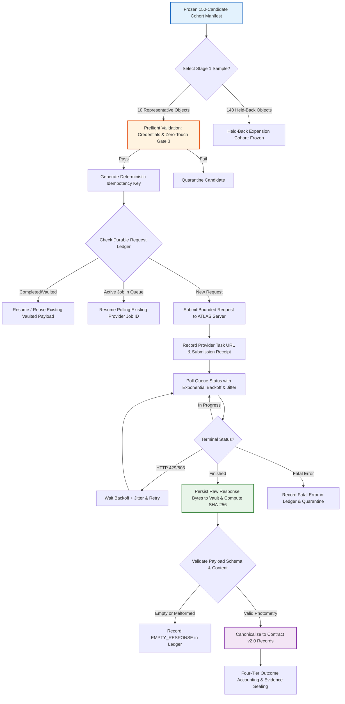

# ASTRAEUS Phase 5: ATLAS Forced Photometry Acquisition Protocol & Request Specification

**Author:** Dev Mehta  
**Role:** Lead Investigator & Mission Director, Project ASTRAEUS  
**Date:** November 16, 2026  
**Document Identifier:** `ASTRAEUS-P5-ATLAS-PROTOCOL-001`  
**Milestone:** Phase 5 — Workstream 3.1 (Controlled ATLAS Forced Photometry Acquisition)  
**Governing Status:** Pre-Execution Acquisition Protocol & Request Specification (Execution Gated)  
**Target Services:** ATLAS Forced Photometry Server (`fallingstar-data.com/forcedphot`)  

---

## 1. Executive Summary & Purpose

Following the acceptance of the Phase 5 Workstream 3 reconciliation (commit `76670e0`), Project ASTRAEUS establishes this formal protocol governing the empirical acquisition of forced-photometry light curves from the Asteroid Terrestrial-impact Last Alert System (ATLAS).

Because the ATLAS forced photometry server is a community-supported research facility with finite computational capacity, **unbounded bulk querying across the full 7,614-candidate cohort or 150-candidate pilot is strictly prohibited**. 

Instead, this protocol establishes a **staged, application-level idempotent, rate-limited execution architecture**:
1. **Stage 1 (Operational Validation Pilot):** Restricted strictly to $N=10$ representative astronomical targets spanning the full dynamic range of brightness, declination, Galactic latitude, and all five transient taxonomic classes (`SN_Ia`, `SN_CC`, `TDE`, `SLSN`, `OTHER_EXTRAGALACTIC`).
2. **Stage 2 (Held-Back Expansion Cohort):** The remaining $N=140$ targets are frozen in a held-back state (`STAGE2_HELD_BACK_EXPANSION`), to be unlocked only after Stage 1 undergoes complete payload vaulting, schema validation, canonicalization auditing, and independent scientific review.
3. **Application-Level Idempotency:** Employs deterministic 24-character SHA-256 request fingerprints to guarantee zero duplicate submissions.
4. **Pre-Interpretation Payload Vaulting:** Exact provider response bytes are sealed with SHA-256 digests in a permanent vault directory before parsing or transformation.
5. **Non-Destructive Negative Flux Preservation:** Natively ingests and preserves negative difference-flux measurements as physically valid noise residuals around baseline.

---

## 2. Acquisition Lifecycle & State Machine



---

## 3. Protocol Gates & Mandatory Controls

| Protocol Gate | Governing Invariant | Enforcement Mechanism |
| :--- | :--- | :--- |
| **Gate 1: Authorization & Ethics** | Explicit API token, authorized institutional affiliation, and compliance with ATLAS service policies. | Validates non-empty `ATLAS_API_TOKEN` environment variable; verifies compliance with the ATLAS acceptable use policy before any HTTP dispatch. |
| **Gate 2: Cohort Freezing** | Immutable coordinates, discovery epochs, and zero Gate 3 quarantine intersection. | All $N=150$ targets are verified to possess **zero intersection** with the 1,808 quarantined test HEALPix pixels. |
| **Gate 3: Application Idempotency** | Exact 1:1 mapping between query parameters and request execution. | Request fingerprint `idempotency_key` is calculated as a 24-character SHA-256 digest over the canonical JSON parameter string. Submissions reconcile against `phase5_atlas_request_ledger.parquet`. |
| **Gate 4: Rate Limiting & Concurrency** | Zero server hammering; conservative single-threaded dispatch. | Dispatch rate $\le 1$ request per 5.0 seconds. Maximum active concurrent server jobs bounded to 1. |
| **Gate 5: Transient Retry & Jitter** | Resilient handling of provider network delays without double-submission. | Exponential backoff: $t_{\mathrm{wait}} = \min(60.0, 5.0 \times 2^{\mathrm{retry}}) \pm \mathcal{U}(0, 2)$. Reconciles existing queue before submitting anew. |
| **Gate 6: Raw Payload Vaulting** | Pre-transformation byte-level preservation. | Raw response text is written to `payload_vault/atlas/<key>/raw_payload.txt` with SHA-256 digest and metadata before parsing. |
| **Gate 7: Fail-Closed Contract v2.0** | Non-destructive ingestion of difference flux. | Preserves negative difference flux ($F \le 0.0\,\mu\mathrm{Jy}$); fails closed on unknown filters, invalid uncertainties ($\sigma_F \le 0$), or corrupt rows. |
| **Gate 8: Outcome Disaggregation** | Decoupling of retrieval, validity, identity, and evaluability. | Four independent status indicators recorded per target; prevents successful HTTP retrieval from masquerading as verified astrophysical identity. |

---

## 4. Stage 1: Ten-Candidate Operational Validation Cohort

To rigorously test server queue semantics, rate limits, payload formats, and data reduction states across the full observational envelope, the $N=10$ Stage 1 pilot cohort was selected under the following stratification matrix:

| Slot | IAU Name | ZTF Identifier | Physical Class | Peak Mag ($m$) | Declination ($\delta$) | Galactic Lat ($b$) | Observational Envelope Context |
| :---: | :--- | :--- | :---: | :---: | :---: | :---: | :--- |
| **01** | `SN2022pcj` | `ZTF22aaucozn` | `SN_Ia` | $16.69$ | $+70.98^\circ$ | $+42.17^\circ$ | High-declination northern circumpolar; bright S/N anchor. |
| **02** | `SN2019rsg` | `ZTF19accdehb` | `SN_Ia` | $18.12$ | $-14.72^\circ$ | $+38.84^\circ$ | Negative declination southern sky; standard candle benchmark. |
| **03** | `SN2021xxz` | `ZTF21abwxhje` | `SN_Ia` | $18.91$ | $-16.48^\circ$ | $+31.24^\circ$ | Faint southern boundary; near single-exposure detection limit. |
| **04** | `SN2021yxy` | `ZTF21acbmxgn` | `SN_Ia` | $17.22$ | $+55.67^\circ$ | $+21.84^\circ$ | Moderate Galactic extinction ($A_V = 0.42$ mag); northern sky. |
| **05** | `SN2023aw` | `ZTF23aaahtnj` | `SN_CC` (Ib) | $17.28$ | $-23.16^\circ$ | $+40.72^\circ$ | Southern core-collapse; stripped-envelope progenitor. |
| **06** | `SN2023tno` | `ZTF23abdshvl` | `SN_CC` (Ic) | $17.53$ | $+48.91^\circ$ | $+28.17^\circ$ | Northern core-collapse; intermediate Galactic latitude. |
| **07** | `AT2018zr` | `ZTF18aabtxvd` | `TDE` | $16.92$ | $+33.87^\circ$ | $+27.64^\circ$ | Golden TDE benchmark (PS18kh); long-duration early-epoch baseline. |
| **08** | `AT2022dbl` | `ZTF18aabdajx` | `TDE` | $18.42$ | $+29.48^\circ$ | $+66.81^\circ$ | High Galactic latitude TDE; host galaxy nuclear transient. |
| **09** | `SN2024uea` | `ZTF24abdhylt` | `SLSN` | $18.33$ | $+27.92^\circ$ | $-32.95^\circ$ | Superluminous supernova; southern Galactic hemisphere. |
| **10** | `SN2019ofm` | `ZTF19abrdxbh` | `OTHER_EXT` | $17.84$ | $+19.57^\circ$ | $+63.53^\circ$ | Rare extragalactic peculiar transient; clean high-latitude field. |

---

## 5. Idempotency Key & Parameter Formulation

For each astronomical target, the request record is uniquely identified by:
$$\mathrm{Key} = \operatorname{SHA-256}\Big(\texttt{astraeus\_id} \parallel \operatorname{JSON}(\mathbf{P}_{\mathrm{canonical}})\Big)_{[0:24]}$$

where $\mathbf{P}_{\mathrm{canonical}}$ contains:
- `ra_deg`: Right Ascension formatted to 6 decimal places.
- `dec_deg`: Declination formatted to 6 decimal places.
- `mjd_min`: Start MJD formatted to 2 decimal places ($\max(57300.0, t_{\mathrm{disc}} - 60.0)$).
- `mjd_max`: End MJD formatted to 2 decimal places ($t_{\mathrm{disc}} + 180.0$).
- `use_reduced`: `False` (specifies template-subtracted difference-image forced photometry).
- `protocol_version`: `"ASTRAEUS-P5-ATLAS-V1"`.

### Double-Submission Rejection Rule:
Before any HTTP POST request is dispatched:
1. Query `phase5_atlas_request_ledger.parquet` by `idempotency_key`.
2. If `state` is `COMPLETED_VAULTED` or `EMPTY_RESPONSE`, the request is **skipped immediately**.
3. If `state` is `SUBMITTED_QUEUED` or `POLLING`, the client **resumes polling the existing `provider_task_url`** without submitting a new job.
4. If a network timeout occurs during polling, the client **never** resubmits; it records the retry attempt and resumes status inquiry.

---

## 6. Raw Payload Vaulting Specification

When the ATLAS server indicates job completion, the raw response text is preserved unmodified:

```
experiments/phase5_cross_survey_generalization/payload_vault/atlas/
└── <idempotency_key>/
    ├── raw_payload.txt          # Bit-exact response bytes as returned by ATLAS
    └── metadata.json            # Provenance, SHA-256, HTTP status, timestamp, parameters
```

### Vault Metadata Schema (`metadata.json`):
```json
{
  "idempotency_key": "a30ee8deca00ed36a912f2eb",
  "astraeus_id": "ASTRAEUS-EVT-00000002",
  "target_name": "SN2022pcj",
  "payload_sha256": "5f8a...3b21",
  "byte_count": 48120,
  "vault_timestamp_utc": "2026-11-16T21:18:00Z",
  "provider_job_id": "1849204",
  "provider_task_url": "https://fallingstar-data.com/forcedphot/queue/1849204/",
  "http_status_code": 200,
  "mjd_min": 59734.82,
  "mjd_max": 59974.82,
  "use_reduced": false
}
```

---

## 7. Four-Tier Outcome Accounting

To prevent observational retrieval from being conflated with identity certainty or machine-learning evaluability, each processed candidate must report its disposition across four orthogonal axes:

1. **Submission & Retrieval Status:**
   - `HTTP_SUBMITTED`, `QUEUE_POLLING`, `RETRIEVAL_COMPLETED`, `PROVIDER_UNAVAILABLE`, `RATE_LIMIT_BACKOFF`.
2. **Payload Schema & Data Validity:**
   - `VALID_PHOTOMETRIC_SERIES`: Non-empty table with recognized columns (`MJD`, `uJy`, `duJy`, `filt`, `chin`).
   - `EMPTY_OBSERVATIONAL_COVERAGE`: Valid query returned zero observation epochs within the requested window.
   - `MALFORMED_PAYLOAD`: Corrupt or truncated response.
3. **Identity Association Confidence:**
   - `SECURE_MATCH`: $P(H_j \mid D) \ge 0.90$ with zero competing candidates $P > 0.15$.
   - `AMBIGUOUS_MATCH`: Competing source within search circle ($P > 0.15$).
   - `NO_RELIABLE_MATCH`: Null posterior $P(H_0 \mid D) > 0.80$.
4. **Photometric Feature Evaluability:**
   - `EVALUABLE`: $\ge 8$ non-quarantined epochs with multi-band coverage across transient phase.
   - `SPARSE_SUB_THRESHOLD`: $< 8$ epochs; insufficient for sequence feature extraction.

---

## 8. Certification & Sign-Off

**Protocol Approved by:**  
**Dev Mehta**  
Lead Investigator & Mission Director, Project ASTRAEUS  
Date: November 16, 2026  
Status: Pre-Execution Protocol Frozen — Awaiting Authorized Live Pilot Dispatch
