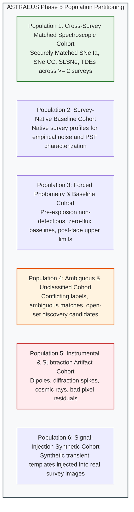

# ASTRAEUS Phase 5: Multi-Survey Dataset, Cohort Architecture & Probabilistic Cross-Matching Design

**Author:** Dev Mehta  
**Lead Investigator & Mission Director, Project ASTRAEUS**  
**Date:** November 16, 2026  
**Document Identifier:** `ASTRAEUS-P5-DATA-001`  
**Milestone:** Phase 5 — Cross-Survey Generalization & Domain Robustness  
**Workstream:** Workstream 3 — Cross-Survey Identity & Provenance Resolution  

---

## 1. Executive Summary & Purpose

A major failure mode in cross-survey transient astrophysics is **false coordinate association**. Setting an arbitrary fixed search radius (e.g. $3.0''$ or $5.0''$) leads to catastrophic cross-contamination in dense stellar fields, blends transients with unrelated background galaxies, or confuses nuclear transients with stochastic AGN activity.

This document establishes:
1. A **canonical transient identity and cryptographic provenance registry**.
2. A **probabilistic Bayesian cross-matching methodology** incorporating positional covariances, local stellar density, temporal coincidence, host-galaxy morphology, and redshift consistency.
3. A **six-population architectural hierarchy** decoupling evaluation cohorts from calibration, native characterization, and adaptation subsets.
4. An immutable **sealed evaluation holdout rule** guaranteeing zero target-label or adaptation leakage.

---

## 2. Canonical Transient Identity & Provenance Registry

Every astrophysical event in Phase 5 is assigned a unique, immutable internal identifier:
$$\text{ASTRAEUS\_ID} = \text{ASTRAEUS-EVT-XXXXXXXX}$$
from the durable `StableEntityRegistry`, decoupling permanent identity from measurement coordinates. Spatial coordinate hashes (`ASTRAEUS-P5-YYMMDD-XXXXXXXX`) serve strictly as non-unique spatial lookup indexing keys.

### Cross-Survey Identity Record Structure:
Each candidate record maintains a complete identity mapping table:
```
ASTRAEUS_ID:         ASTRAEUS-P5-261116-7A8B9C1D
├── IAU Designation: SN 2026abc
├── TNS Object URL:  https://www.wis-tns.org/object/2026abc
├── ZTF Identifier:  ZTF26aabxyzw
├── ATLAS ID:        ATLAS26xyz
├── DECam ID:        DES21-COSMOS-0123
├── PS1 Source ID:   PS1-1234567890
└── Host Galaxy:     SDSS J123456.78+123456.7 (z = 0.042)
```

### Cryptographic Provenance Model:
For every associated photometric point, Phase 5 registers:
- `raw_vault_path`: Path to immutable raw JSON/FITS response.
- `sha256_checksum`: Bit-level cryptographic digest of original retrieved file.
- `archive_origin_url`: Fully qualified HTTP endpoint or TAP query string.
- `query_timestamp_utc`: Exact execution time of data retrieval.
- `pipeline_reduction_tag`: Reduction pipeline version (e.g. `ZTF-DIP-v4.2`, `ATLAS-ACAM-v2.1`).

---

## 3. Probabilistic Bayesian Cross-Matching Methodology

Phase 5 strictly prohibits naive single-radius cone searches. Cross-survey association is determined using a formal Bayesian Likelihood Ratio framework (Sutherland & Saunders 1992; Budavári & Szalay 2008).

### 3.1 The Likelihood Ratio Definition:
For a candidate counterpart at angular separation $\psi$ between source survey $S_1$ and target survey $S_2$:
$$\mathcal{L} = \frac{q(m, c) \, f(\psi \mid \Sigma)}{\rho_{\mathrm{local}}(m)}$$

where:
1. **$f(\psi \mid \Sigma)$ is the astrometric positional error distribution:**
   $$f(\psi \mid \Sigma) = \frac{1}{2\pi \sqrt{\det \Sigma}} \exp\left(-\frac{1}{2} \Delta \mathbf{x}^T \Sigma^{-1} \Delta \mathbf{x}\right)$$
   incorporating the full $2 \times 2$ astrometric covariance matrix $\Sigma = \Sigma_1 + \Sigma_2$ combining measurement seeing, pixel scale, and proper-motion uncertainty.
2. **$\rho_{\mathrm{local}}(m)$ is the local background source density:**  
   Computed empirically within an annulus of radius $30'' < r < 120''$ centered on the source coordinate. Dense Galactic plane regions receive heavily penalized likelihood ratios to prevent false star matches.
3. **$q(m, c)$ is the prior probability:**  
   The expected distribution of transient magnitudes and colors based on the physical transient class.

### 3.2 Multi-Modal Consistency Penalties:
The raw likelihood ratio $\mathcal{L}$ is modulated by physical consistency factors:
$$\mathcal{L}_{\mathrm{final}} = \mathcal{L} \times \mathcal{K}_{\mathrm{time}} \times \mathcal{K}_{\mathrm{redshift}} \times \mathcal{K}_{\mathrm{host}}$$

- **Temporal Consistency ($\mathcal{K}_{\mathrm{time}}$):**  
  $$\mathcal{K}_{\mathrm{time}} = \begin{cases} 
  1.0 & \text{if } |t_{\mathrm{peak}, 1} - t_{\mathrm{peak}, 2}| \le 20\text{ days} \\
  \exp\left(-\frac{(|t_1 - t_2| - 20)^2}{2 \times 10^2}\right) & \text{if } |t_1 - t_2| > 20\text{ days} \\
  0.0 & \text{if } |t_1 - t_2| > 100\text{ days (different eruption)}
  \end{cases}$$
- **Redshift Consistency ($\mathcal{K}_{\mathrm{redshift}}$):**  
  Spectroscopic redshifts from independent archives must satisfy $|\Delta z| \le 0.001 (1+z)$. Any larger discrepancy forces immediate rejection ($\mathcal{K}_{\mathrm{redshift}} = 0$).
- **Host Galaxy Consistency ($\mathcal{K}_{\mathrm{host}}$):**  
  Both survey detections must share a common host galaxy centroid within projected radius $r_{\mathrm{proj}} \le 30\,\mathrm{kpc}$.

### 3.3 Posterior Association Probability & Dispositions:
The posterior association probability is computed as:
$$P(\text{Match} \mid \text{Data}) = \frac{\mathcal{L}_{\mathrm{final}}}{\mathcal{L}_{\mathrm{final}} + (1 - \pi_0)/\pi_0}$$
where $\pi_0$ is the empirical prior probability of finding a counterpart.

| Match Status Code | Posterior Probability Bound | Scientific Classification & Benchmark Disposition |
| :--- | :---: | :--- |
| **`SECURE_MATCH`** | **$P \ge 0.90$** | **Definitive association.** Admitted to primary Phase 5 cross-survey benchmark. |
| **`PROBABLE_MATCH`** | **$0.70 \le P < 0.90$** | **Likely counterpart.** Excluded from primary benchmark; reserved strictly for sensitivity robustness analysis. |
| **`AMBIGUOUS_MATCH`** | **$0.30 \le P < 0.70$** | **Multiple competing counterparts.** Sequestered into Population 4 (Ambiguous / Open-Set Evaluation). |
| **`NO_MATCH`** | **$P < 0.30$** | **No defensible association.** Rejected; classified as independent orphan or un-associated detection. |

---

## 4. Six-Population Architectural Hierarchy

Phase 5 structures all data into six explicitly separated populations to guarantee that no test, calibration, or native data are comingled:



### 4.1 Target-Domain Sub-Partitioning (The Non-Leakage Rule):
Within Population 1, external target-domain transients are partitioned into three strictly segregated splits before any modeling commences:

1. **Target Unlabeled Adaptation Split (50% of target P1):**
   - Available for unsupervised domain adaptation (e.g. CORAL covariance alignment, feature distribution matching).
   - Class labels are permanently withheld from all adaptation algorithms.
2. **Target Labeled Adaptation Split (20% of target P1):**
   - Available strictly for supervised fine-tuning or few-shot adaptation benchmarks.
3. **Target Sealed Evaluation Holdout Split (30% of target P1, minimum $N \ge 100$):**
   - **PERMANENTLY SEALED & UNTOUCHED.**
   - Must never participate in feature selection, standardization fitting, domain alignment, hyperparameter search, or threshold tuning.
   - Evaluated strictly once at final closure review.

*Note on Sample-Size & Partition Strategy:* The 50/20/30 split and $N_{\mathrm{eval}} \ge 100$ requirement is a design target assuming $N \ge 100 / 0.30 \approx 334$ secure matched events. If the empirical matched yield is smaller (e.g. 150–250 events), this split will not be prematurely forced. Instead, the final partition sizes and power analysis will be dynamically calibrated post-retrieval, prioritizing the statistical power of the sealed evaluation cohort ($N_{\mathrm{eval}} \ge 85$). All resampling and hypothesis tests are strictly conducted at the **astrophysical object level**, never at the photometric-epoch level.

---

## 5. Formal Data Deliverables Specifications

Workstream 3 produces three primary Parquet deliverables adhering to strict schema validation:

### 1. `phase5_cross_survey_identity_ledger.parquet`
Columns:
- `astraeus_id` (str, primary key)
- `ra_deg`, `dec_deg` (float64, ICRS J2000)
- `ra_err_arcsec`, `dec_err_arcsec` (float32)
- `survey_ids` (dict: `{"ZTF": "...", "ATLAS": "...", "DECam": "...", "PS1": "..."}`)
- `iau_name`, `tns_name` (str)
- `match_status` (`SECURE_MATCH`, `PROBABLE_MATCH`, `AMBIGUOUS_MATCH`, `NO_MATCH`)
- `match_posterior_prob` (float32)
- `angular_separation_arcsec` (float32)
- `local_source_density_per_sqarcmin` (float32)
- `temporal_peak_delta_days` (float32)
- `redshift_source`, `redshift_target` (float32)

### 2. `phase5_spectroscopic_evidence_ledger.parquet`
Columns:
- `astraeus_id` (str)
- `canonical_spectroscopic_class` (`SN_Ia`, `SN_CC`, `SLSN`, `TDE`, etc.)
- `raw_classification_strings` (list of str)
- `classification_bibcode` (str, 19-digit ADS bibcode)
- `classifying_instrument` (str)
- `spectroscopic_snr` (float32)
- `evidence_tier` (`S1_DIRECT_FITS`, `S2_PUBLISHED_BIBCODE`, `S3_CIRCULAR_ONLY`, `S4_UNVERIFIED`)

### 3. `phase5_survey_acquisition_manifest.parquet`
Columns:
- `astraeus_id` (str)
- `survey_origin` (`ZTF`, `ATLAS`, `DECam`, `PS1`)
- `n_total_observations` (int32)
- `n_positive_detections_snr5` (int32)
- `n_upper_limits` (int32)
- `temporal_baseline_days` (float32)
- `median_cadence_days` (float32)
- `available_passbands` (list of str)
- `raw_vault_path` (str)
- `sha256_checksum` (str)
- `acquisition_status` (`HTTP_200`, `PARSED_VALID`, `QUARANTINED_CORRUPT`)

---

## 6. Design Certification

**Approved and Certified by:**  
**Dev Mehta**  
Lead Investigator & Mission Director, Project ASTRAEUS  
Date: November 16, 2026
