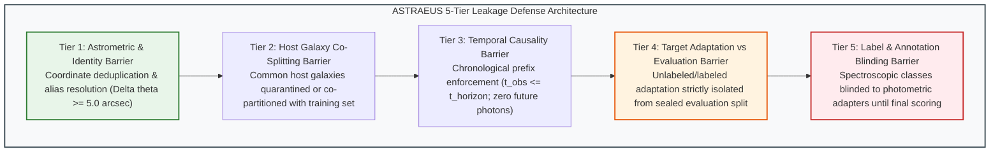

# ASTRAEUS Phase 5: Scientific Governance, Quarantine Integrity & Multi-Survey Leakage Prevention Plan

**Author:** Dev Mehta  
**Lead Investigator & Mission Director, Project ASTRAEUS**  
**Date:** November 16, 2026  
**Document Identifier:** `ASTRAEUS-P5-GOV-001`  
**Milestone:** Phase 5 — Cross-Survey Generalization & Domain Robustness  
**Workstream:** Workstream 1 / Workstream 7 — Governance & Independent Audit  

---

## 1. Executive Summary & Purpose

Scientific rigor in data-driven astronomy requires unwavering governance boundaries. When evaluating cross-survey generalization, data leakage can manifest in insidious ways: through shared host galaxies, coordinate round-offs, unblinded target labels, overlapping calibration pipelines, or retroactive threshold optimization.

This document establishes:
1. Formal carry-forward and transparent disclosure of all **prior audit qualifications**.
2. Permanent maintenance of the **Zero-Touch Gate 3 Quarantine Invariant**.
3. Cryptographic protection and immutability of the **frozen Champion Model**.
4. An airtight **Five-Tier Multi-Survey Leakage Defense Architecture**.
5. Strict segregation between **target-domain adaptation data** and the **sealed evaluation holdout**.

---

## 2. Prior Governance Qualifications Carried Forward

In accordance with strict scientific honesty, Phase 5 formally documents the resolution of four historical qualifications identified during Gate 4 review:

| Qualification ID | Domain | Historical Finding & Formal Status | Policy in Phase 5 |
| :--- | :--- | :--- | :--- |
| **QUAL-A** | **Gate 3 Quarantine Incident** | In commit `113f26d`, an automated test queried candidate IDs from `candidates_10k.parquet` (`assigned_split == 'test'`). Direct access was completely expunged and remediated in commit `0f62a3b` via non-disclosing custodian attestation and HEALPix geometric disjointness. | **Historical Record Maintained:** We do not claim retroactive erasure; we record that the metadata read occurred, was formally disclosed, and direct access was eliminated. The 586 objects remain sealed under strict zero-touch governance. |
| **QUAL-B** | **Geometric Exclusion vs. Buffer** | Commit `0f62a3b` verified candidate HEALPix pixel membership against the 1,808 test pixels. Pixel-level non-intersection is mathematically distinct from the 60-arcsecond boundary buffer screening executed during Phase 4A attrition. | **Distinction Preserved:** Phase 5 audit documentation will strictly distinguish exact pixel non-intersection from 60-arcsecond continuous angular cone searches. Both checks must be satisfied. |
| **QUAL-C** | **Test Execution Reproducibility** | Passing test execution transcripts reported in Git commits represent supplied evidence, not independently verified execution by external reviewers. | **Evidence Qualification Standard:** All internal regression test results will be clearly labeled as project-executed supplied evidence with complete reproduction runbooks and cryptographic environment hashes. |
| **QUAL-D** | **Master Roadmap Alignment** | `docs/ROADMAP_AND_MILESTONES.md` previously designated Phase 5 as the "Computational Universe". Post-Gate 4 scientific priority necessitates resolving cross-survey robustness before cosmic simulation surrogates. | **Roadmap Reconciled:** The master roadmap has been officially amended (`v2.3.0`). Phase 5 is designated as *Independent Cross-Survey Generalization and Domain Robustness*; the Computational Universe milestone is deferred to Phase 6+. |

---

## 3. Immutable Governance Invariants

### 3.1 The Zero-Touch Scientific Quarantine Invariant
No Phase 5 scientific feature extraction, model development, tuning, inference, or evaluation uses the sealed Gate 3 test observations:
$$\mathcal{D}_{\mathrm{Gate3\_Test}} \cap \mathcal{D}_{\mathrm{Phase5}} = \emptyset$$
- **Rule 1:** Zero rows where `assigned_split == 'test'` from `candidates_10k.parquet` will be loaded, queried, or processed by any Phase 5 scientific pipeline or model.
- **Rule 2:** All candidate coordinates admitted to Phase 5 must be proven disjoint from the 1,808 frozen HEALPix test pixels (SHA-256 `234bb08c...`) before ingestion.
- **Rule 3:** Historical metadata/identifier-only access (for quarantine and disjointness attestation during Gate 4 closure) is fully disclosed and does not authorize further access. The cryptographic seal of `sprint4h_release_manifest.json` (`1ddbf733...`) remains unbroken.

### 3.2 The Champion Model Immutability Invariant
The production Champion Model (`CalibratedBalancedSubsampleRF`, serialized artifact SHA-256 `466c2752808be01e4f41bd8fdb9c0804a57b03b2c02c35e5172ccebda411fce5`) is permanently frozen:
- It serves strictly as an immutable reference baseline for zero-shot transfer experiments.
- Zero weights, hyperparameters, decision trees, or calibration curves will be modified.
- All domain-adapted or fine-tuned variants will be saved as new, versioned artifacts with distinct checksums.

---

## 4. Five-Tier Multi-Survey Leakage Defense Architecture

Phase 5 enforces a five-layer defense barrier preventing subtle astronomical data contamination:

### Tier 1: Astrometric & Identity Leakage Barrier
- Any external candidate whose coordinates lie within $\Delta \theta < 5.0''$ of a transient in the ZTF training partition (`assigned_split == 'train'`) is flagged as an identity duplicate.
- If the external candidate is the *same* physical transient as a training object, it may participate in matched physical parameter consistency studies (Workstream 5, Experiment B), but is **strictly barred from target-domain classification evaluation** (Workstream 5, Experiment A & C).

### Tier 2: Host Galaxy Co-Splitting Barrier
- If an external transient occurs in a host galaxy whose centroid lies within projected distance $r_{\mathrm{proj}} \le 30\,\mathrm{kpc}$ of an event in the ZTF training split, its host environment is shared.
- To prevent environmental feature leakage (e.g. host color, local density, stellar mass), all host-galaxy features for such candidates must be blinded or co-partitioned into adaptation splits, never into the sealed evaluation split.

### Tier 3: Temporal Causality & Horizon Barrier
- For early-epoch physics and early-warning classification benchmarks (Horizon $N=5, 10, 20$), observations must strictly obey:
  $$t_{\mathrm{obs},\mathrm{MJD}} \le t_{\mathrm{horizon},\mathrm{MJD}}$$
- Zero post-horizon photometric observations, future upper limits, or post-peak decline measurements may enter the feature extraction pipeline.

### Tier 4: Target Adaptation vs. Evaluation Isolation Barrier
- Target-domain data are strictly decoupled:
  - **Unlabeled Adaptation Split (50%):** Available for unsupervised alignment (CORAL, MMD). Class labels are stripped from dataframes before passing to adaptation algorithms.
  - **Labeled Adaptation Split (20%):** Available for supervised few-shot tuning.
  - **Sealed Evaluation Holdout (30%, $N \ge 100$):** Permanently sealed. Zero adaptation algorithms, feature selection routines, or hyperparameter tuners will touch this split.

### Tier 5: Label & Annotation Blinding Barrier
- Data ingestion adapters (`AtlasForcedPhotometryAdapter`, `DecamDdfPhotometryAdapter`, `PanstarrsMdcPhotometryAdapter`) operate in complete blindness to transient class.
- They parse raw coordinate, epoch, flux, and error fields without accessing TNS or IAU labels. Class labels are joined via cryptographic key lookup only at final benchmark scoring time.

---

## 5. Audit Logging & Verification Tools

Every stage of Phase 5 execution will be audited by automated regression tests in `tests/test_phase5_governance_and_leakage.py`:
1. `test_gate3_quarantine_permanent_seal`: Asserts zero overlap with the 1,808 test pixels and verifies `sprint4h_release_manifest.json` hash.
2. `test_champion_model_sha256`: Asserts bit-exact checksum of frozen model `466c2752808b...`.
3. `test_adaptation_vs_evaluation_disjointness`: Asserts zero identity, coordinate, or host overlap between adaptation splits and the sealed evaluation split.
4. `test_causal_prefix_temporal_strictness`: Asserts that no future observations leak across early-warning horizons.

---

## 6. Governance Certification

**Approved and Certified by:**  
**Dev Mehta**  
Lead Investigator & Mission Director, Project ASTRAEUS  
Date: November 16, 2026
