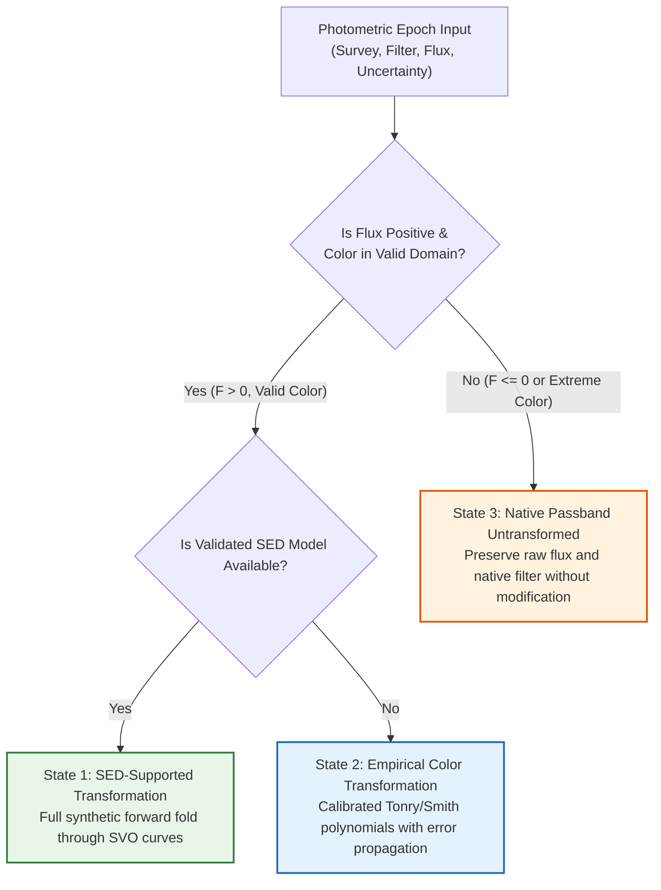

# ASTRAEUS Phase 5: Photometric Harmonization & Cross-Filter Validation Plan

**Author:** Dev Mehta  
**Lead Investigator & Mission Director, Project ASTRAEUS**  
**Date:** November 16, 2026  
**Document Identifier:** `ASTRAEUS-P5-HARMON-002`  
**Milestone:** Phase 5 — Photometric Harmonization & Calibration  
**Governing Status:** Physical Harmonization Protocol & Falsification Plan  

---

## 1. Executive Summary & Physical Principles

Translating photometric measurements between different telescope optics, detector responses, and filter transmission curves requires rigorous physical models. In the Phase 5 technical review, a major vulnerability was identified in the initial implementation: **when difference fluxes were non-positive ($F \le 0$), the harmonizer fell back to linear effective-wavelength weighting**.

This fallback is unphysical:
1. Linear interpolation between effective wavelengths does not represent astronomical radiative transfer through broad, asymmetric optical filters.
2. Negative difference flux is an inevitable and essential feature of forced difference photometry on un-erupted baselines. Applying color transformations to negative flux distorts the noise distribution, creating artificial bias in pre-explosion baselines.

This plan establishes:
1. The **Three Physical Transformation States**.
2. A strict **ban on transforming non-positive difference flux**.
3. **Rigorous uncertainty propagation** including measurement error, zero-point calibration error, and transformation model scatter.
4. **Validation criteria** for bidirectional consistency and information preservation.

---

## 2. The Three Transformation States

Every photometric epoch entering the ASTRAEUS harmonization engine is assigned one of three mutually exclusive transformation states:

### 2.1 State 1: SED-Supported Transformation (`SED_SUPPORTED`)
- **Applicability:** Candidates with synchronous multi-band measurements and a physically constrained spectral template (e.g. Hsiao Type Ia template, Nugent SN II template).
- **Transformation Model:**
  $$F_{\mathrm{target}}(\lambda_2) = F_{\mathrm{source}}(\lambda_1) \times \frac{\int f_{\lambda}^{\mathrm{SED}}(\lambda) R_{\mathrm{target}}(\lambda) \frac{\lambda}{hc} d\lambda / \int R_{\mathrm{target}}(\lambda) \frac{\lambda}{hc} d\lambda}{\int f_{\lambda}^{\mathrm{SED}}(\lambda) R_{\mathrm{source}}(\lambda) \frac{\lambda}{hc} d\lambda / \int R_{\mathrm{source}}(\lambda) \frac{\lambda}{hc} d\lambda}$$
  where $R(\lambda)$ are transmission curves from the Spanish Virtual Observatory (SVO) Filter Profile Service.

### 2.2 State 2: Empirical Color Transformation (`EMPIRICAL_COLOR`)
- **Applicability:** Candidates with synchronous detections ($F > 0$, $\mathrm{SNR} \ge 3$) where the measured color satisfies the polynomial validity range:
  $$-0.4 \le (g - r) \le 2.0$$
- **Transformation Model (Tonry et al. 2018; Smith et al. 2020):**
  $$c_{\mathrm{ATLAS}} = g_{\mathrm{ZTF}} - 0.407 (g - r) + 0.016$$
  $$o_{\mathrm{ATLAS}} = r_{\mathrm{ZTF}} + 0.222 (g - r) - 0.035$$
- **Propagated Variance:**
  $$\sigma_{c}^2 = \sigma_{g}^2 + (0.407)^2 (\sigma_g^2 + \sigma_r^2) + \sigma_{\mathrm{model}}^2$$
  where $\sigma_{\mathrm{model}} = 0.015\,\mathrm{mag}$ accounts for transformation model scatter.

### 2.3 State 3: Native Passband Untransformed (`NATIVE_UNTRANSFORMED`)
- **Applicability:** All non-positive difference flux measurements ($F \le 0.0\,\mu\mathrm{Jy}$), non-detections, and epochs without valid synchronous color.
- **Protocol:**
  - **Zero transformation applied.**
  - Passband is retained as its native instrument filter (e.g., `"ATLAS_c"`, `"ZTF_r"`).
  - Flux density $F$ and heteroscedastic uncertainty $\sigma_F$ are preserved exactly as calibrated by the native reduction pipeline.
  - The record is marked with `transformation_state = "NATIVE_PASSBAND_UNTRANSFORMED"`.

---

## 3. Strict Invariant: Negative Difference Flux Handling

1. **Negative Flux is Physical Signal:** Forced difference photometry measures the PSF flux at fixed celestial coordinates. On pre-explosion or post-fade epochs where no transient emission exists, image subtraction noise fluctuates symmetrically around zero ($\mathbb{E}[F] = 0$).
2. **Magnitude Conversion Prohibited:** Under no circumstances will negative flux be converted to an apparent magnitude. Magnitudes are undefined for $F \le 0$.
3. **Linear Color Fallback Permanently Expunged:** Any attempt to interpolate negative fluxes across wavelength space using color equations is rejected.

---

## 4. Covariance & Calibration Error Propagation

When downstream models ingest transformed multi-band photometry:
1. **Zero-Point Covariance:** Observations taken on the same night or detector quadrant share common zero-point calibration error $\sigma_{\mathrm{ZP}}$. These epochs must record a common `photometric_group_id`.
2. **Coupled Errors:** When both $c_{\mathrm{ATLAS}}$ and $o_{\mathrm{ATLAS}}$ are derived from the same pair of $(g_{\mathrm{ZTF}}, r_{\mathrm{ZTF}})$ measurements, their transformed errors are mathematically correlated. Downstream sequence models must account for the $2 \times 2$ covariance matrix:
   $$\operatorname{Cov}(c, o) = \mathbb{E}[(c - \mu_c)(o - \mu_o)] = -0.407 \times 0.222 \, \sigma_{g-r}^2 \approx -0.090 \, (\sigma_g^2 + \sigma_r^2)$$
