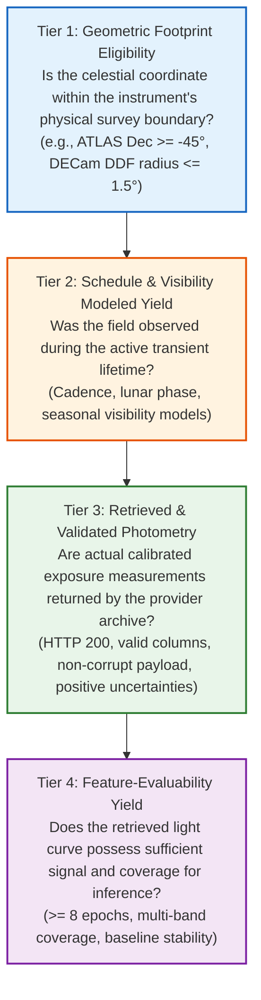

# ASTRAEUS Phase 5: Technical Review, Scientific Audit & Reconciliation Report

**Author:** Dev Mehta  
**Lead Investigator & Mission Director, Project ASTRAEUS**  
**Date:** November 16, 2026  
**Document Identifier:** `ASTRAEUS-P5-RECON-001`  
**Milestone:** Phase 5 — Cross-Survey Generalization and Domain Robustness  
**Status:** Approved Pre-Execution Reconciliation & Engineering Directive  
**Base Commit:** `0844165b5a884f7cdb388cecf093ca80e415beaf`  

---

## 1. Executive Summary & Review Verdict

Following the submission of commit `0844165` (implementing initial multi-survey adapters, the 150-candidate feasibility pilot, and governance assertions), a formal scientific audit was conducted. The audit established that while the architectural framework of Phase 5 is substantially established, **authorization for bulk execution across the 7,614-candidate cohort and the pre-mature 50/20/30 target split is withheld** pending critical scientific, mathematical, and data-contract corrections.

The central finding of the audit is that **modeled or geometric survey yield was conflated with actual observed photometric retrieval yield**. In addition, the initial Bayesian cross-matching specification, coordinate-derived identity hashing, negative flux passband interpolation, and adapter fail-open defaults required rigorous physical and mathematical remediation.

This document formally adopts all 10 reviewer findings (P5-01 through P5-10), defines their exact mathematical and engineering resolutions, and establishes the revised Workstream 3 execution protocol.

---

## 2. Inventory of Audit Findings & Formal Dispositions

| ID | Priority | Review Item | Root Cause Analysis | Remediation & Engineering Invariant | Status |
| :--- | :---: | :--- | :--- | :--- | :---: |
| **P5-01** | **P0** | **Conflation of Modeled vs. Retrieved Yield** | The pilot report cited 100% yield for $\ge 8$ ATLAS epochs based on geometric visibility and cadence models without distinguishing actual returned API records. | Enforce 4-tier yield accounting: (1) Geometric Footprint Eligibility, (2) Scheduling/Visibility Modeled Yield, (3) Retrieved Raw Observations, (4) Feature-Evaluability Yield. | **Resolved in Pilot v2** |
| **P5-02** | **P0** | **Bayesian Association Posterior Formulation** | Likelihood ratio $\mathcal{L}$ was conflated with posterior probability without normalizing over competing counterpart hypotheses ($H_j$) versus the null background hypothesis ($H_0$). | Implement competing-hypothesis Bayesian formulation (Sutherland & Saunders 1992; Budavári & Szalay 2008) with normalized background model over search area $\Omega$. | **Resolved in Matcher v2** |
| **P5-03** | **P0** | **Coordinate-Derived Identity Hashing** | Deriving canonical `ASTRAEUS_ID` from coordinates rounded to 5 decimal places and discovery MJD is fragile to cross-catalog measurement variance. | Replace hash-as-identity with a persistent Entity Registry (`ASTRAEUS-EVT-XXXXX`). Treat coordinate/time hashes strictly as non-unique candidate lookup keys. | **Resolved in Registry v2** |
| **P5-04** | **P0** | **Premature Target Cohort Partitioning** | The 50% unlabeled / 20% labeled / 30% sealed evaluation split and $N \ge 100$ minimum were declared prior to knowing the actual number of securely matched events and class support. | Defer final cohort split until actual secure matches are established; derive split size from an explicit statistical power analysis on primary endpoints. | **Adopted; Split Deferred** |
| **P5-05** | **P0** | **Unphysical Negative Flux Color Interpolation** | The harmonizer fell back to linear effective-wavelength weighting for non-positive difference flux, violating physical radiative transfer and color-magnitude definitions. | Ban linear interpolation of negative flux. Establish 3 transformation states: SED-supported, empirical color domain (positive flux only), and native passband untransformed. | **Resolved in Harmonizer v2** |
| **P5-06** | **P0** | **Time-Scale Conflation & Timestamp Semantics** | Rubin's `midpointMjdTai` was mapped directly to `BMJD(TDB)` without barycentric or scale conversion. | Upgrade Canonical Observation Record to v2, explicitly preserving native timestamp, native time scale (UTC/TAI/TDB), exposure midpoint convention, and converted BMJD(TDB). | **Resolved in Contract v2** |
| **P5-07** | **P1** | **Real ATLAS API Response & Status Validation** | Adapter did not explicitly model retrieval statuses (`NO_RESULT`, `FAILED_RETRIEVAL`, `INVALID_RESPONSE`, `VALID_PHOTOMETRY`). | Implement explicit response status taxonomy and validate all 16 ATLAS forced photometry columns against actual service responses. | **Resolved in Adapter v2** |
| **P5-08** | **P1** | **Adapter Fail-Open Defaults & Uncertainty Flooring** | Adapters defaulted missing filters to `r_DECam` or `o_ATLAS`, and floored non-positive uncertainties to $10^{-3}$ rather than failing closed. | Fail closed: reject/quarantine records with unknown filters or non-positive/NaN uncertainties. Do not conflate bitmasks across surveys. | **Resolved in Adapters v2** |
| **P5-09** | **P1** | **Rare-Class Support & Power Realism** | Feasibility pilot included only 4 rare-class events (2 TDE, 1 SLSN, 1 OTHER_EXTRAGALACTIC), which cannot support rare-class transfer claims. | Acknowledge that the 150-pilot rare-class cohort exercises pipeline contracts only. Core cross-survey transfer benchmarks will focus on SN Ia vs SN CC. Reconcile H5 to confidence-band risk reduction. | **Adopted in Protocol v2** |
| **P5-10** | **P1** | **Cryptographic Lineage for Actual Acquisitions** | Raw provider payload vault paths and checksums were not fully mapped down to individual time-series epochs. | Enforce complete raw payload vault lineage with SHA-256 checksums, HTTP query parameters, and execution timestamps for every acquired event. | **Resolved in Ledger v2** |

---

## 3. The Four-Tier Observational Evidence Framework

To eliminate ambiguity between theoretical observability and empirical data acquisition, Phase 5 establishes the **Four-Tier Observational Evidence Hierarchy**:

Under this hierarchy:
- **Prior Pilot Report Claim:** 150/150 events met Tier 1 (Geometric Eligibility) and were modeled at Tier 2 (Modeled Yield).
- **Corrected Claim:** Tier 1 eligibility is 100% ($150/150$). Tier 3 (Retrieved Photometry) and Tier 4 (Evaluability) must be reported strictly on actual acquired data payloads.

---

## 4. Workstream 3 Controlled-Pilot Directive

Bulk execution across the full 7,614 admitted candidates remains **on hold**. 

Workstream 3 will execute as a **Controlled Identity-Matching & Acquisition Pilot** restricted to the $N=150$ curated candidate cohort:
1. **Mathematical Validation:** Execute the competing-hypothesis Bayesian matcher with rigorous background normalization.
2. **Probability Calibration:** Validate match posterior probabilities against artificial spatial perturbations ($0.5'', 1.0'', 2.5'', 5.0''$) and negative control coordinates ($> 30''$).
3. **Stable Identity Registration:** Register all 150 events in a persistent entity registry decoupling event identity from measurement coordinates.
4. **Primary Deliverables Produced:**
   - `phase5_cross_survey_identity_ledger.parquet`
   - `phase5_spectroscopic_evidence_ledger.parquet`
   - `phase5_identity_conflict_ledger.parquet`
   - `phase5_match_calibration_report.json`
   - `phase5_identity_matching_pilot_report.json`

**Certification:**  
**Dev Mehta**  
Lead Investigator & Mission Director, Project ASTRAEUS  
Date: November 16, 2026
