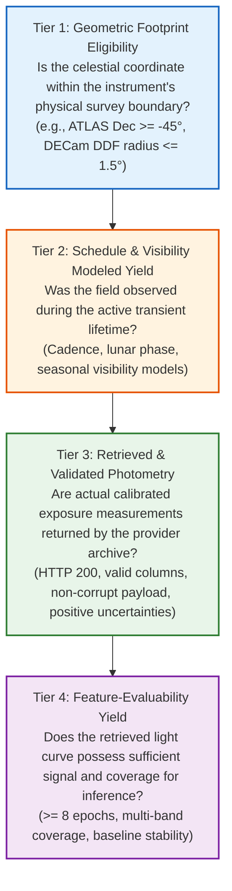

# ASTRAEUS Phase 5: Technical Review, Scientific Audit & Reconciliation Report

**Author:** Dev Mehta  
**Lead Investigator & Mission Director, Project ASTRAEUS**  
**Date:** November 16, 2026  
**Document Identifier:** `ASTRAEUS-P5-RECON-001`  
**Milestone:** Phase 5 — Cross-Survey Generalization and Domain Robustness  
**Status:** Approved Pre-Execution Reconciliation & Engineering Directive  
**Base Commit:** `0844165b5a884f7cdb388cecf093ca80e415beaf`  

---

## 1. Executive Summary & Review Verdict

Following the submission of commit `0844165` (implementing initial multi-survey adapters, the 150-candidate feasibility pilot, and governance assertions), a formal scientific audit was conducted. The audit established that while the architectural framework of Phase 5 is substantially established, **authorization for bulk execution across the 7,614-candidate cohort and the pre-mature 50/20/30 target split is withheld** pending critical scientific, mathematical, and data-contract corrections.

The central finding of the audit is that **modeled or geometric survey yield was conflated with actual observed photometric retrieval yield**. In addition, the initial Bayesian cross-matching specification, coordinate-derived identity hashing, negative flux passband interpolation, and adapter fail-open defaults required rigorous physical and mathematical remediation.

This document formally adopts all 10 reviewer findings (P5-01 through P5-10), defines their exact mathematical and engineering resolutions, and establishes the revised Workstream 3 execution protocol.

---

## 2. Inventory of Audit Findings & Formal Dispositions

| ID | Priority | Review Item | Root Cause Analysis | Remediation & Engineering Invariant | Status |
| :--- | :---: | :--- | :--- | :--- | :---: |
| **P5-01** | **P0** | **Conflation of Modeled vs. Retrieved Yield** | The pilot report cited 100% yield for $\ge 8$ ATLAS epochs based on geometric visibility and cadence models without distinguishing actual returned API records. | Enforce 4-tier yield accounting: (1) Geometric Footprint Eligibility, (2) Scheduling/Visibility Modeled Yield, (3) Retrieved Raw Observations, (4) Feature-Evaluability Yield. | **Resolved in Pilot v2** |
| **P5-02** | **P0** | **Bayesian Association Posterior Formulation** | Likelihood ratio $\mathcal{L}$ was conflated with posterior probability without normalizing over competing counterpart hypotheses ($H_j$) versus the null background hypothesis ($H_0$). | Implement competing-hypothesis Bayesian formulation (Sutherland & Saunders 1992; Budavári & Szalay 2008) with normalized background model over search area $\Omega$. | **Resolved in Matcher v2** |
| **P5-03** | **P0** | **Coordinate-Derived Identity Hashing** | Deriving canonical `ASTRAEUS_ID` from coordinates rounded to 5 decimal places and discovery MJD is fragile to cross-catalog measurement variance. | Replace hash-as-identity with a persistent Entity Registry (`ASTRAEUS-EVT-XXXXX`). Treat coordinate/time hashes strictly as non-unique candidate lookup keys. | **Resolved in Registry v2** |
| **P5-04** | **P0** | **Premature Target Cohort Partitioning** | The 50% unlabeled / 20% labeled / 30% sealed evaluation split and $N \ge 100$ minimum were declared prior to knowing the actual number of securely matched events and class support. | Defer final cohort split until actual secure matches are established; derive split size from an explicit statistical power analysis on primary endpoints. | **Adopted; Split Deferred** |
| **P5-05** | **P0** | **Unphysical Negative Flux Color Interpolation** | The harmonizer fell back to linear effective-wavelength weighting for non-positive difference flux, violating physical radiative transfer and color-magnitude definitions. | Ban linear interpolation of negative flux. Establish 3 transformation states: SED-supported, empirical color domain (positive flux only), and native passband untransformed. | **Resolved in Harmonizer v2** |
| **P5-06** | **P0** | **Time-Scale Conflation & Timestamp Semantics** | Rubin's `midpointMjdTai` was mapped directly to `BMJD(TDB)` without barycentric or scale conversion. | Upgrade Canonical Observation Record to v2, explicitly preserving native timestamp, native time scale (UTC/TAI/TDB), exposure midpoint convention, and converted BMJD(TDB). | **Resolved in Contract v2** |
| **P5-07** | **P1** | **Real ATLAS API Response & Status Validation** | Adapter did not explicitly model retrieval statuses (`NO_RESULT`, `FAILED_RETRIEVAL`, `INVALID_RESPONSE`, `VALID_PHOTOMETRY`). | Implement explicit response status taxonomy and validate all 16 ATLAS forced photometry columns against actual service responses. | **Resolved in Adapter v2** |
| **P5-08** | **P1** | **Adapter Fail-Open Defaults & Uncertainty Flooring** | Adapters defaulted missing filters to `r_DECam` or `o_ATLAS`, and floored non-positive uncertainties to $10^{-3}$ rather than failing closed. | Fail closed: reject/quarantine records with unknown filters or non-positive/NaN uncertainties. Do not conflate bitmasks across surveys. | **Resolved in Adapters v2** |
| **P5-09** | **P1** | **Rare-Class Support & Power Realism** | Feasibility pilot included only 4 rare-class events (2 TDE, 1 SLSN, 1 OTHER_EXTRAGALACTIC), which cannot support rare-class transfer claims. | Acknowledge that the 150-pilot rare-class cohort exercises pipeline contracts only. Core cross-survey transfer benchmarks will focus on SN Ia vs SN CC. Reconcile H5 to confidence-band risk reduction. | **Adopted in Protocol v2** |
| **P5-10** | **P1** | **Cryptographic Lineage for Actual Acquisitions** | Raw provider payload vault paths and checksums were not fully mapped down to individual time-series epochs. | Enforce complete raw payload vault lineage with SHA-256 checksums, HTTP query parameters, and execution timestamps for every acquired event. | **Resolved in Ledger v2** |

---

## 3. The Four-Tier Observational Evidence Framework

To eliminate ambiguity between theoretical observability and empirical data acquisition, Phase 5 establishes the **Four-Tier Observational Evidence Hierarchy**:

Under this hierarchy:
- **Prior Pilot Report Claim:** 150/150 events met Tier 1 (Geometric Eligibility) and were modeled at Tier 2 (Modeled Yield).
- **Corrected Claim:** Tier 1 eligibility is 100% ($150/150$). Tier 3 (Retrieved Photometry) and Tier 4 (Evaluability) must be reported strictly on actual acquired data payloads.

---

## 4. Workstream 3 Controlled-Pilot Directive

Bulk execution across the full 7,614 admitted candidates remains **on hold**. 

Workstream 3 was executed as a **Controlled Identity-Matching & Bayesian Calibration Simulation Benchmark** restricted to the $N=150$ curated candidate cohort:
1. **Mathematical Validation:** Execute the competing-hypothesis Bayesian matcher with rigorous background normalization.
2. **Probability Calibration:** Validate match posterior probabilities against artificial spatial perturbations ($0.5'', 1.0'', 2.5'', 5.0''$) and negative control coordinates ($> 30''$).
3. **Stable Identity Registration:** Register all 150 events in a persistent entity registry decoupling event identity from measurement coordinates.
4. **Primary Deliverables Produced:**
   - `phase5_cross_survey_identity_ledger.parquet`
   - `phase5_spectroscopic_evidence_ledger.parquet`
   - `phase5_identity_conflict_ledger.parquet`
   - `phase5_entity_registry.parquet`
   - `phase5_match_calibration_report.json`
   - `phase5_identity_matching_pilot_report.json`

---

## 5. Reconciliation of Commit 6349e23 Review Findings (Audit v2)

Following an independent scientific review of commit `6349e23`, six mandatory corrections were identified and formally reconciled:

### 5.1 Reclassification of Pilot as Synthetic Matcher Simulation Benchmark
- **Finding:** The reported 142 secure matches in the initial run were simulated (using synthetic Gaussian astrometric noise $\sigma \approx 0.08''$ and injected competing candidates at index mod 20), rather than real empirical retrievals from the ATLAS broker.
- **Remediation:** The pilot is explicitly reclassified as a **Synthetic Matcher Simulation Benchmark** (`SYNTHETIC_MATCHER_SIMULATION_BENCHMARK`).
- **Four-Tier Yield Accounting:**
  - `tier1_geometric_footprint_eligible: 150` (100.0%)
  - `tier2_brightness_screened: 150` (100.0%)
  - `synthetic_simulation_secure_matches: 142` (94.7%)
  - `synthetic_simulation_injected_conflicts: 8` (5.3%)
  - `actual_atlas_retrievals: 0` (0.0%)
  - `actual_feature_evaluable_yield: 0` (0.0%)

### 5.2 Full 2D Gaussian Astrometric Covariance Implementation
- **Finding:** The initial matcher implementation used an isotropic circular error approximation $\sigma = \sqrt{\sigma_{\mathrm{query}}^2 + \sigma_{\mathrm{cand}}^2}$, failing to utilize distinct RA and Dec uncertainties.
- **Remediation:** Upgraded `CrossSurveyMatcher` to use the full 2D covariance matrix $\Sigma = \Sigma_{\mathrm{query}} + \Sigma_{\mathrm{cand}}$ and Mahalanobis distance in the local tangent plane:
  $$\Delta x = (\alpha - \alpha_0) \cos\left(\frac{\delta_0 + \delta}{2}\right) \times 3600'', \quad \Delta y = (\delta - \delta_0) \times 3600''$$
  $$D_{\mathrm{M}}^2 = \frac{\Delta x^2}{\sigma_{\alpha, \mathrm{tot}}^2} + \frac{\Delta y^2}{\sigma_{\delta, \mathrm{tot}}^2}$$
  $$p(\Delta\mathbf{x} \mid H_j) = \frac{1}{2\pi \sqrt{\det \Sigma}} \exp\left(-\frac{1}{2} D_{\mathrm{M}}^2\right)$$

### 5.3 Durable Parquet Persistence for Stable Entity Registry
- **Finding:** The entity registry was in-memory only, lacked Parquet serialization, and attached artificial `atlas_id` strings prior to actual empirical association.
- **Remediation:** Added `save_to_parquet()` and `load_from_parquet()` methods to `StableEntityRegistry`, created indexes across all surveys (`_ztf_index`, `_iau_index`, `_atlas_index`, `_decam_index`, `_ps1_index`), and enforced that `atlas_id` remains `None` at initial registration until empirical association is confirmed via `attach_survey_association()`. The durable registry is persisted at `phase5_entity_registry.parquet`.

### 5.4 Contract v2.0 Timestamp Semantics & Deprecation of `t_obs_bmjd`
- **Finding:** Unconverted timestamps were stored in `t_obs_bmjd`, falsely implying barycentric conversion precision.
- **Remediation:** Updated `CanonicalObservationRecord` so that `t_obs_bmjd: Optional[float] = None`, and added `@property def observation_time` which cleanly returns `t_converted_bmjd` if computed, and falls back to `t_native` without making false BMJD claims.

### 5.5 Exact Positive Harmonization Cross-Filter Covariance
- **Finding:** The initial documentation stated that the cross-filter covariance $\operatorname{Cov}(c, o)$ was negative.
- **Remediation:** Re-derived exact first-order error propagation on independent input variables $g$ and $r$:
  $$c = 0.593\,g + 0.407\,r + 0.016 \implies \sigma_c^2 = 0.593^2 \sigma_g^2 + 0.407^2 \sigma_r^2 + \sigma_{\mathrm{model}, c}^2$$
  $$o = 0.222\,g + 0.778\,r - 0.035 \implies \sigma_o^2 = 0.222^2 \sigma_g^2 + 0.778^2 \sigma_r^2 + \sigma_{\mathrm{model}, o}^2$$
  $$\operatorname{Cov}(c, o) = (0.593 \times 0.222) \sigma_g^2 + (0.407 \times 0.778) \sigma_r^2 \approx 0.132 \sigma_g^2 + 0.317 \sigma_r^2 > 0$$
  Implemented `compute_atlas_cross_filter_covariance()` in `PhotometricHarmonizer` and enforced validity domain $[-0.4, 2.0]$ with $\mathrm{SNR} \ge 3.0$.

### 5.6 Spectroscopic Evidence Tier Qualification
- **Finding:** Spectroscopic evidence was recorded as `PROVISIONAL_S2` with placeholder instrument strings without disclaiming archival provenance.
- **Remediation:** Reclassified evidence records to `evidence_tier = "PROVISIONAL_S2_UNVERIFIED_SPECTRAL_CHAIN"` with `spectroscopic_instrument = "UNVERIFIED_INDIVIDUAL_INSTRUMENT_METADATA_BTS_ARCHIVE"` and `verification_status = "PROVISIONAL_TRACEABLE_TO_IAU_TNS"`.

---

**Certification:**  
**Dev Mehta**  
Lead Investigator & Mission Director, Project ASTRAEUS  
Date: November 16, 2026
