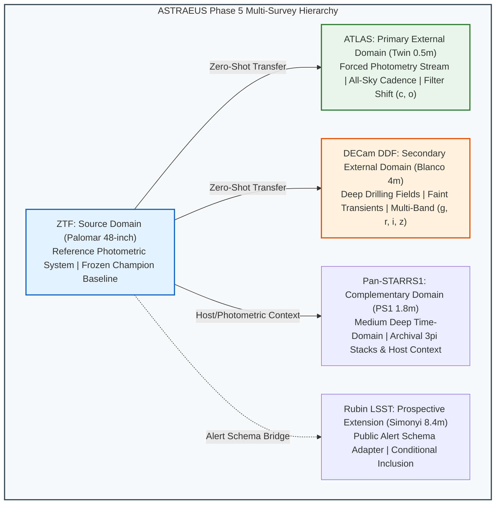

# ASTRAEUS Phase 5: Scientific Protocol
## Independent Cross-Survey Generalization and Domain Robustness

**Author:** Dev Mehta  
**Lead Investigator & Mission Director, Project ASTRAEUS**  
**Date:** November 16, 2026  
**Document Identifier:** `ASTRAEUS-P5-PROTO-001`  
**Milestone:** Phase 5 — Cross-Survey Generalization & Domain Robustness  
**Governing Status:** Pre-Registered Scientific Protocol & Execution Charter  
**Base Dependencies:** Frozen Champion Model (`466c2752808be01e...`), Quarantined Gate 3 Test Set (586 objects), Gate 4 Closure Reconciled (`0f62a3b`)  

---

## 1. Executive Charter & Research Motivation

The fundamental objective of Project ASTRAEUS is to build an autonomous, physically grounded inference engine for transient astrophysics. In Gate 4 (*External Validity & Scientific Robustness*), ASTRAEUS established rigorous data governance, fully accounted for an external cohort of 7,614 candidates, benchmarked early-epoch physics horizons, and quantified conformal uncertainty breakdown under cadence and epoch shifts.

However, Gate 4 also exposed a critical scientific reality:
1. **Catalog Accounting vs. Photometric Benchmark:** While 7,614 external candidates were reconciled at the catalog and metadata level, only 43 light curves (35 controlled broker pilot $+ 8$ local baselines) were acquired and evaluated photometrically.
2. **Processing-Domain Negative Transfer:** Transferring alert-stream-trained models to archival coadded data products from the *same* facility (ZTF DR24) caused a statistically significant performance drop ($\Delta \text{Acc} = -4.4\%, \Delta \text{F1} = -0.051$) and reduced conformal coverage to $62.3\%$, despite high feature rank correlation ($\rho > 0.86$).
3. **Uncertainty Breakdown:** Conformal coverage guarantees nominal $90\%$ coverage on exchangeable holdout data, but empirical coverage drops to $58\text{--}65\%$ under real survey shifts.
4. **Unresolved Generalization:** Cross-survey generalization across *genuinely independent* telescope facilities, optical assemblies, detector physics, and processing pipelines has **never been established**.

### Primary Research Objective:
Determine whether ASTRAEUS can preserve astrophysical information, physical parameter estimates, classification performance, and uncertainty calibration when observations originate from genuinely independent survey instruments and processing pipelines without relying on survey-specific observational artifacts.

### Central Research Question:
> *Can a physics-aware astronomical inference system trained on one survey (ZTF) generalize to independent survey observations (ATLAS, DECam DDF, Pan-STARRS1) without catastrophic performance collapse or false calibration confidence?*

---

## 2. Pre-Registered Scientific Hypotheses & Falsification Criteria

To maintain scientific integrity and prevent post-hoc hypothesis generation, Phase 5 establishes five formal, falsifiable hypotheses prior to data acquisition:

| ID | Scientific Hypothesis | Theoretical Basis | Quantitative Falsification Criterion |
| :--- | :--- | :--- | :--- |
| **H1** | **Astrophysical Parameter Consistency:** Physically harmonized multi-survey observations yield statistically consistent physical parameter estimates for identical transient events. | Intrinsic astrophysical properties (bolometric peak luminosity, explosion energy, ejecta velocity, decline rate) are invariant to the observing telescope. | Falsified if residual parameter discrepancy between matched light curves satisfies $\|\theta_{\mathrm{survey\_A}} - \theta_{\mathrm{survey\_B}}\| > 2.0\sqrt{\sigma_A^2 + \sigma_B^2}$ across $> 25\%$ of the securely matched evaluation cohort. |
| **H2** | **Physical Feature Transfer Superiority:** Features derived from physical and morphological models ($dF/dt$, color evolution, $\Delta m_{15}$, analytical timescale parameters) transfer across surveys with statistically superior classification performance and lower performance drop than uncalibrated, survey-specific raw representations. | Physical features decouple transient astrophysics from telescope optics, detector QE, and PSF variations. | Falsified if physical-feature models fail to outperform raw representations on the matched target domain: $\Delta \text{Macro-F1}_{\mathrm{target}} = \text{Macro-F1}_{\mathrm{phys}} - \text{Macro-F1}_{\mathrm{raw}} \le 0$, or if paired McNemar / bootstrap test fails to achieve significance ($p \ge 0.05$). |
| **H3** | **Bounded Domain Adaptation:** Unsupervised and supervised domain adaptation techniques improve target survey performance without inducing negative transfer on out-of-domain surveys. | Domain alignment aligns second-order feature statistics without destroying invariant astrophysical representations. | Falsified if domain adaptation improves performance on the target survey but causes catastrophic degradation ($\ge 10\%$ drop in Macro-F1) on a third independent held-out survey, or fails on held-out target objects. |
| **H4** | **Covariate Shift Detectability:** A pre-inference covariate shift detector based on observational density and feature covariance reliably predicts classification failure and calibration degradation. | Out-of-distribution observations occupy low-density regions of the source training manifold. | Falsified if distribution shift scores fail to predict classification errors and prediction-set inflation ($\text{AUROC} \le 0.60$ for misclassification prediction). |
| **H5** | **Calibrated Selective Abstention:** Uncertainty-aware selective prediction identifies unreliable predictions, strictly reducing empirical classification risk at a fixed coverage budget. | Well-calibrated prediction sets and epistemic uncertainty capture model ignorance under domain shift. | Falsified if automated abstention does not monotonically reduce empirical risk on accepted candidates ($R(c_1) \ge R(c_2)$ for $c_1 < c_2$). |

---

## 3. Multi-Survey Selection Rationale & Domain Hierarchy

Phase 5 implements a disciplined multi-survey hierarchy designed to decouple survey-specific instrumental signatures from underlying transient physics:

### Detailed Rationale per Facility:

1. **ZTF (Zwicky Transient Facility) — Source Reference Domain:**
   - *Optics & Filters:* 48-inch Samuel Oschin Schmidt telescope, Palomar Observatory; ZTF $g$, ZTF $r$, ZTF $i$.
   - *Role:* Baseline calibration domain. The frozen Gate 4 champion model (`CalibratedBalancedSubsampleRF`) was trained and validated on ZTF alert photometry. Preserves the historical benchmark.
2. **ATLAS (Asteroid Terrestrial-impact Last Alert System) — Primary External Light-Curve Domain:**
   - *Optics & Filters:* Twin 0.5m $f/2$ Schmidt telescopes (Haleakala and Mauna Loa, Hawaii, plus Sutherland and El Sauce); cyan ($c$, $420\text{--}650\text{ nm}$) and orange ($o$, $560\text{--}820\text{ nm}$).
   - *Role:* Primary external light-curve source. Broad-band filter differences ($c, o$ vs $g, r$) provide a rigorous test of filter transformation models. All-sky rolling cadence provides dense temporal overlap for known supernovae.
3. **DECam DDF (Dark Energy Camera Deep Drilling Fields) — Secondary External Replication Domain:**
   - *Optics & Filters:* 4-meter Victor M. Blanco Telescope, CTIO; DECam $u, g, r, i, z, Y$.
   - *Role:* High-cadence, deep faint-transient replication domain. The publicly released 2021 DDF programme provides candidate light curves across COSMOS, ECDFS, ELAIS-S1, and XMM-LSS ($r \sim 23.5\text{--}24.5$), allowing exploration of the low-SNR and faint-regime domain boundary.
4. **Pan-STARRS1 (PS1) — Complementary Photometric & Host Context Domain:**
   - *Optics & Filters:* 1.8-meter Pan-STARRS telescope, Haleakala; $g_{\mathrm{P1}}, r_{\mathrm{P1}}, i_{\mathrm{P1}}, z_{\mathrm{P1}}, y_{\mathrm{P1}}$.
   - *Role:* Archival imaging, zero-point calibration, and Medium Deep Survey (MDS) transient time-series. PS1 $3\pi$ single-epoch warps and deep stacks provide high-resolution host-galaxy morphology and local environment priors.
5. **Rubin LSST (Legacy Survey of Space and Time) — Prospective Extension:**
   - *Optics & Filters:* 8.4-meter Simonyi Survey Telescope, Vera C. Rubin Observatory; $u, g, r, i, z, y$.
   - *Role:* Prospective adapter and forward-compatibility verification. Inclusion in the primary benchmark is strictly conditional on public alert accessibility and data rights, ensuring zero blocking dependency on proprietary data releases.

---

## 4. Target Populations & Evaluation Partitions

Phase 5 explicitly avoids pooling all data into a single undifferentiated dataset. Six distinct population partitions are established:

| Population | Design Role | Defining Characteristics | Permitted Operational Use |
| :--- | :--- | :--- | :--- |
| **Population 1 (P1)** | **Primary Cross-Survey Matched Cohort** | Confirmed astrophysical transients with secure spectroscopic classifications and verified observations in $\ge 2$ surveys. | Zero-shot evaluation, parameter consistency, domain adaptation benchmarking. |
| **Population 2 (P2)** | **Survey-Native Characterization Cohort** | Unmatched survey-native transients representative of each survey's natural selection function and noise profile. | Empirical PSF modeling, cadence profiling, background noise estimation. |
| **Population 3 (P3)** | **Forced Photometry & Non-Detection Baseline** | Pre-explosion baseline epochs, non-detections, and post-fade historical observations at transient coordinates. | Baseline flux subtraction verification, explosion epoch constraints, upper-limit testing. |
| **Population 4 (P4)** | **Ambiguous & Unclassified Subset** | Transients with conflicting classifications, low-confidence spectra, or orphan alerts. | Open-set recognition, selective prediction stress testing, abstention benchmarking. |
| **Population 5 (P5)** | **Instrumental & Subtraction Artifacts** | Dipoles, saturated star residuals, diffraction spikes, cosmic ray hits, bad pixel columns. | False-positive rejection audit, artifact robustness verification. |
| **Population 6 (P6)** | **Signal-Injection Synthetic Cohort** | Synthetic physical transient models (Bazin, Arnett, shock cooling) injected into genuine survey background images. | Controlled detection efficiency and physical parameter recovery completeness auditing. |

---

## 5. Seven Sequential Workstreams Execution Lifecycle

Phase 5 executes as a single, coherent research phase structured across seven ordered workstreams:

```mermaid
flowchart LR
    WS1["WS1: Protocol Freeze"] --> WS2["WS2: Reconnaissance & Pilot"]
    WS2 --> WS3["WS3: Identity & Provenance"]
    WS3 --> WS4["WS4: Harmonization Engine"]
    WS4 --> WS5["WS5: Transfer & Adaptation"]
    WS5 --> WS6["WS6: Uncertainty & Shift"]
    WS6 --> WS7["WS7: Audit & Manuscript"]

    style WS1 fill:#e8eaf6,stroke:#3f51b5,stroke-width:2px
    style WS4 fill:#fff8e1,stroke:#f57f17,stroke-width:2px
    style WS5 fill:#e8f5e9,stroke:#2e7d32,stroke-width:2px
    style WS7 fill:#fce4ec,stroke:#c2185b,stroke-width:2px
```

1. **Workstream 1 — Scientific Preflight & Protocol Freeze:**
   - Formal freeze of this protocol, governance boundaries, and hypothesis registry.
   - Reconciliation of master roadmap (`docs/ROADMAP_AND_MILESTONES.md`).
2. **Workstream 2 — Survey Reconnaissance & Feasibility Audit:**
   - API and archive access verification for ATLAS, DECam DDF, PS1.
   - Execution of a matched-event feasibility pilot across 100–200 candidates.
3. **Workstream 3 — Cross-Survey Identity & Provenance Resolution:**
   - Probabilistic Bayesian cross-matching incorporating astrometric covariance and local source density.
   - Multi-tier leakage defense ensuring zero overlap with training splits.
4. **Workstream 4 — Photometric & Temporal Harmonization:**
   - SED-dependent filter transformations ($F_{\mathrm{target}} = T(F_{\mathrm{source}}, \mathrm{SED}, R_{\mathrm{source}}, R_{\mathrm{target}})$).
   - MicroJansky standardization, Galactic extinction correction, heteroscedastic uncertainty propagation.
   - Native irregular sequence modeling vs. controlled common-grid representations.
5. **Workstream 5 — Zero-Shot & Domain Adaptation Experiments:**
   - Experiment A: Frozen Champion Model zero-shot transfer baseline.
   - Experiment B: Physical feature transfer and parameter consistency.
   - Experiment C: Controlled domain adaptation (Feature Standardization, CORAL, Adversarial, Fine-Tuning).
   - Experiment D: Leave-One-Survey-Out (LOSO) cross-evaluation.
6. **Workstream 6 — Uncertainty, Robustness & Scientific Validation:**
   - Conformal calibration per domain; shift detection scoring; selective prediction risk-coverage analysis.
   - Paired object-level bootstrap and McNemar significance testing.
7. **Workstream 7 — Independent Audit, Reconciliation & Manuscript Release:**
   - Complete data lineage verification; publication of `PHASE5_RESEARCH_PAPER.md` and evidence manifests.

---

## 6. Scientific Governance & Invariant Rules

To ensure strict compliance with scientific integrity standards, Phase 5 enforces three non-negotiable governance invariants:

1. **Zero-Touch Gate 3 Quarantine Invariant:**  
   The 586 quarantined test objects from Gate 3 remain sealed. Exactly zero Phase 5 routines, queries, or evaluations may inspect or load these records.
2. **Champion Model Immutability Invariant:**  
   The Gate 4 Champion Model (`CalibratedBalancedSubsampleRF`, SHA-256 `466c2752808be01e...`) is permanently immutable. It may be evaluated in zero-shot transfer mode, but its serialized artifact will never be modified or overwritten.
3. **Sealed Evaluation Partition Invariant:**  
   The target-domain evaluation cohort is permanently sealed during all feature engineering, normalization fitting, domain adaptation tuning, and threshold selection. Evaluation occurs only once on the sealed holdout.

---

## 7. Protocol Approval & Certification

**Certified and Registered by:**  
**Dev Mehta**  
Lead Investigator & Mission Director, Project ASTRAEUS  
Date: November 16, 2026  
Status: **PRE-REGISTERED & FROZEN FOR EXECUTION**
