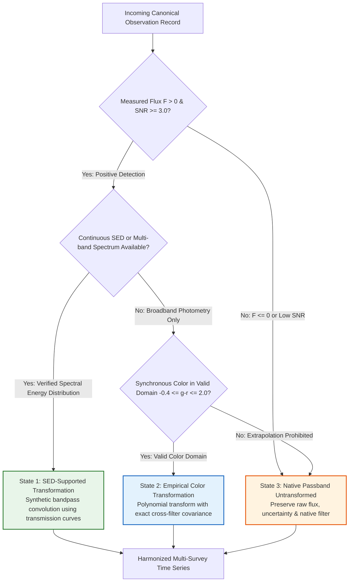

# ASTRAEUS Phase 5: Workstream 4 — Photometric & Temporal Harmonization Master Protocol

**Author:** Dev Mehta  
**Role:** Lead Investigator & Mission Director, Project ASTRAEUS  
**Date:** November 16, 2026  
**Document Identifier:** `ASTRAEUS-P5-WS4-PROTOCOL-001`  
**Milestone:** Phase 5 — Workstream 4 (Photometric and Temporal Harmonization)  
**Governing Status:** Formal Scientific & Engineering Charter (Active Research Program)  
**Target Facilities:** ZTF, ATLAS, DECam DDF, Pan-STARRS1, Rubin LSST  

---

## 1. Executive Summary & Scientific Purpose

In multi-survey time-domain astronomy, observations of the identical physical transient from different telescope facilities exhibit profound systematic divergences arising from:
1. **Divergent Bandpass Transmission Functions:** Differences in central effective wavelength ($\lambda_{\mathrm{eff}}$), bandwidth ($\Delta\lambda$), and filter cutoff profiles (e.g. ZTF $g, r$ vs. ATLAS $c, o$ vs. DECam/LSST $u, g, r, i, z, y$).
2. **Incompatible Temporal Standards:** Mixed time scales (UTC vs. TAI vs. TT vs. TDB) and disparate exposure midpoint timing conventions.
3. **Disparate Reduction Pipelines:** Differences in PSF modeling, template subtraction algorithms, reference catalog zero points, and sky background estimation.
4. **Non-Uniform Temporal Cadence:** Irregular inter-night sampling, seasonal observability windows, and weather dropouts.

**The Core Scientific Objective of Workstream 4:**  
Establish physically defensible common observational representations of transient events across independent surveys that **preserve physical information, quantify transformation uncertainties, and maintain bit-level provenance** without forcing unphysical transformations onto raw observational data.

---

## 2. The Three-State Harmonization Architecture

To eliminate the scientific failure mode of unphysical flux transformations, Workstream 4 enforces the **Three-State Observational Harmonization Taxonomy**:

### State 1: SED-Supported Physical Transformation (`SED_SUPPORTED`)
- **Applicability:** Candidates with synchronous multi-band detections, calibrated spectroscopic sequences, or verified astrophysical SED models (e.g. blackbody fits for TDEs; Nugent/Hsiao templates for SNe Ia).
- **Mathematical Transformation:** Convolves the physical spectral energy distribution $f_\lambda(\lambda, t)$ with the target instrument's filter transmission curve $R_{\mathrm{target}}(\lambda)$:
  $$F_{\mathrm{target}}(t) = \frac{\int f_\lambda(\lambda, t) \, R_{\mathrm{target}}(\lambda) \, \lambda \, d\lambda}{\int R_{\mathrm{target}}(\lambda) \, \lambda \, d\lambda}$$
- **Uncertainty Propagation:** Propagates both photometric measurement noise and SED template modeling uncertainty via Monte Carlo sampling or Gaussian process covariance.

### State 2: Empirical Color Transformation (`EMPIRICAL_COLOR_TRANSFORMED`)
- **Applicability:** Candidates with synchronous detections ($F > 0$, $\mathrm{SNR} \ge 3.0$) in adjacent filters where the measured color satisfies the validated polynomial domain:
  $$-0.4 \le (g - r) \le 2.0$$
- **Transformation Model (ZTF to ATLAS; Tonry et al. 2018; Smith et al. 2020):**
  $$c_{\mathrm{ATLAS}} = 0.593\,g_{\mathrm{ZTF}} + 0.407\,r_{\mathrm{ZTF}} + 0.016$$
  $$o_{\mathrm{ATLAS}} = 0.222\,g_{\mathrm{ZTF}} + 0.778\,r_{\mathrm{ZTF}} - 0.035$$
- **Exact Analytical Variance & Covariance:**
  Because input measurement errors on $g$ and $r$ are statistically independent:
  $$\sigma_{c}^2 = (0.593)^2 \sigma_g^2 + (0.407)^2 \sigma_r^2 + \sigma_{\mathrm{model}, c}^2$$
  $$\sigma_{o}^2 = (0.222)^2 \sigma_g^2 + (0.778)^2 \sigma_r^2 + \sigma_{\mathrm{model}, o}^2$$
  $$\operatorname{Cov}(c, o) = (0.593 \times 0.222)\,\sigma_g^2 + (0.407 \times 0.778)\,\sigma_r^2 \approx 0.132\,\sigma_g^2 + 0.317\,\sigma_r^2 > 0$$
  where $\sigma_{\mathrm{model}} = 0.015\,\mathrm{mag}$ represents intrinsic stellar/transient polynomial dispersion.

### State 3: Native Passband Untransformed (`NATIVE_UNTRANSFORMED`)
- **Applicability:** All non-positive difference-flux measurements ($F \le 0.0\,\mu\mathrm{Jy}$), non-detections, low-SNR observations ($\mathrm{SNR} < 3.0$), and epochs outside the validated color domain.
- **Governing Rule:** The observation is retained strictly in its native passband (e.g. `ATLAS_c`, `ZTF_r`). Downstream sequence models process the observation using passband-aware positional encodings rather than transformed synthetic fluxes.

---

## 3. Mandatory Physical Invariants

1. **Non-Destructive Negative Flux Invariant:**
   Forced photometry on difference images yields unbiased flux estimates distributed as $\mathcal{N}(F_{\mathrm{true}}, \sigma_F^2)$. When $F_{\mathrm{true}} \approx 0$ (e.g. pre-explosion or late decline), statistical fluctuations routinely produce $F \le 0.0\,\mu\mathrm{Jy}$. 
   - Converting negative flux to AB magnitude via $m = -2.5\log_{10}(F) + 23.90$ is mathematically undefined.
   - Setting negative flux to zero introduces a severe positive bias into light-curve baselines.
   - Dropping negative flux truncates the noise distribution and invalidates uncertainty calibration.
   - **Mandate:** Negative difference flux must survive canonicalization and harmonization unmodified in units of microJanskys ($\mu\mathrm{Jy}$).

2. **No Linear Wavelength Fallback:**
   Linear interpolation of negative flux or extreme colors based on central effective wavelength ($\lambda_{\mathrm{eff}}$) violates Planck's law and radiative transfer. It is strictly prohibited across all pipelines.

3. **Coupled Scientific Time Coordinates:**
   Every timestamp must remain permanently coupled to its physical time standard (UTC, TAI, TT, TDB) and conversion provenance. A native MJD(UTC) or MJD(TAI) coordinate must never be treated as BMJD(TDB) without computing verified barycentric corrections.

---

## 4. Workstream 4 Research Deliverables

| Deliverable ID | Title / Artifact | Description |
| :--- | :--- | :--- |
| **D4.1** | `PHASE5_TEMPORAL_HARMONIZATION_SPEC.md` | Complete mathematical specification for time scales, observatory coordinates, Roemer/Shapiro delays, and BMJD(TDB) standardization. |
| **D4.2** | `PHASE5_PHOTOMETRIC_HARMONIZATION_SPEC.md` | Detailed specification of filter transmission functions, synthetic photometry convolutions, and cross-filter covariance matrices. |
| **D4.3** | `PHASE5_HARMONIZATION_STATISTICAL_AND_GOVERNANCE_PLAN.md` | Statistical validation protocol: Bland-Altman consistency, ODR regressions, residual distributions, and non-leakage governance. |
| **D4.4** | `packages/astraeus-data/.../temporal.py` | Production software implementation of `TemporalHarmonizer` supporting barycentric light-travel corrections and time-scale standardization. |
| **D4.5** | `phase5_ws3_ws4_transition_manifest.json` | Cryptographic seal linking Workstream 3.1 closure to Workstream 4 initialization with SHA-256 digests. |

---

## 5. Workstream 4 Exit Criteria

Workstream 4 will achieve formal closure when:
1. All three transformation states (`SED_SUPPORTED`, `EMPIRICAL_COLOR`, `NATIVE_UNTRANSFORMED`) are implemented and pass 100% of regression assertions.
2. Synchronous observations ($\Delta t \le 0.1\,\mathrm{d}$) between ZTF and ATLAS demonstrate statistical agreement under Bland-Altman testing ($|\bar{d}| / \sigma \le 0.20$, LoA coverage $\ge 95\%$).
3. The temporal harmonizer validates barycentric corrections against authoritative solar system ephemerides with timing error $< 0.1\,\mathrm{s}$ ($10^{-6}\,\mathrm{d}$).
4. Negative difference fluxes are proven to survive end-to-end harmonization without alteration or loss.

---

**Certified by:**  
**Dev Mehta**  
Lead Investigator & Mission Director, Project ASTRAEUS  
November 16, 2026
